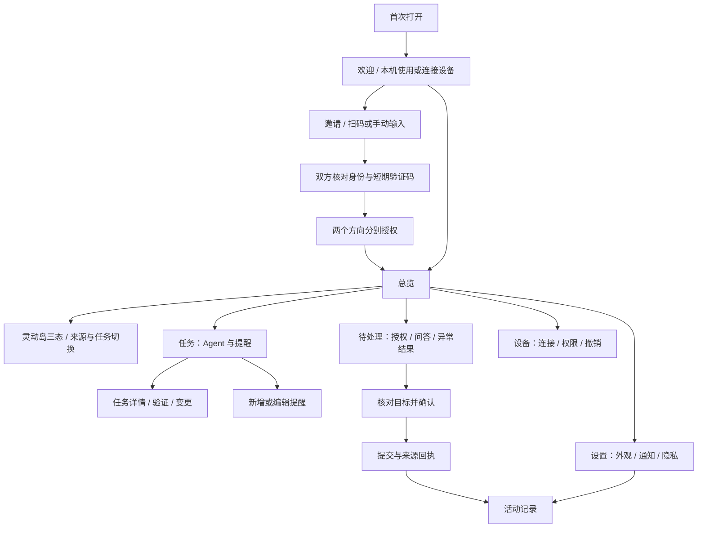
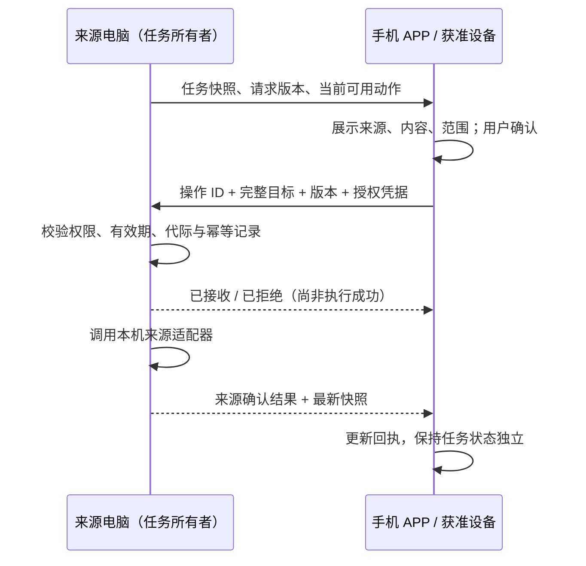

# Bright Moon：三端 APP UI 与双向协同设计

版本：1.0 · 2026-10-20 · 本次交付为设计与交互原型，不是已上线的移动应用。

## 1. 设计范围与判断依据

本设计将“三端”解释为 **Windows 桌面、iOS、Android**。桌面窗口、平板和手机是响应式尺寸，不是另外三套产品。手机浏览器是移动布局的可访问入口；未来原生 APP 复用页面与状态语义，不承诺浏览器具有原生后台能力。

目标：用户不必守着执行任务的电脑，也能知道进展、理解待处理事项，并在来源设备明确授权后提交操作。所有端共享信息架构，保持任务身份、来源、状态、权限与回执含义一致，布局按屏幕变化。

本次阅读依据：

- `monitor_solo/monitor/multi_diverse/arc_ui.md`：一长一圆、12px 间隔、三态及来源切换规范。
- `monitor_solo/monitor/multi_diverse/IMPLEMENTATION.md` 与 `arc.md` 第 19 节：当前电脑协同、实际权限边界与手机只读限制。
- 现有 `monitor_solo/monitor/icon_asset/`：复用品牌、Agent、提醒、手机及设备图标。

已有基础与本次规划必须分清：当前桌面具备协同基础，现有手机浏览器仍是只读；本原型演示的手机审批、原生手机本地提醒、远程创建提醒和配对向导属于 **后续 APP 目标交互**，没有接入真实服务。电脑之间已有受限操作也不能等同于所有来源都支持控制。

## 2. 产品原则

1. **先看到重要内容**：首屏是实况空间与待处理事项，设备配置不是首页主体。
2. **来源永远清楚**：电脑执行的任务在手机上仍标为远程；手机不能因为正在查看就变成任务执行者。
3. **决定之前有上下文**：展示来源、任务、操作内容和作用范围；高风险动作二次确认。
4. **发送不等于完成**：提交、来源接收、执行结果分开显示；未知结果保持可核对。
5. **稳定而克制**：刷新数据不重建授权表单、不抢用户焦点、不反复弹出历史任务。
6. **一致不是相同截图**：导航名称和操作语义统一，桌面支持鼠标键盘，手机适配拇指、安全区和系统返回。

## 3. 页面地图



一级入口统一为 **总览、任务、待处理、设备、设置**。活动记录是辅助页：桌面侧栏下方提供快捷入口，手机从待处理或设置进入。不将连接设置挤进个性化子弹窗。

### 3.1 首次进入

- 未配对桌面：欢迎页说明“监控本机”与“连接另一台设备”，可直接进入本机模式。
- 未配对手机：提供“连接电脑”和“先看看演示”；本机原生提醒可独立使用，浏览器不提供可靠后台调度承诺。
- 不强制账号登录以使用同一局域网协同。设备信任与用户云账号是不同概念，未来账号不能默认覆盖本地权限。
- 配对步骤：选择方式 → 输入邀请/扫描二维码 → 双方核对 → 分别选择共享范围 → 成功进入总览。
- 权限默认仅状态，不默认开放正文、审批、问答、停止、提醒编辑或转发。验证失败、邀请码过期、数量已满、网络不可达都有明确返回入口。
- 重开 APP：恢复导航和上次选中设备，先标记“正在核对最新状态”。未完成同步之前不启用旧操作按钮。

原型直接进入已有设备的总览；“设备 → 连接设备”可体验配对向导的核心路径。扫码、真实邀请、首次欢迎屏不在本次可执行范围。

### 3.2 总览

桌面布局：左侧导航；右侧顶部是无外框的标题与连接状态；正文左列为实况空间、统计和当前任务，右列为待处理卡及设备概况。

手机布局：顶部标题区 → 灵动岛 → 关注数量 → 当前任务列表 → 待处理卡。底部五项导航固定可达；右列内容下移，不压缩成桌面缩略图。优先将最高紧急的请求露出在灵动岛/待处理角标，不在后台自动跳页。

展示：

- 当前关注数量、待处理数、今日提醒数，数量必须由同一筛选后的数据集生成。
- 任务列表包含应用图标、标题、来源设备、真实状态、必要时间。
- 连接状态区分“设备通道在线”和“任务来源正常”。连接在线不能说明 Agent 正常。
- 无任务时保留安静文案“留一点时间，给自己”，显示最近一小时的下一条提醒与剩余数量；超过一小时的提醒不参与当前关注计数。
- 没有提醒时显示“暂时没有安排”，提供新增入口；不能显示虚构时间。

原型统计与时间是固定演示数据，不代表真实聚合或流逝计时。

### 3.3 灵动岛与任务详情

沿用已确认的桌面几何，不另创不兼容外壳：

- 有远程内容时总宽 420px：长胶囊 348 + 间距 10 + 圆圈 62，高 62。
- 本地在左、远程在右；聚焦哪边，哪边变长。两个入口宽度之和恒定。
- 第二、三态仍保留“一长一圆”，下方独立详情同宽 420，间隔 12px；间隔完全透出场景背景。
- 普通第二态正文高 182，第三态正文高 518；审批等特殊内容按来源适配器的既有规则确定高度，不能硬套所有 Agent。
- 手机宽度按可用空间收缩，总宽与详情一致，保留 62px 圆圈与 10px 间隔；不缩放文字。420 是桌面基准，不要求窄屏横向溢出。
- 无远程内容时回到本地连体样式，首态约 300×62；第二/三态连体，不能留空远程圆圈。

交互：

1. 点未选中的圆圈：只换来源，层级不变。
2. 点选中的长胶囊：第一态与展开态切换；从第三态也可直接回第一态。
3. 点“查看详情”进第三态，“返回进度”回第二态，“收起”回第一态。
4. 来源列表在正式浮窗内嵌；APP 页面可使用有标题的选择 sheet/modal，选完回原层级。原型采用 modal。
5. 远程详情的第一行必须先显示设备符号与“远程 · 设备名”。所有正文、步骤、时间与按钮目标原子更新。
6. 总结位于进度链上方；长总结显示前 200 字和全文入口。步骤是实际计划的投影，无计划来源只显示轨迹，不能伪造百分比。
7. 审批控件在待处理详情中直接可达。所有来源统一操作外壳，详情块仍按 Codex / Harness / OpenCode 等来源能力呈现。
8. 本地胶囊的时间之后可显示实际前台接收的手机图标；手机已保存但离线不显示。手机 APP 本身不重复显示“手机连接自己”的图标。
9. 图标按运行、授权、完成、失败、失联分别表达，颜色之外还有符号或文字；键盘焦点与业务焦点不能混淆。

手机“本机”仅可包含该手机真正拥有的提醒等内容；Windows 进程、文件或工具执行不能归入手机本机。浏览器仅为查看角色时，应将左侧命名为“主机 · 已连接电脑”或使用单远程来源视图，不能假装拥有手机本地执行能力。原型的 iOS/Android 模式表达未来原生 APP，左侧手机提醒明确标为规划。

### 3.4 任务

顶部标题和新增提醒；筛选“全部 / Agent 任务 / 提醒”，支持按来源设备过滤。Agent 任务来自监控目录，不在 UI 凭空创建 Agent 执行能力。后续“提交 Agent 任务”必须有适配器与来源明确开放的能力。

Agent 详情包括摘要、当前步骤、工具结果、验证结果、文件变更、上下文指标和执行环境；某来源不提供的内容显示“来源未提供”，不补造数据。

提醒编辑器的最终字段：标题、正文、日期和时间、IANA 时区、重复模式（一次/每周/间隔，互斥）、提前 2–10 分钟、来源设备、声音策略。原型保留标题、正文、时间、三种示例重复模式、来源；不是完整定时器。

已到时的提醒实例第二态并排展示“5 分钟后提醒”“已知晓”；未到时的定义只能编辑/停用，不提供无效的已知晓动作。跨端操作由 owner 写入实例回执，其他端不会产生第二个重复调度器。远程编辑定义需要独立权限，并带版本；冲突展示差异，用户重新决定，不采用静默最后写入覆盖。

### 3.5 待处理

按最早未处理请求排序，区分授权、问答和需要核对的未知结果。每张卡显示来源、任务、请求创建时间、作用范围、相关命令或问题。正文安全排版，路径/长命令可换行或局部滚动，不作为 HTML 执行。

同意、拒绝都针对当前请求；停止是独立操作，不伪装成拒绝。结构化问答按来源 schema 提供文本、单选、多选，不能支持的输入仅提供返回来源处理。

操作会在底部稳定位置展示；长正文可滚动但按钮不反复闪烁。来源关闭、权限撤销、请求被另一设备处理时禁用旧按钮，说明原因。用户输入草稿不因快照刷新消失，提交前仍需重新检查版本。

### 3.6 设备

每台设备展示名称、类型、前台/后台/离线、最后同步时间、来源能力与信任状态。配对与在线是不同标签。

设备详情按方向展示：

- **对方 → 我**：对方允许我看到什么、能做什么；我可以主动收窄接收范围，但不能自己给自己增加对方权限。
- **我 → 对方**：我授权对方看到本机哪些来源与细节；审批、问答、停止、提醒实例处理、定义编辑、再次分享分别授权。

暂停共享不等于删除设备；断开当前连接不等于撤销配对；删除配对需要解释将撤销长期信任和清除该设备缓存。当前 5 台电脑、3 个浏览器配对的限制仍分别沿用，不凭 UI 把它们合成已支持的统一设备池。未来原生手机上限由服务层能力声明驱动。

### 3.7 设置与活动记录

设置分外观、通知与声音、隐私、无障碍、应用与平台能力。壁纸、面板颜色、透明度、灵动岛样式保持系列感；默认独立保存于各端，不把用户壁纸自动发给其他设备。显式选择跨端同步主题时只同步设定与授权资产。

桌面才显示开机自启、托盘与系统悬浮窗；手机才显示系统通知权限；浏览器仅显示其真正支持的功能。减少动态效果、文字缩放、屏幕阅读器在三端均适配。

活动记录保留请求、提交、来源接收、来源确认、失败、未知结果与权限变动。不默认同步原始工具日志、密钥、完整代码或全量对话；提供按设备/任务/结果过滤。原型包含演示事件与操作回执。

## 4. 双向通信如何映射到 UI

双向的含义是“双方按独立权限发布事实、双方可向任务所有者提交获准的意图”，不是双方都能执行同一个任务。



### 4.1 界面必须识别的状态

- `draft`：尚未提交，允许取消/修改。
- `sending`：发送中，禁用重复按钮。
- `accepted`：来源已接收/排队，不能声称动作已经执行。
- `confirmed`：来源证实本次操作已处理，任务本身可能仍在运行。
- `rejected`：权限、版本、过期等验证拒绝，显示可理解原因。
- `outcome_unknown`：发送后连接丢失或外部副作用无法确认；保留记录并查询收据，不能自动重发。

“拒绝授权”是用户决定的内容；“请求被服务拒绝”是传输/校验结果，两个概念要分开。

### 4.2 边界规则

1. 来源拥有唯一执行权。所有按钮绑定完整目标：`owner_device_id / source_id / task_id / generation / request_id / request_version`。
2. 两端同时同意/拒绝：来源事务和请求版本决定唯一有效决定，后到者显示“已在另一设备处理”。不能只凭按钮变灰防重复。
3. 不离线排队审批/停止/执行；重新连接先同步、查询未决回执，再重新展示可执行能力。
4. 连通性、采样新鲜度与 Agent 业务状态分开。来源失联不直接声称任务失败；计时冻结并显示最后更新时间。
5. 现有终态保留时间与持久退场收据继续生效。重连全量快照不触发历史终态的动画、响铃或重新弹出。
6. 不转发其他设备的任务，除非未来专门设计受控再分享协议并由来源明确授权。手机不能因连接 A 就自动看见 B 给 A 的内容。
7. 图像资源按版本/hash 变更获取，任务流只发送引用。壁纸不随心跳反复下载；撤销时删除已缓存的受限内容，不承诺擦除恶意截图。
8. 接收端设备先验证身份与权限，再处理数据，远程数据不指定任意 HTML、脚本、路径或渲染器。
9. 后台与推送：锁屏通知仅提示“有一项待处理”，敏感正文按用户选择；点击后回 APP 同步并核对，不能用过期通知按钮越过来源检查。

## 5. 页面与后端的接口边界（未来实现）

建议共用跨端的规范化 ViewModel，而非复制 Tk 绘制代码或把现有手机 SSE 直接当控制协议。

```text
SnapshotStore       设备/任务事实、版本与接收时间
ConnectionStore     通道、来源健康、权限与前台活跃状态
CommandStore        用户意图、操作 ID、发送阶段、来源回执
PreferenceStore     本机主题/无障碍；显式授权才跨端同步
UIState             导航、筛选、当前来源、展开层级、未提交草稿

Adapter -> Owner service -> Authorized projection -> Transport
        -> SnapshotStore -> ViewModel -> 统一组件 / 各端宿主

用户意图 -> CommandStore -> Transport -> Owner 再校验 -> Adapter
```

最小呈现模型：

```json
{
  "entity_key": {
    "owner_device_id": "demo-laptop",
    "source_id": "codex",
    "task_id": "demo-task",
    "generation": "demo-generation"
  },
  "snapshot_revision": 42,
  "received_at": "2026-10-20T06:42:00Z",
  "freshness": "live",
  "state": "awaiting_approval",
  "title": "搭建项目预览页面",
  "summary": "准备安装项目依赖，需要确认。",
  "progress": {"kind": "plan", "completed": 2, "total": 5},
  "request": {"id": "demo-request", "version": 3},
  "available_actions": ["approve_once", "reject"],
  "detail_blocks": [{"kind": "command", "text": "npm install"}]
}
```

这是展示契约示意，不是对当前 wire schema 的替换。`available_actions` 只是 UI 提示，真实操作必须使用来源发出的短期能力并在来源再次验证。详情块用注册的类型、长度上限和纯文本字段，不把网络内容直接作为组件源码。

组件建议：`AppShell`、`IslandHeader`、`OriginSelector`、`TaskDetailRenderer`、`RequestCard`、`CommandReceipt`、`DevicePermissionPanel`、`ReminderEditor`、`ConnectionBanner`。外壳和交互共享；Agent 专属详情通过可信注册表扩展，不能影响其他来源布局。

原生 APP 可用成熟跨端框架共用这些模型与组件语义；现有 Python 监控内核和 Windows Tk 外壳可以先保留。是否迁移桌面 UI 要另做性能、安装体积、系统悬浮与密钥存储验证，本设计不把全面重写当成前提。

## 6. 通信与平台限制

- 局域网原生 APP：沿用设备身份和 TLS 信任设计，使用标准库/成熟网络栈；iOS Keychain、Android Keystore 保存私钥或受保护凭据。
- 浏览器：不能忽略自签名证书警告。现有 HTTP 只读入口不能直接加高权限按钮后宣称安全；控制前必须有可被浏览器信任的 HTTPS、会话认证、Origin/CSRF 防护与来源能力验证。不要把长效密钥塞 URL。
- iOS 受本地网络权限、后台挂起和系统调度约束。ActivityKit / Live Activities 是可选原生扩展，不能承诺网页拥有系统灵动岛，也不能替代可靠的实时控制通道。
- Android 后台网络与悬浮窗分别受系统策略和权限约束，不以永久后台服务作为默认产品承诺。
- 手机进后台后前台在线状态及时失效；返回时取新快照。已保存配对只是认证关系，不意味着永远连接。
- 公网协同、推送、中继、NAT 穿透不在当前局域网设计的完成声明里。未来需要独立服务、端到端信任和离线策略，不把“同一 Wi-Fi”文案换成“任意地点”就算实现。

## 7. 视觉与无障碍规范

视觉方向是温和的工作空间：浅苔绿背景、偏白内容、深绿实况胶囊、琥珀色待处理。标题区不套卡片，普通行用分隔线，真正需要用户决定的内容才强调。

- 间距基准 4 / 8 / 12 / 16 / 24 / 32；移动端正文留白不少于 16。
- 普通卡片圆角 16，独立实况详情 26，胶囊使用全圆角。
- 产品正文目标 14–16px；辅助说明不低于 12px，重要命令不可用过细字重。原型为设计展示画布，部分胶囊和辅助字按现有桌面密度缩小，正式手机需按平台文字缩放验收。
- 移动端交互热区至少 44pt / 48dp；图标可小，命中区域不能随图标缩小。原型的部分内嵌文本按钮仅展示位置，正式组件需要扩展热区。
- 文字在深色胶囊、各种壁纸和透明度下均需对比度测试；状态有文字与图形双重表达，不能只靠蓝/黄/绿辨认。
- 弹簧展开/来源互换约 420ms，呼吸约 2.8s；禁止按高频快照重播。系统减少动态效果优先于应用设置。
- 表单有明确标签，弹窗限制焦点、Esc 返回；回执用 live region，计时不每秒朗读。
- 键盘打开/关闭、屏幕阅读器阅读顺序、横屏、放大字体、手机软键盘遮挡都列入实施验收。

## 8. 交互原型与使用方法

直接双击 [index.html](index.html)，无需 npm、安装依赖或联网。全部资源来自本目录，使用合成任务，无真实调用。

可选本机预览服务：

```powershell
python Product/APP_design/serve.py
# 浏览器打开 http://127.0.0.1:18826/index.html
```

顶部 Windows / iOS / Android 按钮用于平台与宽度预览。移动预览使用相同信息架构；不是已生成的 IPA / APK。底部“原型场景”可切运行、失联、只读、空闲。

可操作范围：

- 六个页面；灵动岛三态；保持层级的来源切换。
- 模拟审批/拒绝 → 二次确认 → 发送 → 来源接收 → 来源回执。
- 发送期间切失联，显示结果待核对，不再误报完成。
- 配对三步、方向权限展示、本机向外的权限开关。
- 演示提醒新增、查看、启用/停用；主题与减少动画。
- 重置演示，清除本次内存数据；刷新页面亦重置，不接触真实用户持久化目录。

未实现：真实网络、后台任务、推送、系统悬浮、真实 Agent 调用、完整提醒编辑器、问答 schema 表单、停止操作、账户/云同步、持久缓存。原型不应被当成这些能力已上线的证据。

## 9. 实施验收场景

1. 两台电脑和手机看到相同任务，身份包含 owner 和 generation，不因标题相同而合并。
2. 来源切换不改变层级，12px 间隙及上下等宽保持；手机窄屏无横向滚动，操作目标和详情同时切换。
3. 同一授权在 A 与手机同时处理，仅来源验证成功的决定生效，另一端显示已处理。
4. 发送前断线不可点；发送后断线显示未知；重连先查回执，不重放。
5. 撤销权限后旧卡片不能继续操作；内容缓存清理；仍在线的另一共享方向不被误关闭。
6. 来源关机、休眠、网络抖动分别展示，失联与执行失败区分；终态按保留时长退场，重启不复活。
7. 只读日志来源无审批按钮；无计划时无假百分比；无上下文指标时不显示虚构 1%。
8. 提醒时区、夏令时、每周/间隔互斥、同周期已知晓与 5 分钟延后由唯一 owner 决定。
9. 同时收到多个待处理请求不抢当前手动焦点；表单草稿在更新期间稳定。
10. 静态壁纸资源只在首次/版本变化时获取；声音默认来源播放一次，历史全量不重播。
11. 移动前后台、系统权限拒绝、浏览器关闭、系统大字体与减少动画分别验收。
12. 360/390/412px 手机、平板、桌面与高 DPI，检查 44pt/48dp 热区和文字对比度。真实设备结果不能以网页截图代替。

## 10. 设计审查结论

- **一致性**：页面与术语一致，系统能力按平台明确区分；手机不会显示电脑任务在本机执行。
- **兼容性**：保留已确认的多来源几何与来源私有详情；新增 APP 不要求立即重写监控内核。
- **双向性**：明确两个授权方向、唯一 owner 和操作回执，避免同步视图成为第二个执行器。
- **可实现性**：可从既有结构化快照和受限命令扩展；手机控制的安全传输、原生后台与通知是实施前提，不冒充已有功能。
- **可验证性**：交互原型用于核对布局和流程；端到端权限、并发与后台行为另有明确验收场景。

本轮原型的实际检查结果与预览见 [REVIEW.md](REVIEW.md)。后续开发以本文的身份、权限、状态和布局规则为准，不能把固定演示数据和简化表单直接移入生产。
