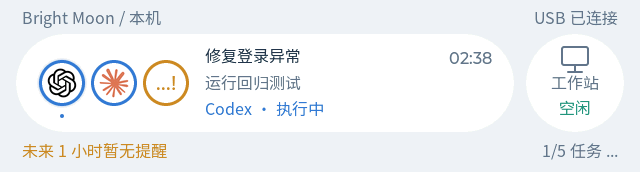
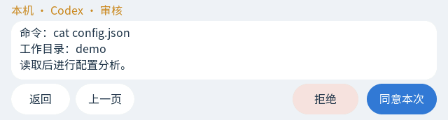

# Bright Moon Monitor · ESP32 桌面伴侣

此固件面向 **Waveshare ESP32-S3-Touch-LCD-3.49 V2**，使用现有 QSPI、触摸和 IMU 驱动，把 172×640 屏幕旋转为 **640×172 横屏**。本次改造日期：2026-10-30。

## 新版 UI 与双向操作（2026-10-30）

完整设计：[UI_DESIGN.md](../UI_DESIGN.md)。交互原型：开发工作区中的交互预览（不随此次源码发布）。实际 LVGL 渲染保存在 `preview/esp32-native-v2/`，与浏览器设计预览分开。

- 无任务显示产品 LOGO；固定高度98px胶囊，单设备宽608px，协同为498px + 12px间隔 + 98px。点击小圆交换大小；设备位置保持本机左、远程右，460ms平滑变化。
- 每台电脑的任务单独选焦点。最多三个圆形入口；超过三个显示两个任务LOGO及“…”圆圈，隐藏任务待审核时入口为琥珀色。点击打开任务卡片列表，最多三张/页。设备超过两台可长按小设备圆选择。
- 任务计时、摘要、状态跟随选中任务；仅真实计划显示步骤计数，完成绿色勾、失败红色感叹号，停止保留LOGO，不显示空白圆圈。
- 提醒独立于Agent任务。底部进入提醒页，可“返回 / 5分钟后提醒 / 已知晓”。操作只改变本轮，不删除周期任务；尚未开始的未来提醒只读。多提醒可列表选择。
- 审核读取完整分页参数后才提供同意/拒绝，最后确认提交。缺失、隐藏、过长、字体无法完整显示或来源不支持的请求不开放设备同意。
- USB操作走桌面已有OwnerBridge、SourceHub/AgentGate和TaskStore；远程通过既有可信协同连接到来源端。旧固件SOLO1仍能只读，新固件使用SOLO2控制消息。
- 操作ID持久化去重，请求绑定到任务/版本/来源，断线或更新后禁止旧决定；超时只查询原请求。来源返回accepted显示“已提交来源，等待实际状态确认”，不冒充任务或工具已完成。
- 已实现PWR长按3秒关机确认保持不变。USB供电关闭屏幕并深睡眠，电池释放电源保持；仍需实机验收。





以上为实际LVGL代码主机渲染，不是实机照片。使用的是现有16px中文字体，具体字重和字形与HTML视觉稿不同；页面经过原生像素尺寸检查。SD素材、音频、无线ESP32接入不属于此次升级。

## 使用步骤

**新增 USB 一次配网 / Wi-Fi 自动连接**：详见 [无线连接使用与实现说明](../../../monitor/esp32/WIRELESS.md)。桌面 ESP32 页下方可开启专用网络服务、让板卡扫描 Wi-Fi、通过 USB 下发配置并验证；成功保存后可使用独立供电，通过 Wi-Fi 查看任务及处理来源支持的审核/提醒。需要更新固件，未自动烧录。

1. 电脑退出SOLO、关闭Arduino串口监视器。上传此目录新版固件（本次代码修改不自动烧录）。
2. 重新运行 `monitor_solo/run.py`，打开“远程连接 → ESP32”，刷新、选择串口。
3. 如需审核和处理待办，勾选“允许此 USB 屏幕审核与处理待办”，关闭“仅显示状态”，点击“保存并连接”。该选项持久化，默认不启用控制。只监控时不必勾选。
4. 只有来源本身开放真实审核接口才能操作；Claude普通只读日志、未接入审批的CLI等不会凭空产生审核能力。完整命令含小屏字体不支持的字符时回电脑处理，不用不完整摘要授权。

5. 远程设备需在SOLO中已经绑定且在线；离线设备可显示但不能操作。板子任务选择与电脑桌面焦点互不强制覆盖。
6. 操作后查看实际状态文案；“已提交来源”表示来源已接收，不代表工具执行成功。“结果暂未确认”可查询原请求，避免重复操作。

### 待授权点击后没有进入页面

旧设置没有 `allow_control` 时，按只读监控处理，不会自动开启审核权限。
现在仅本机与多设备使用同一个入口：点击待处理任务的胶囊正文、LOGO 圆圈或列表卡片，均进入请求阅读页或不可操作说明页。没有控制句柄时不再仅切换摘要。

- 显示“USB 屏幕审核尚未开启”：在桌面「远程连接 → ESP32」勾选「允许此 USB 屏幕审核与处理待办」，点击「保存并连接」。
- 显示“详情已隐藏”：关闭「仅显示状态」，保存并连接。
- 显示“来源未提供可安全提交的完整请求”：可能是来源没有审批接口，或参数被隐藏、过长、含当前字体无法完整显示的字符；回来源应用处理。
- 待回答请求提示回来源应用填写；离线请求提示恢复连接，不展示可提交按钮。

本次修复同时涉及桌面状态协议与固件 UI，需要重启新版 SOLO，并重新编译、烧录新版固件；只更新电脑文件不会更新板上程序。

当前每帧最多5个Agent任务、5个有效提醒、6个设备身份；超出任务上限显示已同步/总数。提醒与Agent的上限独立，不用提醒挤掉Agent列表。状态帧不超过8000字节，完整审核正文通过独立分页获取。

## 编译环境

- Arduino IDE 2.x / Arduino CLI。
- Espressif ESP32 core 3.3.10；LVGL **8.4.0**（不是 9.x）；ArduinoJson **7.4.2**。
- ESP32S3 Dev Module、16MB Flash、OPI PSRAM、USB CDC On Boot 开启。
- Partition Scheme：16M Flash / 3MB APP / 9.9MB FATFS。
- 将当前 `lv_conf.h` 复制到 Arduino 库目录，与 `lvgl` 文件夹同级。本目录带中文点阵字体和小尺寸 Agent 图标，无需 SD 卡即可显示基本 UI。

FQBN：`esp32:esp32:esp32s3:PSRAM=opi,FlashSize=16M,PartitionScheme=app3M_fat9M_16MB,CDCOnBoot=cdc`。

本机临时验证工具链位于 `monitor_solo/.artifacts/esp32-upgrade/`，不应当上传或打包这些下载缓存。以前 README 中提及的旧编译体积不代表此版本；本次结果见 [验收记录](../../../docs/UPDATE_2026-10-30.md)。

## 代码结构与线程边界

- `ESP32-S3-Island.ino`：启动顺序与 USB/WiFi 状态选择。先初始化 I2C、电源保持、屏幕、PWR 监控，再进入配置与连接。
- `power_hold.h`：不依赖硬件的长按状态机。
- `power_control.cpp`：20ms 周期的独立电源任务。按键不依赖网络请求是否阻塞；UI 操作持有 LVGL 锁，用户确认后等待松手再休眠。
- `lvgl_port.c`：唯一的 IO 扩展器实例；EXIO6 电源保持、EXIO1 背光使能。避免两个驱动对象互相覆盖 IO 状态。
- `island_ui.cpp`：固定胶囊、设备 / 任务焦点、完整审核与待办页、关机弹层、失联状态。重复更新复用控件。
- `island_icons.c`：由 `../tools/make_icons.py` 使用 SOLO 图标生成，36px 圆形 RGB565+A；不是 SD 图片读取器。
- `serial_client.cpp`：唯一串口读写者，SOLO1显示握手和SOLO2 GET / DETAIL / DO / QUERY / RESULT。
- `island_model.h`、`net_client.cpp`：共享紧凑数据结构和解码；UTF-8 字段截断保持字符完整。
- `../../../monitor/esp32/`：桌面配置规范化、状态投影、串口服务和嵌入式设置 UI。
- `../tools/render_host.py`、`ui_host_test.cpp`：主机 LVGL 渲染和交互回归测试，不参与板卡 sketch 编译。

串口工作线程只读取已经投影的快照；不访问 Tk 控件、任务 SQLite 或 Agent 会话。刷新设备只枚举串口，不遍历打开所有串口。发送状态每秒一次，最大 8000 字节；没有新桌面快照超过 4 秒就停止发送，固件据此展示失联，而不是永远显示旧任务执行中。

## USB 协议与兼容

```text
电脑 → SOLO1 HELLO
板卡 → SOLO1 READY v1
电脑 → SOLO1 STATE {"v":1,"rev":1,"epoch":"...","tasks":[...]}
板卡 → SOLO1 ACK 1 0
```

协议仍是 v1；每个任务新增可选 `device` 稳定标识和 `control` 短期请求句柄，旧帧没有该字段时仍按设备名称分组。任务字段保持固定字节上限（含末尾 NUL）：标题 96、摘要 220、设备名称 24。桌面发送前按 UTF-8 字节截断；固件也再次防御性检查。

主题为桌面解析后的纯色和面板混色，不是桌面操作系统透明窗口。物理屏幕不具备桌面式背景透明效果。

## WiFi 的实际边界

旧固件保留了配网、SD 配置、`/api/esp32/v1/state` HTTP 轮询。**当前仓库的 SOLO 服务没有实现这个旧 ESP32 专用网络端点，本次交付的是可用的 USB 接入。** 手机服务已存在，不代表旧固件协议自动兼容手机服务；本次没有在 ESP32 设置页面展示不可用的令牌或网络地址。

旧 TLS 客户端并非完整的生产级设备认证：未配置 CA 时不验证对端，配置 CA 后也有证书时间 / 主机名验证的历史限制。不要把它描述为已经完成安全无线配对。后续无线版本应接入统一设备服务的认证、证书固定、吊销与协议版本机制，并保留 USB 作为配对或恢复入口。

## 64GB SD 卡、壁纸、声音和卡通

**可以实现，64GB 容量本身不是障碍；这些能力尚未在当前固件中交付。** 现有 SD 代码仅在启动时读取 `/solo-island/config.json` 和 CA，读完就卸载，并不是媒体文件系统。

1. **文件系统**：64GB SDXC 常见出厂格式为 exFAT，不能假设当前 ESP32 FatFs 配置已经启用 exFAT。建议先备份，再使用支持的 FAT32 卡做验证；若坚持 exFAT，应先确定所选 core 的 FatFs 配置。无需也不应因本次代码修改自动格式化用户卡。
2. **电源与电气**：通过板载 TF 插槽和现有 SDMMC 1-bit 引脚（CLK41 / CMD39 / D0=40）接入。必须验证卡的供电稳定性、识别、读写和空间检测；64GB 容量不等于 64GB 内存。
3. **资源传输**：桌面准备素材，通过当前 USB 通道新增独立版本的 `MEDIA_BEGIN / MEDIA_CHUNK / MEDIA_COMMIT / MEDIA_ABORT`。每块约 1KB，偏移与 CRC 校验、ACK、限速，最终核对 SHA-256；先写临时文件，成功才改名。不要把整段音频一次性放进 RAM。必须复用同一个串口工作线程，不能再打开第二个串口。
4. **存储服务**：新增统一 SD 挂载与互斥管理，允许媒体长期读取；将配网加载的 `SD_MMC.end()` 改为由存储服务统一管理。只允许 `/solo-island/media/` 下受控文件名，禁止覆盖配置、CA 和路径穿越；管理可用空间、取消、断电残片、卡拔出和重连续传。
5. **壁纸**：桌面裁剪为 640×172，可先使用 RGB565，单帧约 215KiB，渲染成本低。JPEG / PNG 能节省存储或支持透明，但需要实际解码器和内存预算。桌面 PNG 不能直接放进卡就假设 LVGL 会自动读取。
6. **卡通**：静态透明素材先落地；动画使用小尺寸帧序列或经过验证的动画解码器，限制帧率和尺寸，图片 I/O 不阻塞 LVGL 触摸线程。
7. **音频**：官方板卡配备 ES8311，音频输出还需要正确的 I2S、编解码器初始化、功放控制和扬声器连接。先支持 16-bit 单声道 PCM WAV，例如 22050Hz；MP3 再增加合适的解码库。播放使用独立缓冲 / 任务，任务完成按事件 ID 去重，只播一次；断线重连不能重播全部历史通知。
8. **桌面交互**：在此 ESP32 板块增加“素材库”：容量、上传、进度、取消、删除、预览、设为壁纸 / 角色 / 提示音。只有固件报告相应能力才显示可用按钮，避免现在就给出无效入口。

115200 的真正 UART 通路理论约 11.5KB/s（8N1，不计协议开销）；原生 USB CDC 的实际吞吐不由这个 baud 参数直接决定，必须测量。音频和壁纸不需要像任务状态一样每秒重发，只在素材变化时传一次，状态中引用资源 ID。

## 实机验收

- USB 与电池分别测试 PWR：短按不关机，长按弹窗，取消不重复弹，确认后松手关闭；USB 下再按 PWR 唤醒。BOOT 仍用于原有配网 / 翻转，不是 PWR。
- 真机核对显示方向、背光和触摸命中（包括倒装180°）；测试网络断开和配网页状态下长按。
- 空闲、执行、待授权、完成、失败；单电脑多任务、两台电脑、同名电脑、任务删除及重启。
- 拔插 USB、端口改变、端口被 Arduino 占用、退出 SOLO；断线后不能误显示“已连接”。
- 卡、扬声器和媒体吞吐属于后续媒体功能验收，本次不声称已验证。

## 依据与许可

- [Waveshare 官方板卡 Wiki](https://www.waveshare.com/wiki/ESP32-S3-Touch-LCD-3.49)
- [官方 PWR 示例](https://github.com/waveshareteam/ESP32-S3-Touch-LCD-3.49/tree/main/Examples/Arduino/07_BATT_PWR_Test)：GPIO16 按下低电平；TCA9554 EXIO6 高电平保持供电、低电平释放。
- BSP、LVGL、字体许可证继续见 [THIRD_PARTY_NOTICES.md](THIRD_PARTY_NOTICES.md) 与 `licenses/`。


## SOLO2 控制消息

`READY v2` 宣告固件支持控制。设备发送 `SOLO2 GET {id,page}`，电脑返回 `DETAIL {id,page,total,text,kind,actions,expires}`；逐页读取完整文档后发送 `DO {id,cmd,op}`。cmd为32位随机十六进制，不变地用于 `QUERY {id,cmd,op}`；RESULT始终携带同一id/cmd及pending/accepted/succeeded/rejected/outcome_unknown等状态。

操作只允许approve/deny/snooze/acknowledge。任意shell、来源路径、目标run_id不接受从串口指定。完整参数文档最多12000 UTF-8字节/120页，字体支持不足时不发布操作。设备页面每页最多3行、每行最多34个字符，按16px最大字形预算而非乐观ASCII宽度避免命令被裁切。

USB为本地物理连接，不宣称SOLO2提供加密；远程转发复用原有认证协同通道。请求令牌仅保存在内存，结果日志不落盘命令正文。用户关闭控制或仅状态模式立即撤销操作能力。
