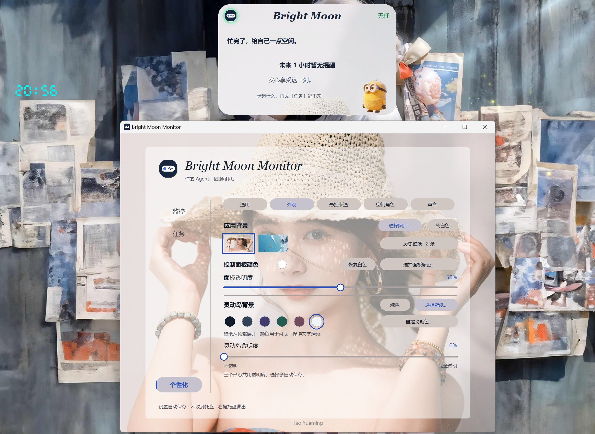
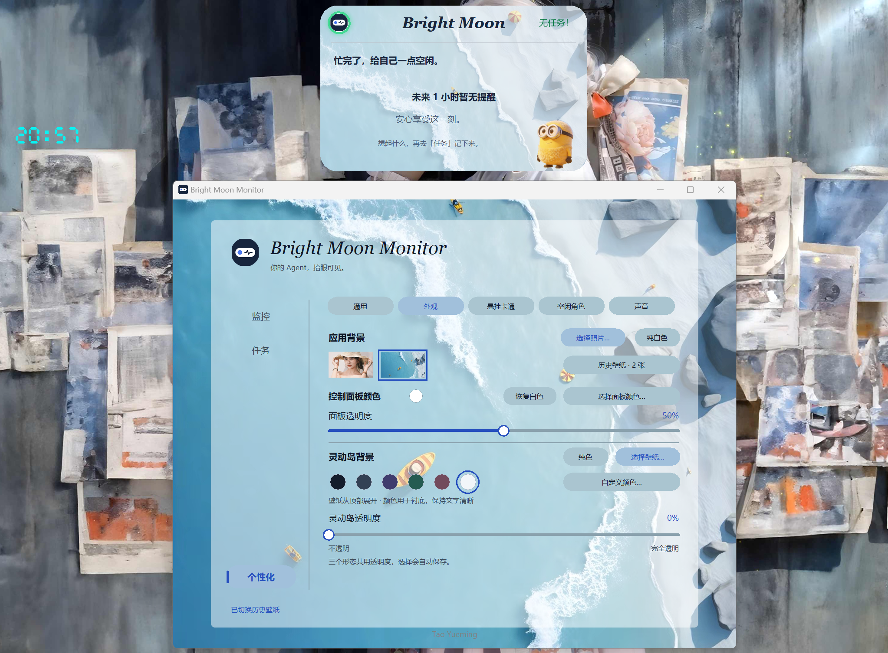
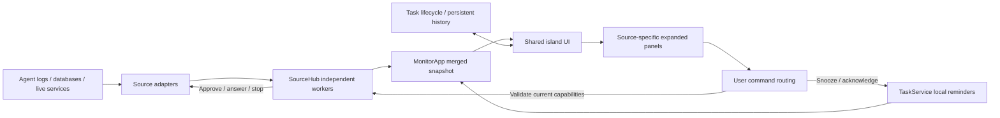

<p align="center">
  
</p>

<h1 align="center">Bright Moon Monitor · Solo</h1>

<p align="center"><a href="README.md">简体中文</a> · <strong>English</strong></p>

<p align="center">A little island on your desktop for Agent progress and everyday reminders.</p>
<p align="center"><strong>Desktop Live View · Multiple Agent Sources · Local Reminders · Custom Appearance</strong></p>

<p align="center">
  
</p>

Solo is a standalone desktop monitor. Follow Agent tasks in one place, handle approvals when the source supports live interaction, or use it for local reminders. No BrightMoon account or BrightMoon main application is required.

**Current version: 0.1.0 · Windows 10 (1809+) / Windows 11 · x64**

**[Download the Windows installer ZIP](MonitorSolo-0.1.0-windows-x64.zip)** · **[Download checksums](SHA256SUMS.txt)**

This is the English documentation. Screenshots show the current Chinese interface; this README does not imply that the application has an English UI option.

## Wallpaper and desktop showcase

Combine your own application wallpaper, panel styling, and island background. These two actual screenshots show a photo background with a light island card, and a coastal wallpaper shared by the control panel and the island.

<p align="center">
  
  <br><em>Example 1 · Photo wallpaper with a light island. Control panel transparency is adjustable independently.</em>
</p>

<p align="center">
  
  <br><em>Example 2 · One wallpaper across the panel and island, revealing more of the image as the island expands.</em>
</p>

> These two images are actual screenshots of customized appearances. Other previews include simulated tasks. The example wallpapers, characters, and tasks are not fixed installation defaults.

## Make it your own

- **Wallpapers and colors**: choose backgrounds, colors, and transparency separately for the panel and island. Previously imported wallpapers can be selected again.
- **Spring animation**: expand the capsule into a card, revealing more of its wallpaper.
- **Hanging character**: choose an image and its horizontal position. Clicking the pendant also expands the island, with a gentle tug and fade animation.
- **Idle character**: toggle it independently and upload a transparent PNG / WebP cutout.
- **Sounds**: choose and preview notification sounds in Personalization → Sounds (「个性化 → 声音」).

<p align="center">
  
</p>
<p align="center">
  
</p>

## From capsule to task details

The compact view shows source logos, task status, and elapsed time. Click to expand a progress card, then expand further to inspect details supplied by the source. Each Agent can provide a different detail view.

<p align="center">
  
</p>

- **Multiple tasks**: display up to 5 tasks at once and click their source icons to switch focus.
- **Visible status**: indicator colors, breathing effects, and text distinguish running, pending interaction, completed, and failed tasks.
- **Individual dismissal**: each ended task has its own timer. Normal terminal tasks can remain visible for 1–10 minutes; disconnected and other exceptional states follow their respective dismissal rules.
- **Persistent deduplication**: retain display history so already-ended tasks do not keep reappearing after a restart.
- **Capability-aware interaction**: offer approval, answer, or stop controls when supported by the live connection. Log-only sources remain read-only.

> Task previews illustrate layout and interaction. Available information depends on the connected Agent.

## Supported Agents

- **Codex**: reads local session logs and attempts to discover a local App Server. Approvals require a connection to the same live service that owns the task, with the required operation available. Log-only monitoring does not provide working approval controls.
- **OpenCode**: reads status from its local database. Approvals, answers, and stop requests require a reachable live service with the corresponding capabilities.
- **DeepSeek Harness**: monitors local session logs. Approvals and answers require an optional interaction bridge. The bridge currently targets **0.2.0-rc.2**; compatibility with other versions needs verification.
- **CodeAgent**: reserved entry; integration is not yet available.

Agent source switches are off on first launch. Install and run the Agent you want to monitor, then enable its source under Monitor (「监控」). If discovery fails, specify the data location in that source's settings.

Solo does not bundle these Agents or provide their accounts, model services, or APIs. Normal monitoring does not install Agents or modify Harness plugin configuration. Instructions for the DeepSeek interaction bridge are available through the installed application's Start menu user guide.

## Local reminders on the island

Open Tasks (「任务」) to add a title, content, and time. Choose a one-time reminder, weekly recurrence, or an interval of N hours. Weekly and hourly recurrence are mutually exclusive. Set reminders to appear **2–10 minutes in advance**.

<p align="center">
  
  
</p>

When a reminder is due, it appears ahead of Agent tasks. Expand it to choose:

- **Snooze for 5 minutes (「忽略 · 5分钟后」)**: dismiss temporarily and remind again in 5 minutes.
- **Acknowledge (「已知晓」)**: end this occurrence; recurring tasks still follow their next scheduled occurrence.

<p align="center">
  
</p>

Switch the task display between list and grid views. Reminder and Agent completion sounds can be chosen or disabled separately: each reminder round plays 3 times, while Agent completion plays once.

**Solo must remain running to deliver reminders.** Reminders do not run after exiting from the tray, while the computer is shut down, or during sleep. On reopening, only reminders still within their valid window resume; missed historical reminders are not replayed.

## A quieter view between tasks

Enable Always-on Island under Monitor (「监控 → 灵动岛常驻」) to keep the capsule visible without active tasks. The header previews the number of reminders that will **start within the next hour**. Expand it to see the nearest reminder and its time, with the rest summarized as a count. If none qualify, the capsule displays 「无任务！」 (No tasks).

<p align="center">
  
</p>

Always-on mode is off by default. When enabled, ended tasks still leave after their retention period, and the island automatically collapses into the idle capsule after the last task leaves.

## Installation and first launch

1. Download `MonitorSolo-0.1.0-windows-x64.zip` using the link above.
2. **Extract the ZIP first**, then open the extracted folder.
3. Double-click `MonitorSolo-0.1.0-windows-x64-setup.exe` and follow the installer.
4. Launch **Bright Moon Monitor (Solo)** from the desktop shortcut or Start menu.
5. Enable your sources under Monitor (「监控」), or go to Tasks (「任务」) to create a reminder.

The installer includes the Python/Tk runtime and application dependencies. **No separate Python, Conda, or pip installation is required.** Monitored Agents still have their own installation requirements. This release targets Windows x64; it is not a macOS or Linux installer.

### Background operation, login startup, and exit

<p align="center">
  
</p>

- Enable startup under Personalization → General (「个性化 → 通用」). It is off by default. When enabled, Solo starts in the background **when the current user signs in to Windows**, without opening the control panel.
- Clicking the window's **×** hides it to the system tray; monitoring and reminders continue.
- Double-click the tray icon or launch the desktop shortcut again to bring back the panel.
- **Right-click the tray icon → Exit (「退出」)**, or click Exit Monitor (「退出监控器」), to end the application.
- The tray icon may be inside the taskbar's hidden-icons menu. If the tray is unavailable, the window falls back to ordinary taskbar minimization.

### Data, upgrades, and uninstalling

Settings, reminders, images, and task display history are stored locally for the current Windows user:

```text
%LOCALAPPDATA%\MonitorSolo\data
```

Paste this path into File Explorer's address bar. To back up your data, exit Solo first and copy the entire directory.

Upgrades retain personal data and the startup preference. Uninstall from Windows Installed Apps or the Start menu uninstall entry. Personal data is retained by default; interactive uninstall offers an option to delete it. Uninstalling Solo does not remove monitored Agents or their sessions. If you installed the DeepSeek interaction bridge, follow the user guide to remove that bridge before uninstalling Solo.

## Run from source and explore the architecture

This repository now includes both the installer archive and **standalone Solo source code**. The repository root is the source root; no BrightMoon parent project or developer-specific Python environment is needed. A [detailed source guide](docs/SOURCE_GUIDE.md) is available in Chinese.

### Run from source

Use Windows x64 and Python 3.10+ with Tkinter, preferably an official Python installation. The current release build and source checks use CPython 3.13.16.

```powershell
git clone https://github.com/TYueMing/BrightMoon-Monitor-V1.git
cd BrightMoon-Monitor-V1
py -3 -m venv .venv
.\.venv\Scripts\python.exe -m pip install -r requirements.txt
.\.venv\Scripts\python.exe run.py
```

After creating the environment and installing dependencies, you can also double-click `start.cmd`. Runtime dependencies are **Pillow, zstandard, and websocket-client**; Python provides SQLite, Tkinter, and other standard-library components. Source mode creates its own `data/` directory with no developer settings or tasks. If the `py` launcher is unavailable, use your Python executable's path to create the environment.

### Layout and responsibilities

```text
run.py / start.cmd            Entry points
monitor/
  app.py                      Application wiring, snapshots, command routing
  settings.py                 Configuration validation and persistence
  UI/                         Shared capsule, animations, task strip, settings
    tasks/                    Reminder list, editor, and detail card
  src/                        Source hub, identity, history, tray, startup, paths
  codex_monitor/              Codex logs, App Server, and source-specific panel
  deepseek_monitor/           Harness logs, optional bridge, and detail panel
  opencode_monitor/           OpenCode database, live service, and detail panel
  tasks/                      Local reminder storage, scheduling, and lifecycle
  music/play/                 Sound discovery, preview, and playback
  icon_asset/                 Application and source icons
tests/                        Python regression tests and preview generators
docs/                         Usage, integration, and architecture documentation
packaging/                    Build scripts, resource lists, locks, and licenses
```



The shared UI handles island states, animation, and task switching. Adapters parse source data and communicate with Agents; source-specific panels render their details. Commands recheck the current task and available actions. Reading logs does not grant approval capability. Local reminders have separate storage and commands, so reminder buttons never become Agent commands.

### Tests and data boundaries

```powershell
.\.venv\Scripts\python.exe -m pip install -r requirements-dev.txt
.\.venv\Scripts\python.exe -m pytest tests -q
# Optional interaction bridge tests; requires Node.js 20+
node --test monitor/deepseek_monitor/tests/bridge.test.mjs
```

The source includes required icons, sounds, curated build resources, and tests. **Personal data, account settings, task databases, sessions, logs, virtual environments, and download caches are excluded.** Source mode writes to the root `data/` directory; installed mode uses the Windows user data directory. Add your own pendant and idle-character images; source startup does not import the developer's image selections.

The repository does not contain `packaging/vendor/`. Rebuilding an installer requires preparing dependencies and tools as described in the [build guide](docs/WINDOWS_PACKAGING.md), currently in Chinese. Publishing source does not itself assign an open-source license. See [THIRD_PARTY_NOTICES](packaging/THIRD_PARTY_NOTICES.md) for component licenses and resource attribution.

## What is SHA256SUMS.txt?

It is a list of **file fingerprints**. Changing a file normally changes its SHA-256 digest, so you can check whether a download is intact and matches the publisher's file. It is not an application dependency and does not need to be installed or executed.

The [SHA256SUMS.txt](SHA256SUMS.txt) at the repository root checks the **ZIP archive**. Another file with the same name inside the ZIP checks the **extracted installer and installation notes**. They cover different files; do not compare the ZIP digest with the EXE digest.

Open PowerShell in your download folder and run:

```powershell
Get-FileHash .\MonitorSolo-0.1.0-windows-x64.zip -Algorithm SHA256
```

Compare the output's `Hash` with the value before the matching filename in the root checksum file. Letter case does not matter. The expected digest for the current 0.1.0 ZIP is:

```text
49089c56b03364ff2716423c64835fdbada50a2a6d0df9fb4d3742f79f9384d4
```

If it differs, do not run that downloaded file; download again from a trusted release location and recheck. **A checksum is not a digital signature or proof that software is safe.** You also need to trust the source of the expected checksum.

## Frequently asked questions

**Why is there no island after launch?**

By default, it appears for active tasks or valid reminders. Enable Always-on Island to preview the idle capsule. Agent sources must also be enabled manually on first use.

**Why can I see progress but not approve a request?**

Logs provide status only. Action controls depend on a connection to the live service that owns the task and its supported capabilities. Harness also needs its optional bridge. Solo does not bypass the Agent's own authorization rules.

**Why does Windows show an unknown publisher warning?**

The current installer is not code-signed. Windows may display an unknown publisher or reputation warning. Verify the source and checksum; disabling system security protections to install it is not recommended.

**What has been tested?**

The 0.1.0 build records 285 passing automated tests, a passing frozen-application self-test, and local install, upgrade, and uninstall acceptance checks. Independent clean Windows VM testing, real reboot/sign-in testing, and interaction testing across all Agent versions have not been completed. These results do not establish compatibility with every environment.

**How can I report a problem?**

Use this repository's Issues, if enabled. Include your Windows version, Solo version, Agent name and version, steps to reproduce, and expected behavior. Remove account details, secrets, and private conversations from screenshots and logs before sharing.

---

<p align="center">Bright Moon Monitor · Solo<br>Stay close to progress. Leave a little warmth on your desktop.</p>
