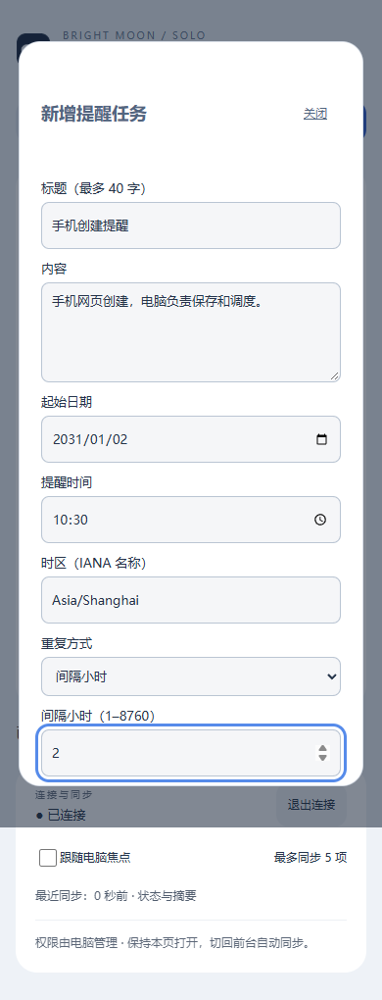
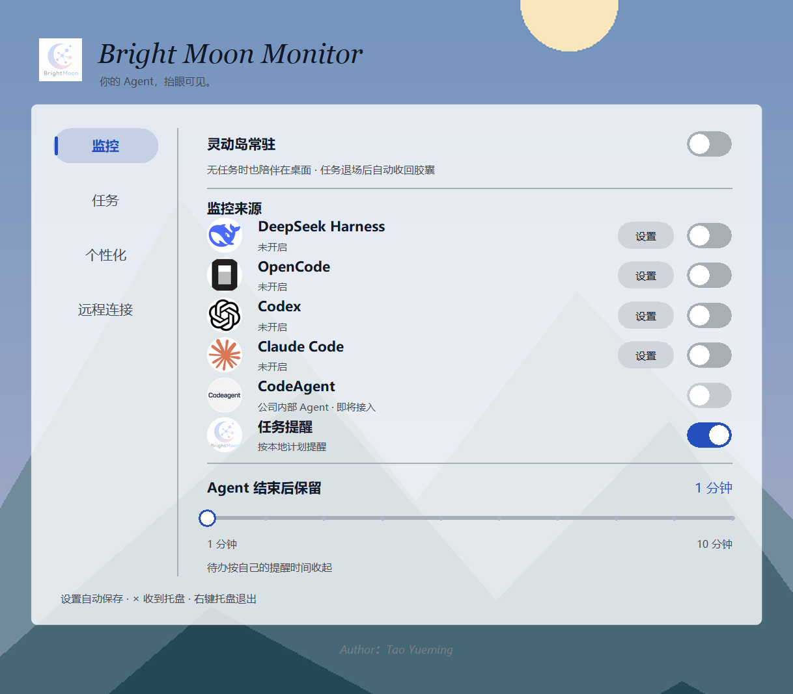
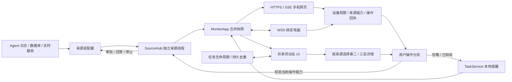

<p align="center">
  
</p>

<h1 align="center">Bright Moon Monitor · Solo</h1>

<p align="center"><strong>简体中文</strong> · <a href="README.en.md">English</a></p>

<p align="center">把 Agent 的进展和日常提醒，放进桌面上的一座小岛。</p>
<p align="center"><strong>Agent 灵动岛 · 多电脑协同 · 手机监控 · 周期提醒</strong></p>

<p align="center">
  
</p>

Solo 是独立运行的桌面监控器：集中查看 Agent 的任务状态，在来源支持实时交互时处理授权，也可以只用它管理本地提醒。不需要 BrightMoon 账户，不依赖 BrightMoon 主程序。

**源码更新：2026-10-30 · 已发布安装包：0.1.0 · Windows x64**

**[下载 Windows 安装包 ZIP](MonitorSolo-0.1.0-windows-x64.zip)** · **[下载校验文件](SHA256SUMS.txt)**


**源码更新 · 2026-10-25：**同步加密设备服务、手机提醒编辑与授权、电脑绑定与重连优化、灵动岛动画与布局修复，以及新 LOGO。**0.1.0 安装包未重新打包，最新功能请运行源码。** 本次不更新测试与打包文件。见 [本次同步与验证](docs/UPDATE_2026-10-25.md)。详见 [手机连接指南](docs/REMOTE_SERVICE_GUIDE.md) 和 [源码架构](docs/SOURCE_GUIDE.md)。

## ESP32 桌面屏幕：USB 配网，Wi-Fi 自动连接

新增 **ESP32-S3-Touch-LCD-3.49** 固件和桌面控制入口：本机/远程设备切换、多任务选择、待授权详情与待办处理共用 SOLO 的状态与操作通道。

1. 烧录新版固件，在「远程连接 → ESP32 屏幕」连接 USB。
2. 开启无线服务，选择专用网络网卡并保存。
3. 扫描 2.4GHz Wi-Fi，输入密码，通过 USB 配置；验证成功后才保存到板卡。
4. 之后可用独立供电，自动重连，通过 HTTPS 查看实况；开启设备控制后可处理来源支持的授权和提醒。

支持错误配网回退、局域网地址重新发现、板卡解绑，以及 USB/Wi-Fi 操作去重。路由器必须允许设备互通。SD 卡通/媒体上传仍是设计，尚未实现。


详见 [使用与实现说明](monitor/esp32/WIRELESS.md)、[固件与烧录说明](Product/Firmware/ESP32-S3-Island/README.md)、[更新核对记录](docs/UPDATE_2026-10-30.md)。固件已编译、桌面与接口已自动化验证；真实板卡 Wi-Fi/USB 切换仍需实机验收。本次不重新打包，旧安装包不包含这些功能。

## 多电脑协同与手机监控

**同一局域网，把电脑上的进展带到另一块屏幕。** 桌面上的「远程连接」直接管理设备服务与电脑协同，不需要另开终端。两项服务都依赖网络可互通；没有公网中继或 NAT 穿透。

### 电脑之间：一次绑定，持续协同

1. 两台电脑都运行最新源码，在「远程连接 → 电脑协同」开启服务。
2. 一方生成邀请，另一方粘贴邀请；核对相同校验码后确认绑定。
3. 绑定后双向共享当前任务和来源支持的操作，不必再逐项选择共享权限。Agent 的每次授权仍需人工确认。
4. 本地长胶囊与远程圆圈并列，点击切换焦点；第二、三态显示所选设备的详情。

绑定与身份持久保存。重启、短暂断网后会重试连接；如果两端保存的地址都失效，需要更新地址，不必删除绑定重来。「个性化 → 通用」可以让在线的已绑定电脑常驻显示；删除绑定会撤销互信。

### 手机：浏览器查看，也能按权限操作

1. 在电脑「远程连接 → 设备服务」选择可信专用网络并开启 HTTPS。
2. 按指南在手机建立证书信任，打开电脑显示的网址，输入 8 位配对码。
3. 在电脑选择「长期保存」，最多保存 **3 台设备**。同一地址和浏览器凭据保留时，再次打开可恢复连接。
4. 电脑可为每台手机单独授予提醒查看、编辑、删除、知晓/暂缓，以及来源支持的 Agent 授权等权限。

手机可以查看本机灵动岛和**远程协同实况**；协同来源在手机上只读。初次配对和 HTTP 兼容模式均为只读；敏感操作需要 HTTPS 与设备权限。编辑提醒支持版本冲突检查，避免覆盖电脑端的新修改。

<p align="center">
  
  
</p>

> 上图使用示例任务。当前交付的是手机网页，不是原生手机 App；浏览器退出、锁屏或进入后台不保证连接持续，也不提供手机系统后台推送。请按 [手机连接指南](docs/REMOTE_SERVICE_GUIDE.md) 建立证书信任，不要用跳过证书警告替代配置。

详细说明：[电脑协同](monitor/multi_diverse/IMPLEMENTATION.md) · [统一设备服务](monitor/remote/README.md) · [远程接口](monitor/remote/API.md)。

## 最新控制面板

统一使用新的 LOGO；品牌栏与控制面板保持相邻，布局随窗口尺寸调整。增加声音总开关、协同设备提示音和在线协同设备常驻选项；手机在线提示与空闲文字分开，减少闪烁与遮挡。

<p align="center">
  
</p>

## 壁纸与桌面效果

应用背景、控制面板和灵动岛可以自由搭配。下面两张实际截图展示了照片背景搭配浅色卡片，以及控制面板与灵动岛采用同一张海岸壁纸的效果。

<p align="center">
  
  <br><em>效果 1 · 照片背景与浅色灵动岛，控制面板透明度可独立调节。</em>
</p>

<p align="center">
  
  <br><em>效果 2 · 同一张壁纸贯穿控制面板和灵动岛，展开时显示更多画面。</em>
</p>

> 这两张图片是自定义外观的实际截图；其余预览包含模拟任务。示例壁纸、角色和任务不是安装后的固定内容。

## 外观由你决定

- **壁纸与颜色**：控制面板和灵动岛可以分别选择背景、颜色与透明度，历史壁纸可再次选择。
- **弹簧开合**：从胶囊展开卡片，壁纸随展开显示更多区域。
- **悬挂卡通**：自选图片与横向位置；点击挂件也能触发展开，伴随轻拉和渐入动画。
- **空闲角色**：独立控制开关，支持上传带透明背景的 PNG / WebP 抠图。
- **声音**：在「个性化 → 声音」选择并试听提示音，包含声音总开关与协同设备提示音。

<p align="center">
  
</p>
<p align="center">
  
</p>

## 从胶囊到任务详情

第一形态展示来源 Logo、任务状态和计时；点击后展开进度卡片，再进一步查看来源提供的执行细节。来源不同，详情内容也会有所区别。

<p align="center">
  
</p>

- **多任务切换**：最多同时展示 5 个任务，点击顶部来源图标切换关注的任务。
- **状态一眼可见**：用指示灯、呼吸效果和文字区分运行、待处理、完成和失败等状态。
- **独立退场**：每条结束任务分别计时；正常结束任务保留时间可设为 1～10 分钟，失联等异常状态按相应规则退场。
- **跨重启去重**：保存已监控任务的显示记录，避免重启后反复弹出已结束的旧任务。
- **按能力交互**：实时连接具备相应能力时，提供审批、回答或停止入口；只有日志时显示只读状态。

> 此处任务预览用于展示布局和交互，请以所连接 Agent 实际提供的信息为准。

## 支持哪些 Agent？

- **Claude Code**：通过本机 Hook 监控受支持的桌面 Code 标签与 CLI 会话，显示观察到的阶段、工具结果、子 Agent、压缩与摘要；可选单次授权默认关闭。先在来源设置安装 Hook，再开始新的 Code 会话。不支持普通 Chat / Cowork 或远端执行会话。

- **Codex**：读取本机会话日志，并尝试发现本机 App Server。审批需要连接到任务所在的同一实时服务，且服务提供相应操作能力。仅能读取日志时，不提供可用的审批入口。
- **OpenCode**：通过本地数据库读取状态；授权、回答和停止等交互依赖可连接的实时服务与对应能力。
- **DeepSeek Harness**：支持本地会话日志监控；授权和答题需要额外安装可选交互桥。当前桥接适配目标是 **0.2.0-rc.2**，其他版本需要核实兼容性。
- **CodeAgent**：预留入口，当前尚未接入。

首次打开时，Agent 来源开关默认关闭。先安装并运行需要监控的 Agent，再在 Solo 的「监控」中开启对应来源；自动发现不成功时，可以在来源设置中指定数据位置。

Solo 不包含这些 Agent 本身，也不提供它们的账号、模型服务或 API。普通监控不会自动安装 Agent 或修改 Harness 的插件配置。DeepSeek 交互桥的操作说明可从安装后的开始菜单使用说明中查看。

## 本地待办，也能登上灵动岛

在「任务」中添加标题、内容和时间，选择单次、每周重复或每隔 N 小时重复。每周重复与按小时重复互斥，提醒提前量支持 **2～10 分钟**。

<p align="center">
  
  
</p>

到提醒时间后，待办优先于 Agent 任务显示。展开后可以选择：

- **忽略 · 5分钟后**：暂时收起，5 分钟后再提醒。
- **已知晓**：结束本次提醒，重复任务仍按下一次计划执行。

<p align="center">
  
</p>

任务列表支持列表/网格切换。待办提醒音与 Agent 完成音可以分别选择或关闭：待办每轮播放 3 遍，Agent 完成时播放 1 遍。

**提醒需要 Solo 保持运行。** 从托盘退出、电脑关机或睡眠期间不会提醒；重新打开只恢复仍在有效提醒窗口内的项目，不补发已经错过的历史提醒。

## 无任务时，留一点轻松的空间

打开「监控 → 灵动岛常驻」后，没有活动任务也可以保留小胶囊。顶部预告未来 **1 小时内开始提醒**的任务数量；展开后显示最近一条提醒的内容和时间，其余提醒以数量概括。没有符合条件的提醒时显示「无任务！」。

<p align="center">
  
</p>

常驻默认关闭。开启后，已结束任务仍按保留时间退场，最后一条退场时自动收回空闲胶囊。

## 安装与首次使用

1. 下载上方的 `MonitorSolo-0.1.0-windows-x64.zip`。
2. **先解压 ZIP**，打开解压后的文件夹。
3. 双击 `MonitorSolo-0.1.0-windows-x64-setup.exe`，按照向导安装。
4. 通过桌面上的 **Bright Moon Monitor (Solo)** 快捷方式或开始菜单启动。
5. 在「监控」开启需要的来源，或直接进入「任务」创建提醒。

安装版自带 Python/Tk 运行环境及应用所需依赖，**无需另装 Python、Conda 或 pip**。这不替代被监控 Agent 自身的安装要求。当前发行包面向 Windows x64，不是 macOS/Linux 安装包。

### 后台运行、开机自启和退出

<p align="center">
  
</p>

- 「个性化 → 通用」可开启自启，默认关闭。开启后在**当前用户登录 Windows 时**后台启动，不自动打开控制面板。
- 点击窗口右上角 **×** 收到系统托盘，监控和提醒继续运行。
- 双击右下角托盘图标或再次点击桌面快捷方式，可以唤回控制面板。
- **右键托盘图标 → 退出**，或点击「退出监控器」，才会真正结束程序。
- 托盘图标可能藏在任务栏的小箭头中；托盘不可用时，窗口会退回普通任务栏最小化。

### 数据、升级与卸载

设置、待办、图片和任务显示记录保存在当前 Windows 用户的本地目录：

```text
%LOCALAPPDATA%\MonitorSolo\data
```

可以将此路径粘贴到资源管理器地址栏。备份前先退出 Solo，再复制整个数据目录。

升级安装保留个人数据和自启选择。在 Windows「已安装的应用」或开始菜单卸载入口中卸载；默认保留个人数据，交互卸载时可选择删除。卸载不会删除被监控 Agent 的程序或会话。如安装过 DeepSeek 交互桥，请按使用说明先移除桥接，再卸载 Solo。

## 源码运行与架构

仓库现在同时提供安装包和 **Solo 独立源码**。源码根目录就是本仓库根目录，不需要下载 BrightMoon 主工程或使用开发者的 Python 环境。完整职责说明与扩展入口见 [源码架构指南](docs/SOURCE_GUIDE.md)。

### 从源码启动

需要 Windows x64、Python 3.10+（含 Tkinter），推荐官方 Python。依赖版本以 `requirements.txt` 为准；不绑定开发者的 Conda 环境。

```powershell
git clone https://github.com/TYueMing/BrightMoon-Monitor-V1.git
cd BrightMoon-Monitor-V1
py -3 -m venv .venv
.\.venv\Scripts\python.exe -m pip install -r requirements.txt
.\.venv\Scripts\python.exe run.py
```

创建环境并安装依赖后也可双击 `start.cmd`。运行依赖为 **Pillow、zstandard、websocket-client、aiohttp、cryptography、tzdata、tzlocal**；SQLite、Tkinter 等由 Python 提供。源码启动会建立自己的 `data/`，不会携带开发者的配置或任务。没有 `py` 启动器时，可使用自己的 Python 路径创建环境。

### 目录与职责

```text
run.py / start.cmd            启动入口
monitor/
  app.py                      应用装配、快照合并、操作分流
  settings.py                 配置校验与持久化
  UI/                         共享胶囊、动画、任务圈、个性化
    tasks/                    待办列表、编辑器、详情卡片
  src/                        来源汇总、任务身份、去重、托盘、自启、路径
  codex_monitor/              Codex 日志 / App Server / 私有详情
  deepseek_monitor/           Harness 日志 / 可选交互桥 / 私有详情
  opencode_monitor/           OpenCode 数据库 / 实时服务 / 私有详情
  tasks/                      本地待办存储、调度与提醒
  music/play/                 音频枚举、试听与播放
  claude_monitor/            Claude Code Hook、事件邮箱、授权、设置与专属详情
  multi_diverse/             多电脑配对同步、权限及独立远程布局
  phone/                      手机网页、配对、SSE 与资源发布
  remote/                     HTTPS、设备权限、任务编辑、命令回执
  runtime_check.py            启动前依赖诊断
  icon_asset/                 应用与来源图标
tests/                        Python 回归测试与预览生成器
docs/                         使用、接入与架构文档
packaging/                    构建脚本、资源清单、依赖锁与许可证
```



共享 UI 负责形态、动画与任务切换；各来源适配器负责解析和通信，专属面板负责展示。交互命令重新核对当前任务和可用动作，日志读取不会赋予审批能力。本地待办有独立存储与操作接口，不会把提醒按钮转成 Agent 命令。

### 源码同步与数据边界

本次只同步应用源码、运行图标/音频和文档。**不更新测试、打包脚本、安装包或离线依赖，也不上传个人 `data/`、设置、任务数据库、会话、日志、密钥、虚拟环境、宣传视频或生成缓存。** 仓库中既有的测试与打包文件保留历史版本，不能视为与本次源码完全同步的验收或构建材料。

源码模式在项目根目录创建 `data/`；安装版使用 Windows 用户数据目录。挂件、角色与壁纸可以自行添加；不会导入开发者的私人图片。运行资源中的 ICO 和 LOGO 随源码发布，干净目录启动不依赖 `packaging/`。

可使用 `python run.py --check-runtime` 检查当前解释器依赖。`python run.py --self-test report.json` 在临时数据目录执行离线桌面自检，不连接真实 Agent；该自检会临时创建并删除独立的 Windows 测试启动项。详见 [启动诊断](docs/WINDOWS_SOURCE_FIX_2026-10-25.md)。

第三方组件说明见 [THIRD_PARTY_NOTICES](packaging/THIRD_PARTY_NOTICES.md)。源码公开不等于选择了某种开源许可证。

## SHA256SUMS.txt 是什么？

它是下载文件的**指纹清单**。文件内容发生变化，计算出的 SHA-256 通常也会变化，因此可以用来检查下载是否完整、是否与发布者提供的文件一致。它不是运行程序需要的依赖，不需要安装或双击执行。

本仓库顶层的 [SHA256SUMS.txt](SHA256SUMS.txt) 校验 **ZIP 压缩包**；ZIP 内部另有同名文件，校验**解压后的安装程序和安装说明**。两者校验对象不同，不要直接拿 ZIP 的指纹和 EXE 的指纹比较。

在下载目录打开 PowerShell，执行：

```powershell
Get-FileHash .\MonitorSolo-0.1.0-windows-x64.zip -Algorithm SHA256
```

将输出的 `Hash` 与顶层 `SHA256SUMS.txt` 中对应文件名前的值比较，忽略字母大小写。当前 0.1.0 ZIP 的预期值是：

```text
49089c56b03364ff2716423c64835fdbada50a2a6d0df9fb4d3742f79f9384d4
```

不一致时不要运行该下载文件，应从可信发布位置重新下载并核对。**哈希校验不等于数字签名，也不证明软件绝对安全**；需要信任提供校验值的来源。

## 常见问题

**打开后为什么没有灵动岛？**

默认在有活动任务或有效提醒时出现。可以打开「灵动岛常驻」预览空闲胶囊；首次使用还需要手动开启 Agent 来源。

**能看到状态，为什么不能点同意？**

日志只能提供状态。操作按钮依赖同一任务所在实时服务的连接与能力；Harness 还需要可选桥接。Solo 不会绕过 Agent 自身的授权机制。

**Windows 为什么提示未知发布者？**

当前安装程序尚未代码签名，Windows 可能出现未知发布者或信誉提示。请确认下载来源和校验值；不建议为了安装而关闭系统安全防护。

**当前版本测试到了什么程度？**

0.1.0 构建记录为 285 项自动化测试通过，冻结程序自检与本机安装、升级、卸载验收通过。尚未完成独立干净 Windows 虚拟机、真实重启登录及所有 Agent 版本的交互验收，不代表所有环境都已验证。

**如何反馈问题？**

可在本仓库 Issues（如已开启）说明 Windows 版本、Solo 版本、Agent 名称与版本、复现步骤和预期结果。截图及日志请先去除账号、密钥和私人会话内容。

---

<p align="center">Bright Moon Monitor · Solo<br>关注进展，也给桌面留一点温柔。</p>
