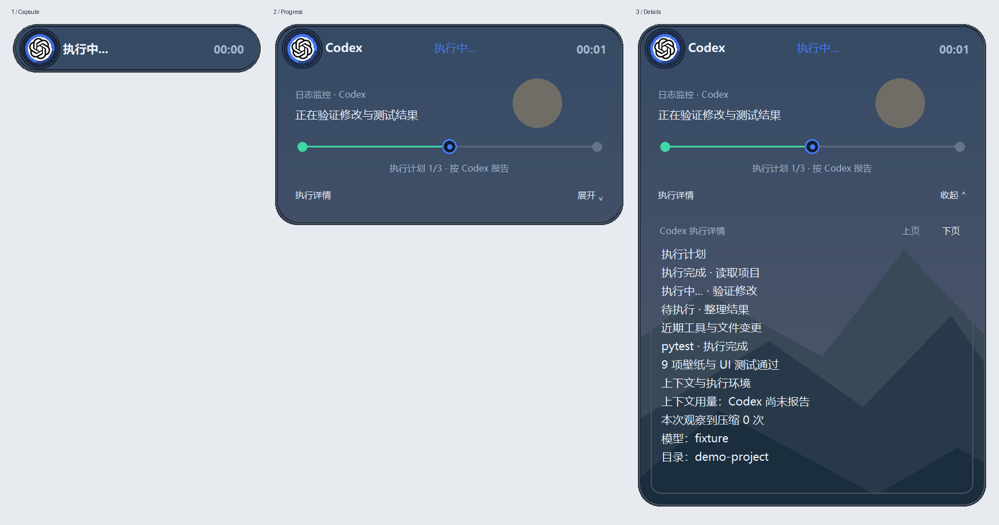
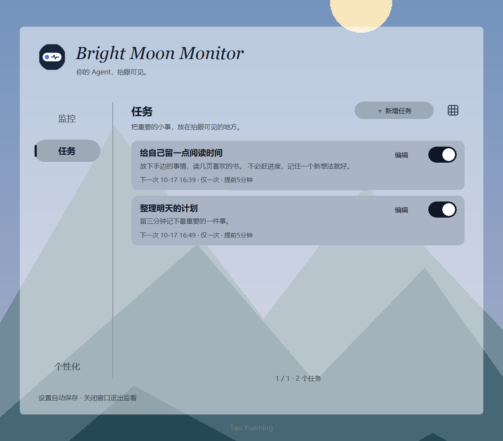
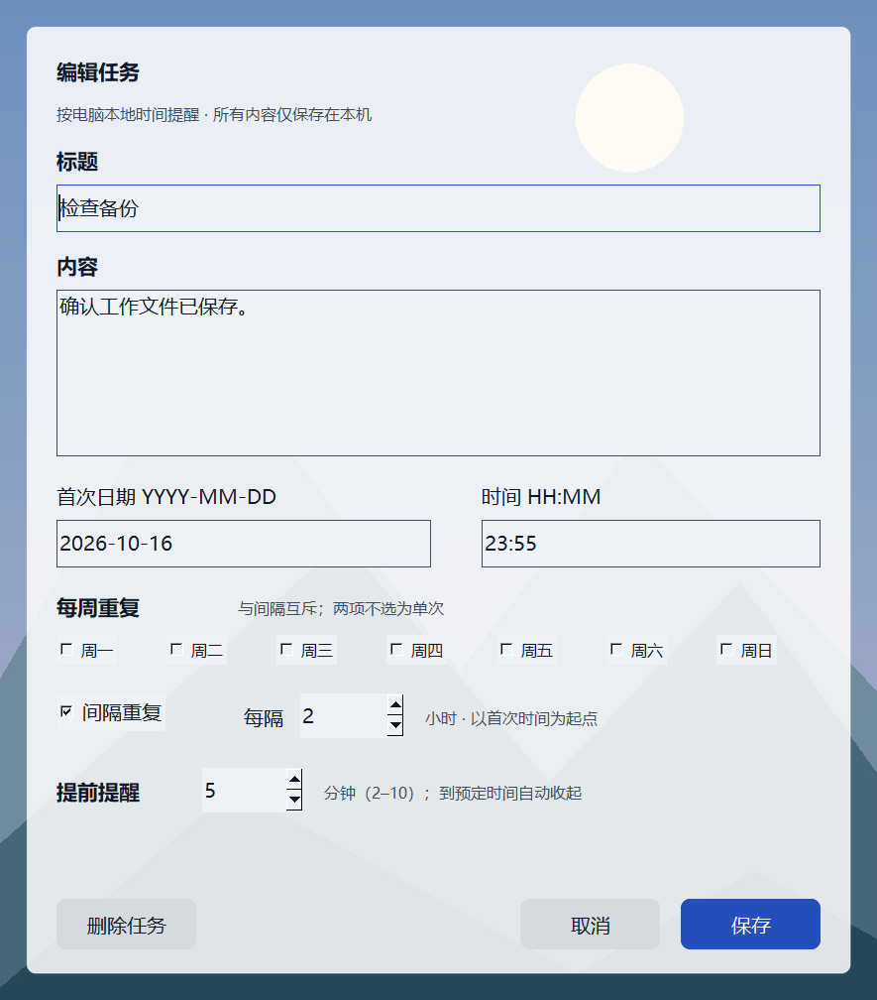
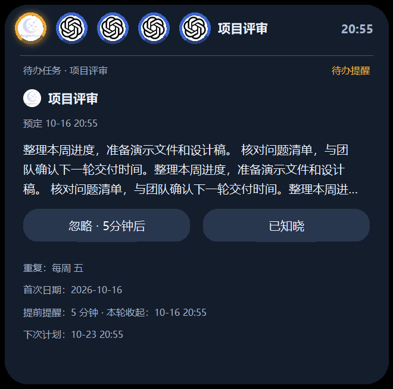
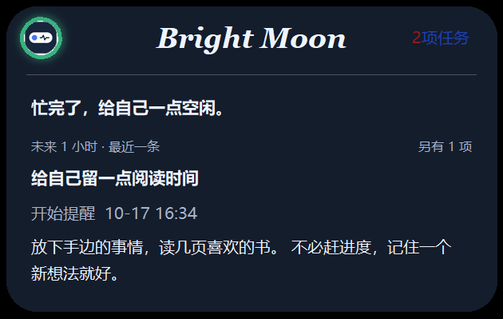
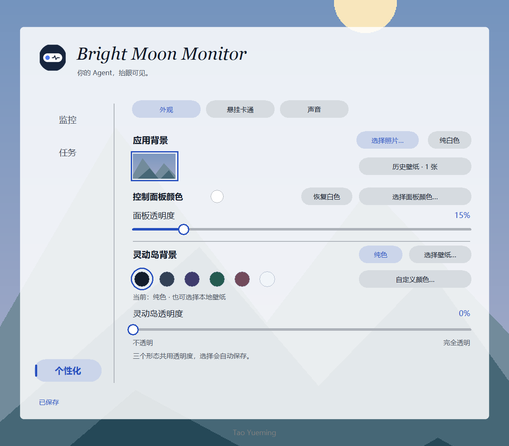
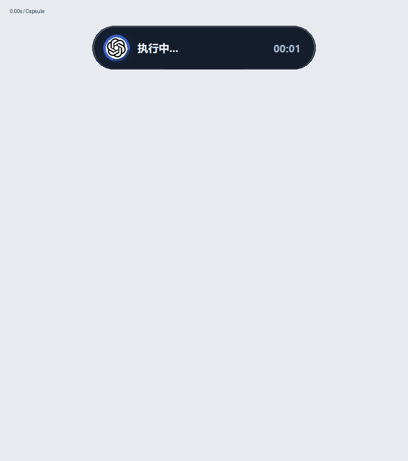
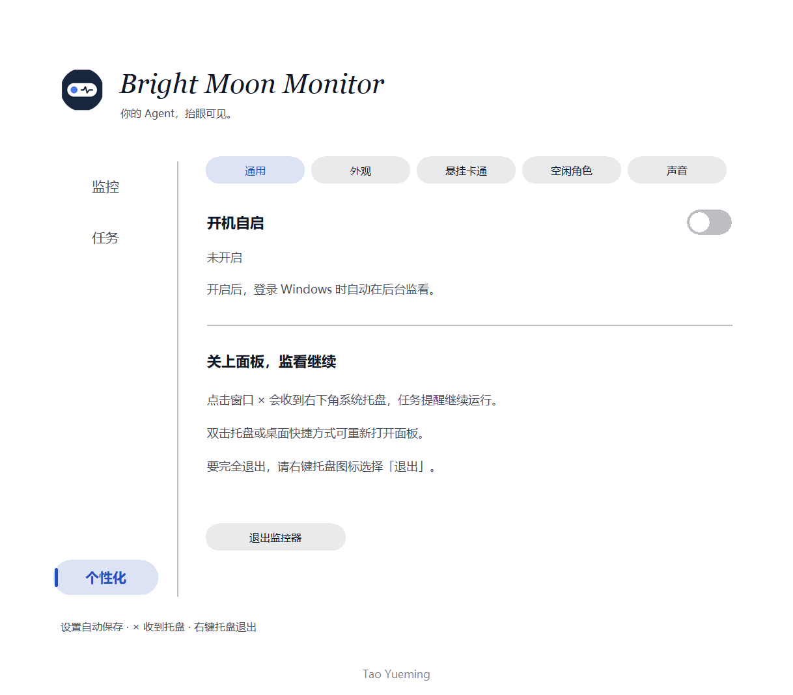

<p align="center">
  
</p>

<h1 align="center">Bright Moon Monitor · Solo</h1>

<p align="center">把 Agent 的进展和日常提醒，放进桌面上的一座小岛。</p>
<p align="center"><strong>Windows 桌面灵动岛 · 多来源监控 · 本地待办 · 自定义外观</strong></p>

<p align="center">
  
</p>

Solo 是独立运行的桌面监控器：集中查看 Agent 的任务状态，在来源支持实时交互时处理授权，也可以只用它管理本地提醒。不需要 BrightMoon 账户，不依赖 BrightMoon 主程序。

**当前版本：0.1.0 · Windows 10（1809+）/ Windows 11 · x64**

**[下载 Windows 安装包 ZIP](MonitorSolo-0.1.0-windows-x64.zip)** · **[下载校验文件](SHA256SUMS.txt)**

## 从胶囊到任务详情

第一形态展示来源 Logo、任务状态和计时；点击后展开进度卡片，再进一步查看来源提供的执行细节。来源不同，详情内容也会有所区别。

<p align="center">
  
</p>

- **多任务切换**：最多同时展示 5 个任务，点击顶部来源图标切换关注的任务。
- **状态一眼可见**：用指示灯、呼吸效果和文字区分运行、待处理、完成和失败等状态。
- **独立退场**：每条结束任务分别计时；正常结束任务保留时间可设为 1～10 分钟，失联等异常状态按相应规则退场。
- **跨重启去重**：保存已监控任务的显示记录，避免重启后反复弹出已结束的旧任务。
- **按能力交互**：实时连接具备相应能力时，提供审批、回答或停止入口；只有日志时显示只读状态。

> 图片来自界面预览与模拟任务，用于展示布局和交互。角色、壁纸和示例任务不是安装后的固定内容；请以所连接 Agent 实际提供的信息为准。

## 支持哪些 Agent？

- **Codex**：读取本机会话日志，并尝试发现本机 App Server。审批需要连接到任务所在的同一实时服务，且服务提供相应操作能力。仅能读取日志时，不提供可用的审批入口。
- **OpenCode**：通过本地数据库读取状态；授权、回答和停止等交互依赖可连接的实时服务与对应能力。
- **DeepSeek Harness**：支持本地会话日志监控；授权和答题需要额外安装可选交互桥。当前桥接适配目标是 **0.2.0-rc.2**，其他版本需要核实兼容性。
- **CodeAgent**：预留入口，当前尚未接入。

首次打开时，Agent 来源开关默认关闭。先安装并运行需要监控的 Agent，再在 Solo 的「监控」中开启对应来源；自动发现不成功时，可以在来源设置中指定数据位置。

Solo 不包含这些 Agent 本身，也不提供它们的账号、模型服务或 API。普通监控不会自动安装 Agent 或修改 Harness 的插件配置。DeepSeek 交互桥的操作说明可从安装后的开始菜单使用说明中查看。

## 本地待办，也能登上灵动岛

在「任务」中添加标题、内容和时间，选择单次、每周重复或每隔 N 小时重复。每周重复与按小时重复互斥，提醒提前量支持 **2～10 分钟**。

<p align="center">
  
  
</p>

到提醒时间后，待办优先于 Agent 任务显示。展开后可以选择：

- **忽略 · 5分钟后**：暂时收起，5 分钟后再提醒。
- **已知晓**：结束本次提醒，重复任务仍按下一次计划执行。

<p align="center">
  
</p>

任务列表支持列表/网格切换。待办提醒音与 Agent 完成音可以分别选择或关闭：待办每轮播放 3 遍，Agent 完成时播放 1 遍。

**提醒需要 Solo 保持运行。** 从托盘退出、电脑关机或睡眠期间不会提醒；重新打开只恢复仍在有效提醒窗口内的项目，不补发已经错过的历史提醒。

## 无任务时，留一点轻松的空间

打开「监控 → 灵动岛常驻」后，没有活动任务也可以保留小胶囊。顶部预告未来 **1 小时内开始提醒**的任务数量；展开后显示最近一条提醒的内容和时间，其余提醒以数量概括。没有符合条件的提醒时显示「无任务！」。

<p align="center">
  
</p>

常驻默认关闭。开启后，已结束任务仍按保留时间退场，最后一条退场时自动收回空闲胶囊。

## 外观由你决定

- **壁纸与颜色**：控制面板和灵动岛可以分别选择背景、颜色与透明度，历史壁纸可再次选择。
- **弹簧开合**：从胶囊展开卡片，壁纸随展开显示更多区域。
- **悬挂卡通**：自选图片与横向位置；点击挂件也能触发展开，伴随轻拉和渐入动画。
- **空闲角色**：独立控制开关，支持上传带透明背景的 PNG / WebP 抠图。
- **声音**：在「个性化 → 声音」选择并试听提示音。

<p align="center">
  
</p>
<p align="center">
  
</p>

## 安装与首次使用

1. 下载上方的 `MonitorSolo-0.1.0-windows-x64.zip`。
2. **先解压 ZIP**，打开解压后的文件夹。
3. 双击 `MonitorSolo-0.1.0-windows-x64-setup.exe`，按照向导安装。
4. 通过桌面上的 **Bright Moon Monitor (Solo)** 快捷方式或开始菜单启动。
5. 在「监控」开启需要的来源，或直接进入「任务」创建提醒。

安装版自带 Python/Tk 运行环境及应用所需依赖，**无需另装 Python、Conda 或 pip**。这不替代被监控 Agent 自身的安装要求。当前发行包面向 Windows x64，不是 macOS/Linux 安装包。

### 后台运行、开机自启和退出

<p align="center">
  
</p>

- 「个性化 → 通用」可开启自启，默认关闭。开启后在**当前用户登录 Windows 时**后台启动，不自动打开控制面板。
- 点击窗口右上角 **×** 收到系统托盘，监控和提醒继续运行。
- 双击右下角托盘图标或再次点击桌面快捷方式，可以唤回控制面板。
- **右键托盘图标 → 退出**，或点击「退出监控器」，才会真正结束程序。
- 托盘图标可能藏在任务栏的小箭头中；托盘不可用时，窗口会退回普通任务栏最小化。

### 数据、升级与卸载

设置、待办、图片和任务显示记录保存在当前 Windows 用户的本地目录：

```text
%LOCALAPPDATA%\MonitorSolo\data
```

可以将此路径粘贴到资源管理器地址栏。备份前先退出 Solo，再复制整个数据目录。

升级安装保留个人数据和自启选择。在 Windows「已安装的应用」或开始菜单卸载入口中卸载；默认保留个人数据，交互卸载时可选择删除。卸载不会删除被监控 Agent 的程序或会话。如安装过 DeepSeek 交互桥，请按使用说明先移除桥接，再卸载 Solo。

## SHA256SUMS.txt 是什么？

它是下载文件的**指纹清单**。文件内容发生变化，计算出的 SHA-256 通常也会变化，因此可以用来检查下载是否完整、是否与发布者提供的文件一致。它不是运行程序需要的依赖，不需要安装或双击执行。

本仓库顶层的 [SHA256SUMS.txt](SHA256SUMS.txt) 校验 **ZIP 压缩包**；ZIP 内部另有同名文件，校验**解压后的安装程序和安装说明**。两者校验对象不同，不要直接拿 ZIP 的指纹和 EXE 的指纹比较。

在下载目录打开 PowerShell，执行：

```powershell
Get-FileHash .\MonitorSolo-0.1.0-windows-x64.zip -Algorithm SHA256
```

将输出的 `Hash` 与顶层 `SHA256SUMS.txt` 中对应文件名前的值比较，忽略字母大小写。当前 0.1.0 ZIP 的预期值是：

```text
49089c56b03364ff2716423c64835fdbada50a2a6d0df9fb4d3742f79f9384d4
```

不一致时不要运行该下载文件，应从可信发布位置重新下载并核对。**哈希校验不等于数字签名，也不证明软件绝对安全**；需要信任提供校验值的来源。

## 常见问题

**打开后为什么没有灵动岛？**

默认在有活动任务或有效提醒时出现。可以打开「灵动岛常驻」预览空闲胶囊；首次使用还需要手动开启 Agent 来源。

**能看到状态，为什么不能点同意？**

日志只能提供状态。操作按钮依赖同一任务所在实时服务的连接与能力；Harness 还需要可选桥接。Solo 不会绕过 Agent 自身的授权机制。

**Windows 为什么提示未知发布者？**

当前安装程序尚未代码签名，Windows 可能出现未知发布者或信誉提示。请确认下载来源和校验值；不建议为了安装而关闭系统安全防护。

**当前版本测试到了什么程度？**

0.1.0 构建记录为 285 项自动化测试通过，冻结程序自检与本机安装、升级、卸载验收通过。尚未完成独立干净 Windows 虚拟机、真实重启登录及所有 Agent 版本的交互验收，不代表所有环境都已验证。

**如何反馈问题？**

可在本仓库 Issues（如已开启）说明 Windows 版本、Solo 版本、Agent 名称与版本、复现步骤和预期结果。截图及日志请先去除账号、密钥和私人会话内容。

---

<p align="center">Bright Moon Monitor · Solo<br>关注进展，也给桌面留一点温柔。</p>
