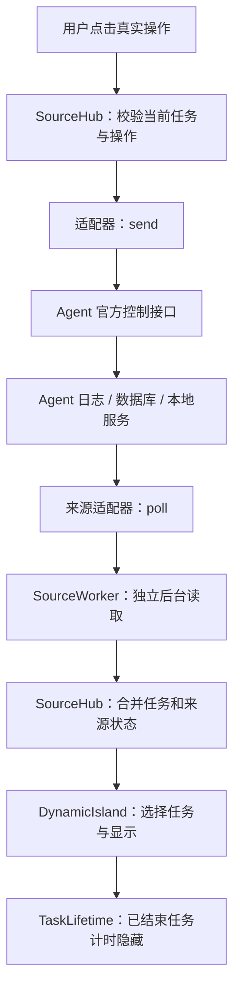

# 在 Bright Moon Monitor 中实现 Agent 监控

本文面向接入新 Agent 的开发者，说明如何从本地日志、数据库或实时服务读取任务，转换成灵动岛状态，并在来源确实支持时接入授权与答题。最后给出公司 CodeAgent 的落地步骤。

当前工程位于 `monitor_solo/`，它是独立项目。下文所有路径均相对此目录。应用作者：**Tao Yueming**。

## 1. 先明确监控的数据边界

监控的第一步，是找到 Agent 实际输出的任务事实。进程存在不等于正在执行任务，终端一段时间没有输出也不等于执行完成，出现工具调用也不等于正在等待用户授权。

建议先确认以下问题，再写 UI：

1. 什么事件表示一轮任务开始？会话与任务是否有独立 ID？
2. 完成、失败、取消是否有明确事件？任务暂停和等待授权如何区分？
3. 事件有顺序号、时间戳和格式版本吗？日志是否压缩、轮转或截断？
4. Agent 能否同时执行多轮任务、子任务或多个工作目录的任务？
5. 是否有官方查询接口、插件接口或事件流？
6. 授权和问题是否有独立请求 ID、可选决定、版本号及处理回执？
7. 能读取哪些文件？能调用哪些本地接口？哪些内容应排除？

一般优先使用官方事件流和查询 API，再选择稳定的本地日志或只读数据库。读取窗口标题、像素和进程列表只能提供有限辅助信息，不能承担任务状态的主要依据。

监控仅保留展示所需字段：任务身份、时间、状态、工具名、简短摘要和必要的操作信息。不要直接把整个事件对象塞进 UI，也不要收集密钥、账户凭据、原始推理内容或不相关聊天记录。

## 2. 工程中的数据路径



职责分布：

- `monitor/app.py`：主窗口、来源设置、照片导入、提示音选择。
- `monitor/settings.py`：规范化与原子保存设置；不负责读 Agent 日志。
- `monitor/UI/settings_panel.py`：主面板绘制和输入；左侧“监控 / 个性化”标签切换右侧内容，启动默认打开监控页；照片与圆角底色合成，文字和控件独立绘制。
- `monitor/src/source_config.py`：合法来源、启用开关、数据路径、连接模式。
- `monitor/src/source_hub.py`：创建、关闭来源，隔离后台读取，合并快照，校验并路由操作。
- `monitor/<provider>_monitor/`：来源专属采集、协议解析、状态转换与详情面板。
- `monitor/UI/island.py`：统一灵动岛外观、动画、任务切换和完成提示音。
- `monitor/UI/task_selection.py`、`task_lifetime.py`：选择与显示生命周期。
- `monitor/src/app_sources.py`：来源名称和可信本地图标路径。

每个启用的来源都有自己的后台工作线程，约每 0.7 秒读取一次。某个来源阻塞不会拖住其他来源的读取。Tk 线程只读取缓存快照；不要在绘制函数里扫描磁盘、查询进程或连接网络。

## 3. 先选择采集方式

### 3.1 追加日志 / JSONL

适合 CLI、编程代理和已有结构化会话记录的 Agent。

实现时保存文件身份、字节偏移和未完成的一行。只有读到完整换行后才能解析一条事件；下一次继续读取剩余内容。不要每 0.7 秒重新读取全部历史。

必须处理文件被截断、替换或轮转；否则偏移落在新文件末尾以后会永久丢数据。应限制单次读取字节数、文件数和返回任务数。编码、格式版本、会话 ID 或序列号不一致时，应报告数据异常而不是猜测。

DeepSeek Harness 的默认日志可能是连续的带校验和 Zstandard 帧，不等同于一个普通 JSON 文本。参考 `deepseek_monitor/log_reader.py` 和 `projection.py`，保留压缩格式校验及读取预算。

### 3.2 本地 SQLite 数据库

适合有 session、message、part、todo 等关系表的桌面 Agent。

使用只读连接、有限查询、明确排序和受支持的 schema 版本；兼容 WAL 和短暂锁定。不要为了监控去写业务表，也不要把 `tool.pending` 自动当成用户授权。

OpenCode 的实现可参考 `opencode_monitor/bridge.py`：数据库用于任务快照，实时本地服务补充授权、问题和状态。当前任务的耗时应从最新一轮用户任务开始，而不是从整个会话首次创建时间开始。

### 3.3 本地 HTTP / WebSocket 服务

适合能公开实时事件、任务快照和交互操作的 Agent，是接入公司 CodeAgent 时较推荐的方式。

至少需要首次快照、增量事件、断线恢复和明确的实例 ID。先拉快照，再按序处理增量；重连时查询未确认任务，避免漏掉断线期间的完成事件。

网络调用必须有超时和消息大小限制。自动发现仅连接已识别的本机服务；不要把扫描到的任意端口当作可信 Agent。需要鉴权时使用专用的本地配对协议，不读取或复用 Agent 的账户登录令牌。

Codex 可参考 `codex_monitor/app_server.py`、`discovery.py`。只有连接到提供真实请求的同一个 App Server，才具备处理该请求的能力；读取桌面会话日志不会自动获得授权回复能力。

### 3.4 Agent 插件 / 本地交互桥

若只读日志能显示任务，但没有控制接口，可以通过 Agent 官方插件机制实现一个可选桥。

DeepSeek 的 `deepseek_monitor/bridge/` 是此模式：插件从真实交互网关读取待处理请求，在回环地址上公开有限操作。每次启动产生独立实例身份和配对凭据，描述文件位于本项目的 `deepseek_monitor/runtime/`。

普通监控开关不安装插件、不修改来源应用。插件安装由用户按 README 手动执行。公司 CodeAgent 如果可修改源码，优先直接公开受支持的监控接口，减少桥接兼容成本。

## 4. 把事件变成稳定的任务状态

为一个会话中的每一轮任务创建单独的 `run_id`。推荐形式：

```text
codeagent:<实例标识>:<会话ID>:<轮次ID>
```

同一轮任务的 ID 在正常轮询、断线恢复和摘要更新期间保持不变；新的一轮不能复用旧 ID。多个来源必须使用不同前缀，否则任务选择、隐藏和授权可能互相覆盖。

常见状态流转：

```text
queued → running → waiting_model → running → completed
                  ↘ waiting_confirmation → running
                  ↘ waiting_input        → running
running → cancellation_requested → cancelled
running → failed / partial / blocked / budget_exhausted
```

使用 `UI/window_state.py` 中的状态集合。活动状态包括运行、排队、等待模型、待授权、待回答和暂停。结束状态包括 `completed`、`partial`、`blocked`、`budget_exhausted`、`failed`、`cancelled`。

关键规则：

- `started_at` 是这一轮任务开始的时间，建议使用带时区的 ISO 8601。
- `updated_at` 是最后一次真实业务事件的时间。普通心跳不要伪造为业务更新。
- `ended_at` 在明确结束时写入，之后摘要补充不能修改。
- 较晚到达的旧轮次结束事件不能结束新轮次。
- `waiting_confirmation` 必须来自真实授权请求；普通工具队列不能产生授权按钮。
- 断线是连接事实，不能写成“任务成功”。保留最后可信状态，并设置 `connection_error` 或来源错误状态。
- 首次启用默认不灌入所有历史完成任务；可以显示当前活动任务，以及本次监控已经观察到的任务完成状态。
- 进度百分比只能来自明确的总量；没有总量时显示阶段、已执行工具和真实状态。

任务结束后的隐藏是显示层行为。目前用户可选择 **1～10 分钟**。`TaskLifetime` 为每个结束任务独立计时，使用首次可信结束时间；隐藏不会取消任务或删除来源记录。仍在运行或等待用户的任务不会因这个设置而隐藏。

## 5. 适配器的最小接口

新来源通常实现下面三个方法：

```python
class CodeAgentSource:
    def __init__(self, config):
        # config 已通过 source_config 的验证。
        # 初始化游标、连接对象、状态转换器；不修改来源的业务数据。
        ...

    def poll(self) -> dict:
        # 有限读取，应用新增事件，返回当前快照。
        ...

    def send(self, action: str, run_id: str, payload: dict):
        # 可选。只读来源可以不实现；此时 actions 必须为空。
        ...

    def close(self):
        # 释放自己的文件、连接、线程或订阅；不要终止来源 Agent。
        ...
```

`poll()` 的示例结果：

```json
{
  "status": "ready",
  "message": "已连接本机 CodeAgent",
  "read_only": true,
  "session_count": 1,
  "runs": [
    {
      "run_id": "codeagent:instance-a:session-1:turn-3",
      "app_id": "codeagent",
      "status": "running",
      "started_at": "2026-10-15T10:00:00+00:00",
      "updated_at": "2026-10-15T10:00:08+00:00",
      "task_summary": "运行项目测试",
      "message": "正在执行测试",
      "summary_preview": "",
      "steps": [],
      "tools": [],
      "pending_confirmations": [],
      "confirmations": []
    }
  ],
  "actions": []
}
```

顶层 `status` 描述连接健康程度，任务自己的 `status` 描述执行状态。两个层次不要混用。`runs` 和 `actions` 始终是列表；没有数据时返回空列表，而不是返回 `None`。

`SourceHub` 会为任务附加来源身份、转换排序时间，并计算当前活动任务。关闭或重新指定来源会立即丢弃旧 worker 的结果，因此旧连接即使稍后返回也不会重新显示。适配器仍应为 I/O 设置有限超时，确保后台资源最终释放。

## 6. 为 CodeAgent 设计一个可落地的只读协议

以下是建议的协议，**不是公司 CodeAgent 已存在的接口**。可以先在 CodeAgent 中实现一个原子更新的本地 `monitor.json`，或者提供同样结构的 `GET /v1/monitor/snapshot`。

```json
{
  "schema_version": 1,
  "instance_id": "generated-on-process-start",
  "revision": 42,
  "tasks": [
    {
      "session_id": "session-1",
      "turn_id": "turn-3",
      "state": "running",
      "started_at": "2026-10-15T10:00:00+00:00",
      "updated_at": "2026-10-15T10:00:08+00:00",
      "ended_at": null,
      "title": "运行项目测试",
      "summary": "",
      "current_tool": "run_tests"
    }
  ]
}
```

生产端先写临时文件，flush 后再原子替换目标文件。网络端返回同样的完整快照并提供修订号。任务列表应有边界，实例 ID 在进程重启时变化，修订号在同一实例内单调递增。

消费端逐步实现：

1. 读取不超过固定大小（例如 2 MiB）的完整快照，并拒绝未知 `schema_version`。
2. 校验顶层字段和每项任务类型；限制 ID、标题和摘要的长度。
3. 为同一实例拒绝倒退的 `revision`，避免旧快照覆盖新任务。
4. 映射白名单中的 `state`，为每轮组合唯一 `run_id`。
5. 仅复制展示白名单字段，`current_tool` 变成简短状态文本。
6. 记录本次已观察任务，对历史完成任务做启动过滤。
7. 所有操作能力尚未实现时，固定返回 `actions: []` 和 `read_only: true`。
8. 增加异常恢复、轮转/重启处理和上限测试，再接入 UI。

可以先完成“监看任务”，之后再扩展控制协议。不要为了让界面按钮看起来完整而先创建没有真实接口的审批操作。

## 7. 授权、答题与停止：如何保证操作对应正确任务

如果来源有真实控制接口，一个授权请求至少需要：任务 ID、请求 ID、实例 ID、请求版本、允许的决定集合和当前状态。展示的内容发生变化时，请求版本必须变化。

适配器返回的授权示例：

```json
{
  "runs": [{
    "run_id": "codeagent:instance-a:session-1:turn-3",
    "status": "waiting_confirmation",
    "pending_confirmations": [{
      "id": "approval-8",
      "status": "pending",
      "revision": 7,
      "requested_at": "2026-10-15T10:00:08+00:00",
      "tool_name": "write_file",
      "arguments": {"path": "src/example.py"}
    }]
  }],
  "actions": [{
    "type": "approve_tool",
    "label": "同意一次",
    "run_id": "codeagent:instance-a:session-1:turn-3",
    "confirmation_id": "approval-8",
    "expected_revision": 7
  }]
}
```

上例省略了任务时间等已在上一节说明的字段。通常也要把待处理请求同步投影到 `confirmations`，以便 UI 根据回执撤下按钮。

用户点击后有两层校验：

1. `SourceHub.send()` 重新读取当前缓存快照，确认任务存在、连接正常，而且操作仍在 `actions` 中；带授权 ID 的操作还要核对版本。
2. 适配器 `send()` 必须再次向来源核对请求身份、版本、实例和允许的决定。Hub 的校验不能代替服务器校验，因为点击和发送之间来源可能已经变化。

来源原窗口已经处理、请求已过期、连接重建产生新实例、开关已关闭时，都应拒绝旧卡片操作。失败后不要自动重发授权，因为第一次请求可能已成功但响应丢失。

HTTP 200 只表示请求处理成功，不一定表示任务已继续执行。建议返回 `command_id`，随后在快照中投影 `command_receipt`，例如：

```json
{
  "command_id": "decision-unique-id",
  "status": "confirmed"
}
```

拒绝时使用明确的 `rejected` 状态和原因；来源支持幂等键时，应将 `command_id` 作为幂等标识。同一命令重复到达不能重复执行。

答题还需要题目 ID、选项 ID、是否允许多选、是否允许自定义回答以及题目版本。每一题都必须验证，不能只凭显示文字定位选项。停止请求同样应作用于明确的一轮/会话，不能通过枚举进程去批量终止 Agent。

## 8. 在项目内注册 CodeAgent

目前 CodeAgent 是预留项，已有 `icon_asset/Codeagent_logo.png`，界面不允许开启。实际协议完成后进行以下修改：

1. 新建 `monitor/codeagent_monitor/`，包含 `__init__.py`、`adapter.py`、必要的采集/状态转换文件和 `panel.py`。
2. 在 `monitor/src/source_hub.py` 的 `source_factories()` 中导入 `CodeAgentSource`，加入 `"codeagent": CodeAgentSource`。配置文件里不能存任意 Python 导入路径。
3. 在 `monitor/src/source_config.py` 的 `PLACEHOLDERS` 中移除 `codeagent`；如需新字段，在 `normalize_sources()` 中增加有限验证，不要直接放行未知配置。
4. `monitor/src/app_sources.py` 已注册名字和图片，可直接沿用。来源日志不得控制图标的文件路径。
5. 在 `monitor/UI/detail_panels.py` 注册 `CodeAgentPanel()`，实现 `header`、`size`、`draw`、`rows`、`summary_lines`。
6. 在 `monitor/UI/settings_panel.py` 移除 CodeAgent 的禁用/“即将接入”分支，让它使用正常的开关和设置入口；在 `app.py` 中增加来源设置说明和连接状态。
7. 编写测试并更新 README。未通过真实协议验证前，不默认启用该来源。

面板只消费统一任务模型和来源专属的已过滤数据。共用 UI 不应理解公司内部执行器阶段；阶段解释放在 CodeAgent 自己的 panel/projection 中。

## 9. 背景、保留时间、提示音与监控逻辑的关系

这些是用户显示偏好，不能改变来源任务的执行语义。

- `monitor_hide_minutes`：整数 1～10，决定完成任务的显示期限。
- `panel_transparency`：0～100，默认 50。有照片时，面板白色底的覆盖率为 `1 - transparency / 100`；无照片时保持纯白背景。文字和图标不参与底色透明合成。
- `monitor_background_color`：灵动岛底色，六位十六进制 RGB，例如 `#141d2c`。个性化页面提供预设色和系统颜色选择器；灵动岛根据底色明暗选择文字颜色。
- `monitor_opacity`：灵动岛窗口不透明度，整数 0～100，默认 100。界面展示的是“透明度”，值为 `100 - monitor_opacity`；Tk 窗口的 `-alpha` 为 `monitor_opacity / 100`。此设置影响整个灵动岛窗口，与主面板的照片合成透明度相互独立。完全透明后可从个性化页面调回。
- `monitor_completion_sound`：本地 `monitor/music/` 中的声音 ID。完成提醒与 OpenCode 待处理提醒使用当前选择。
- `monitor_sound_enabled`：控制实际任务提醒。用户主动点击“试听”可以试听声音，不改变选中的声音或开关。
- `background_photo`：项目 `data/` 下的相对路径。照片导入后，移动原照片不影响应用背景。

设置由 `SettingsStore.update()` 验证、写临时文件、原子替换。写入失败时保留上一次有效状态。适配器不要自己覆盖整个 `settings.json`，避免丢失其他来源和外观配置。

灵动岛颜色或透明度保存成功后，主窗口立即触发一次灵动岛快照刷新，应用新调色板与窗口透明度。没有任务时灵动岛仍保持隐藏，新任务出现时使用已保存的外观。标签选择只存在于当前界面，不持久化，保证每次启动都回到监控页。

## 10. 验证步骤与验收标准

先用人工构造的事件和临时目录测试，避免单元测试控制真实 Agent。

至少覆盖：

1. 启动、等待模型、工具调用、完成、失败、取消的正常转换。
2. 同会话新一轮与旧一轮事件交错；多个来源和多个任务并行。
3. 半行日志、截断、轮转、坏压缩帧、未知版本、重复或乱序事件。
4. 初次连接过滤旧完成任务；断线期间完成的已观察任务可以恢复。
5. 一个来源读取慢或抛错时，其他来源和窗口仍可响应。
6. 关闭来源后立即移除其任务与操作；旧 worker 返回不能重新发布。
7. 授权 ID/版本不匹配、原窗口先回答、重复命令、断线重连均不误执行。
8. 每个结束任务独立隐藏；活动任务和待授权任务持续显示。
9. 切换提示音只改变声音配置，试听不会提交任何 Agent 操作。
10. 将项目复制到没有父工程的目录后仍可启动与导入全部模块。

当前测试入口：

```powershell
python -m pip install -r requirements-dev.txt
python -m pytest tests -q
node --test monitor/deepseek_monitor/tests/bridge.test.mjs
```

最后进行一次人工联调：启动来源 Agent → 开监控 → 发起一个无副作用任务 → 确认任务出现 → 观察完成 → 验证保留时间 → 关闭来源。若增加交互能力，再使用专门的测试工程逐项验证批准、拒绝、答题和停止，核对来源原窗口的真实结果。

测试日志应记录来源 ID、错误类型和协议版本，不记录访问凭据和用户完整提示词。发布时把用户配置、个人照片、会话日志和运行时桥描述文件排除在版本库之外。

## 11. 常见问题定位

**开关已开启但没有任务：** 确认数据路径、首次历史过滤、任务 ID 和真实开始事件。先检查 `poll()` 是否返回活动任务，再看 Hub 是否启用了正确来源，最后看 UI 是否提前判定为结束。

**任务一直不消失：** 检查是否收到真实结束状态、`ended_at` 是否被每次轮询重写，以及任务是否仍被投影为活动状态。

**任务过早消失：** 检查时间单位（毫秒/秒）、时区、旧轮次结束事件和重复使用的 `run_id`。不要用进程存活或文件更新时间代替业务状态。

**能监控但不能审批：** 只读日志没有控制能力。检查实时接口或交互桥是否连接、请求是否属于同一个服务实例，以及操作是否仍被来源提供。

**关闭来源后又出现旧任务：** 检查旧线程是否绕过了当前 worker 的发布边界、是否共享了其他来源的可变快照。返回的任务模型应是可复制的数据，不包含 Tk 对象或连接对象。

**移动项目后失效：** 应用自己的资源必须通过 `__file__` 定位；用户照片使用项目相对路径。外部 Agent 的自定义数据目录仍是本机路径，需要按新电脑实际位置设置。Harness 插件若链接到旧目录，需要重新安装链接。

## 12. 任务退场与跨启动去重接口

已加入 Solo 自有的 SQLite 显示记录，完整规则见 [TASK_LIFECYCLE.md](TASK_LIFECYCLE.md)。
`poll()` 的 run 可增加 `monitor_task_id` 统一多个连接中的同一逻辑任务，增加 `completion_id` 或 `turn_id`
区分同一会话的不同轮次。若提供 `monitor_activity_id`，必须只随真实执行事件变化，重连、标题或心跳
不得改变它；空值意味着暂时没有执行证据，防止旧历史补载被当作继续执行。

适配器继续发布源事实，不应为绕过 UI 去重随机修改 run_id 或 started_at，也不要写入显示数据库。
连接不可达时使用 connection_error 并撤销 actions；明确的终态保留原值。共享层负责一分钟退场、
候选过滤、焦点转移与恢复；不会调用来源的停止方法。主题边线已与背景和窗口透明度一起更新。
