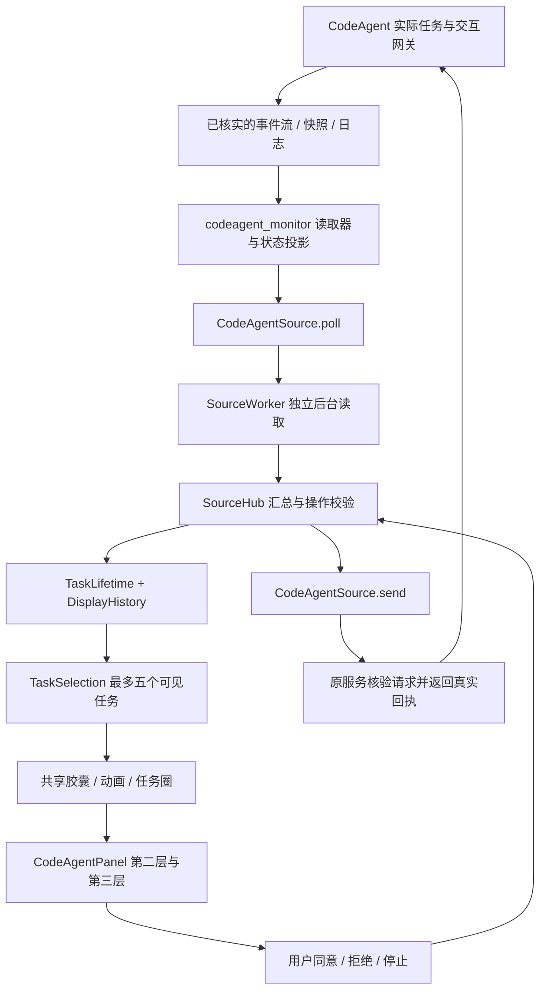

# CodeAgent 接入 Solo 灵动岛：新手开发与测试指南

更新：2026-10-16。读者：负责公司 CodeAgent 的开发者，或在公司电脑上协助开发的 CodeAgent。

**本文是接入指导书，并不表示 CodeAgent 已经接入。** 本次只新增文档和 README 入口，没有启用监控、修改公司 Agent、启动服务或提交审批。文中的 test cases 指“测试用例”，不是一个名为 test cease 的工具。

除特别说明外，本文路径都相对于 `monitor_solo/`。这个目录可以独立复制使用，不需要 BrightMoon 账户、登录、后端或父项目。这里的 `monitor` 指 **Solo 内部的包**，不要误改父项目的同名目录。

阅读路线：第一次了解时先看第 1～3 节和第 8 节；直接交给公司 Agent 时使用第 14 节任务说明；开发时按第 4～10 节操作；测试时使用第 11～12 节。没有公司安装环境也能先运行第 12 节的 5 个练习。

## 1. 新手先理解：需要连接的是数据，而不是一个窗口

监控体系分成三件事：

1. **读取事实**：CodeAgent 正在执行哪一轮任务、哪一个工具，是否等待授权，是否真正结束。
2. **转换数据**：把 CodeAgent 自己的日志或服务协议转换成 Solo 能理解的任务快照。
3. **呈现与回传**：共享灵动岛负责动画和任务切换；CodeAgent 面板负责详情；只有真实控制通道可用时才回传同意、拒绝或停止。

“看到了 `.cac` 目录”只能证明找到了一个候选数据位置，不能证明那里有实时事件或审批接口。读取历史记录可以实现只读监控；要在岛上授权，还需要连接**产生该请求的同一个服务或交互网关**。另开一个服务通常不能控制已有终端中的任务。

建议按本文顺序操作：先确认协议 → 写入脱敏样本 → 实现适配器与测试 → 注册设置和面板 → 在隔离测试工程联调。没有公司协议资料时，可以先完成共享层的练习测试，不应猜测 URL、端口、数据库表或日志字段。

完成接入的目标是：任务开始自动出现；状态、步骤和工具结果准确；授权不串任务；结束、失联、暂停按规则收起；重启不重播旧任务；现有 Codex、DeepSeek Harness、OpenCode 的显示不受影响。

## 2. 已知信息与必须核实的信息

### 2.1 已核实的 Solo 代码

- `monitor/src/source_config.py` 已有 `codeagent`，但它在 `PLACEHOLDERS` 中，开启会被拒绝或规范化为关闭。
- `monitor/src/source_hub.py` 的 `source_factories()` 目前只注册三种真实来源，没有 CodeAgent。
- `monitor/UI/settings_panel.py` 将 CodeAgent 开关禁用，并隐藏它的设置入口。
- `monitor/app.py` 的来源设置说明、状态刷新尚未支持 CodeAgent。
- `monitor/src/app_sources.py` 已注册 CodeAgent 名称及 `monitor/icon_asset/Codeagent_logo.png`。
- `monitor/UI/detail_panels.py` 已提供来源专属面板接口；当前没有 CodeAgent 面板。
- 任务去重、跨重启持久化及退场逻辑已经存在，应直接复用，详见 [TASK_LIFECYCLE.md](TASK_LIFECYCLE.md)。

### 2.2 用户提供的安装线索

公司 Agent 名为 CodeAgent；用户目录下有 `.cac`，包含 `server`、`server-env`、`seeions` 等目录。**这些是用户提供的线索，不是本次读取到的安装事实**：本次环境中未找到所述 `.cac`，因此无法确认版本、目录拼写或接口。

在公司电脑上逐项核实：

- `server` 是源码、已构建服务、缓存，还是运行数据？目录名不能证明正在监听 HTTP。
- `server-env` 是 Python 虚拟环境、依赖目录，还是其他内容？不要将其默认当成环境变量配置，也不要递归扫描整个依赖目录。
- 会话目录实际叫 `seeions`、`sessions`，还是另一个名称？按实际名称配置；不要创建、重命名目录来“修正”猜测。
- CLI、桌面程序和服务各自的版本是什么？它们是否共享会话存储与审批通道？

以下内容全部**待公司环境核实**：监听方式、鉴权、事件结构、会话/轮次标识、日志编码与轮转、心跳或租约、取消和审批 API、插件能力。本文后面的协议样例是建议格式，不是已经存在的公司接口。

## 3. 在公司电脑上收集最小证据

### 3.1 只查看目录名称和类型

在 PowerShell 执行以下只读命令。若公司使用自定义目录，将 `$cacRoot` 改为实际路径。

```powershell
$cacRoot = Join-Path $env:USERPROFILE '.cac'
if (Test-Path -LiteralPath $cacRoot -PathType Container) {
    Get-ChildItem -LiteralPath $cacRoot -Force |
        Select-Object Name, Mode
    foreach ($name in @('server', 'server-env', 'sessions', 'seeions')) {
        $candidate = Join-Path $cacRoot $name
        if (Test-Path -LiteralPath $candidate -PathType Container) {
            Write-Output "候选目录：$name"
            Get-ChildItem -LiteralPath $candidate -Force |
                Select-Object -First 20 Name, Mode
        }
    }
} else {
    Write-Output '未找到默认 .cac，请核实实际数据目录。'
}
```

不要把 `server-env`、`.env`、账户配置、认证缓存或完整业务会话直接输出到报告。目录不存在时给出诊断，不扫描整个硬盘，不要求安装新服务。

### 3.2 在确认的源码范围内找入口

先查看清单，再打开少量已确认不含密钥的说明、包元数据或源文件。下面的命令只列出候选文件，不执行它们，也不打印匹配行：

```powershell
$cacServer = Join-Path $cacRoot 'server'
if (Test-Path -LiteralPath $cacServer -PathType Container) {
    rg --files $cacServer -g 'README*' -g 'package.json' -g 'pyproject.toml' -g '*openapi*' -g '*protocol*' -g '!**/node_modules/**' -g '!**/site-packages/**' -g '!**/.venv/**'
    rg -l --glob '*.py' --glob '*.ts' --glob '*.js' --glob '*.mjs' --glob '!**/node_modules/**' --glob '!**/site-packages/**' --glob '!**/.venv/**' 'WebSocket|text/event-stream|approval|permission|session|turn_id|jsonrpc' $cacServer
}
```

`rg` 是文本搜索工具。未安装时，可以在编辑器中对确认的源码目录搜索相同词语。若只有打包二进制，应索取公司提供的接口说明或插件文档；不要因找不到文本就假定使用 Codex、OpenCode 或 DeepSeek 的协议。

建立 `docs/codeagent_protocol_evidence.md`（**后续开发时创建，本次未创建**），每项记录“结论、版本、证据文件/符号、脱敏字段、验证结果、未知项”：

1. 启动入口与服务生命周期；监听地址或 IPC 描述文件如何发现。
2. 一个会话中的两轮任务如何区分；服务重启后这些 ID 是否保持。
3. 一轮完整任务的开始、工具开始、工具结束、最终结果事件。
4. 真正的待授权、待回答、人工停止和程序崩溃分别留下什么事实。
5. 快照与事件顺序号、恢复游标、实例 epoch、格式版本。
6. 同意、拒绝、停止的请求/响应；原界面先处理时的冲突结果。
7. 可用能力与鉴权方式；是否允许只读订阅或多个客户端订阅。
8. 日志是否有半行、UTF-8、多文件、压缩、截断、数据库 WAL；运行时数据是否可能长期保留旧 running。

采样使用专门的测试工程和无敏感内容的任务，保留字段结构，替换账号、路径、业务文本、凭据。不要为查看帮助而直接导入未知服务模块；有些模块导入时会启动服务或执行迁移。

## 4. 监控体系与接入方式



采集方案按实际能力选择：

- **已有官方本地服务**：复用已运行实例的快照和事件流，核实它与用户正在使用的 CLI 是同一服务。HTTP、WebSocket、SSE、命名管道都可以，不能仅凭目录名选择。已有 stdio RPC 由原客户端独占时，不能直接抢读它的流，应使用官方多客户端能力或插件桥。
- **只有结构化会话日志或数据库**：只读解析，`read_only: true`、`actions: []`。可以显示真实待授权记录，但提示“请在 CodeAgent 中处理”，不能写日志伪造同意。
- **可改公司源码或有官方插件机制**：在原任务事件、工具结果和授权网关上发布最小监控事件，控制端仍调用原权限校验逻辑。监控异常不得阻塞 Agent 主循环；使用有限队列，溢出时重新同步快照。
- **只有终端文字或进程列表**：只能提供粗略连接诊断，不能承诺准确进度和审批。应先补结构化数据出口。

本地桥仅作为可选实现。若新增 HTTP 服务，默认只绑定回环地址，并使用公司认可的本地配对机制；拒绝不受信任的 Origin/Host 和跨站写请求。配对凭据不写普通设置或测试报告，不复用模型 API Key。发现端口后先验证协议、版本和实例身份；不要扫描任意服务后发送命令。普通监控开关不安装插件、不激活 `server-env`、不运行配置路径中的程序。

### 4.1 快照和增量如何不丢事件

初次订阅需要建立一致的边界：服务提供带游标的快照，再读取该游标之后的事件；或先缓冲事件、再读取快照并丢弃不晚于快照的重复事件。直接“先读快照，过一会儿才开始监听”会丢失中间的审批/完成事件。

事件应有可去重的 ID 或序列号；重复事件不得重复加工具、步骤或播放提示音。旧序列不能覆盖新状态。发现缺口、游标失效或服务 epoch 改变时重新拉取快照并核对当前请求，不继续提交旧操作。多任务并行时，按每轮任务保留状态，不能用一个全局 current_task 覆盖全部任务。

日志读取保存文件身份、字节偏移、未完成行和解码状态，处理半个 UTF-8 字符、轮转与截断；SQLite 使用只读连接，不改业务表、不复制一个正在写入的主库文件来代替正确的 WAL 读取。初次补载、重连补载和真正的新事件必须能区分。

### 4.2 连接健康不等于任务是否输出文字

服务有心跳/租约时使用其协议判断健康；重连采用有上限的退避。任务等待模型很久、长时间执行工具、等待人工批准，都不等于失败。

仅日志模式没有通用的“几秒无输出就失败”规则。需要公司协议确认的进程实例/租约/结束事件等证据；证据不足时显示“状态待核实/只读”，超过约定的新鲜度窗口可以标记 `connection_error` 或 `stale`，但不声称任务已被取消。必须在协议证据文档中记录阈值来源。

读取失败保留最后可信任务快照，撤销操作，不返回一个看似成功的空任务列表来隐藏故障。一次局部文件损坏应尽量只影响对应任务，不污染其他会话：此时保留其他合法任务，只标记受影响 run。当前 Hub 对顶层 `status: error` 的处理是用该来源的整个旧缓存替换结果，所以局部错误不能不加区分地升级为整个来源 error。

## 5. 文件划分与职责

建议新增以下文件，按实际协议选用，不要求为不存在的协议创建空模块：

```text
monitor/codeagent_monitor/
  __init__.py
  adapter.py        CodeAgentSource，提供 poll/send/close
  discovery.py      限定范围内发现 .cac 数据或已运行的服务
  protocol.py       版本、结构、长度、状态白名单校验
  projection.py     事件归并成每轮任务；去重、顺序和能力投影
  log_reader.py     仅在使用日志时实现：增量、轮转、读取预算
  client.py         仅在使用服务时实现：连接、重连、控制回执
  panel.py          CodeAgent 第二层/第三层布局与本地交互
  README.md         核实过的版本、接入方法、能力边界和排错
tests/
  fixtures/codeagent/               脱敏日志、快照和事件
  test_codeagent_protocol.py        解析和状态机
  test_codeagent_source.py          来源、连接、热切换、命令
  test_codeagent_ui.py              面板与按钮
  test_codeagent_lifecycle.py       去重、恢复、退场
preview/codeagent/                 人工联调截图
```

采集与解析不放进 `UI/island.py`，审批 HTTP 请求不放进 `panel.py`。所有新增依赖声明在 Solo 自己的 `requirements*.txt`；不能导入父工程的 `backend`、`MoonAgent`、登录配置或账号服务。

`poll()` 不能在返回对象中夹带 Tk 控件、连接或迭代器，只返回可复制的数据。Tk 线程只消费缓存。来源工作线程约在每次读取结束后等待 0.7 秒再次读取；灵动岛约每 400 ms 刷新快照，这些不是硬实时保证。

特别注意：当前 `SourceWorker.poll()` 和 `send()` 共享适配器锁，灵动岛的 `_send_action()` 同步调用发送函数。**现有结构不自动保证慢审批请求不阻塞 UI**。新适配器应在 `poll()` 中只做有界读取/缓存交换，将长连接 I/O 放入自己管理的后台线程；`send()` 快速校验并写入有界命令队列、返回 command_id，真正网络发送和回执由后台处理。队列满则明确拒绝。不能持锁等待长轮询，也不能为每次点击无界创建线程。

可先采用以下工程预算再测量调整：单次日志读取不超过 2 MiB，单条事件不超过 256 KiB，有限数量的近期工具记录，后台网络请求有总超时和连接超时。它们是建议值，不是目前 Solo 已执行的 CodeAgent 限额。超过限额要报可解释的诊断，不能默默丢弃审批或把截断输出当完整结果。

## 6. 将 CodeAgent 转成 Solo 的数据契约

### 6.1 适配器接口

```python
class CodeAgentSource:
    def __init__(self, config):
        # config 来自 Solo 的规范化配置，不执行其中的文件路径。
        ...

    def poll(self) -> dict:
        # 有限读取或读取后台缓存，返回本节定义的快照。
        ...

    def send(self, action: str, run_id: str, payload: dict):
        # 只读实现不提供可用 actions。
        # 可控实现核验请求后入队，快速返回稳定 command_id。
        ...

    def close(self):
        # 关闭本适配器的订阅、连接、队列与线程，不停止公司 Agent。
        ...
```

这只是方法签名示意，不是可以直接启用的实现。`poll()` 顶层 `status` 描述来源连接，`runs[*].status` 描述任务。二者不能混用；列表必须是真正的列表。

下面是 **Solo 目标格式的只读样例**，不是 `.cac` 的原始事件：

```json
{
  "status": "ready",
  "message": "CodeAgent 只读监控",
  "read_only": true,
  "session_count": 1,
  "runs": [
    {
      "app_id": "codeagent",
      "run_id": "codeagent:dataset-demo:session-a:turn-3",
      "monitor_task_id": "codeagent:dataset-demo:session-a:turn-3",
      "turn_id": "turn-3",
      "monitor_activity_id": "turn-3:execution-event-42",
      "status": "running",
      "started_at": "2026-10-16T09:00:00+08:00",
      "updated_at": "2026-10-16T09:00:12+08:00",
      "task_summary": "为示例项目补充测试",
      "message": "正在执行测试",
      "summary_preview": "",
      "steps": [
        {"id": "step-1", "name": "检查代码", "status": "completed"},
        {"id": "step-2", "name": "执行测试", "status": "running"}
      ],
      "tools": [
        {"id": "call-2", "name": "run_tests", "status": "running", "detail": "测试尚未返回"}
      ],
      "pending_confirmations": [],
      "confirmations": [],
      "codeagent": {
        "mode": "logs",
        "stage_label": "工具执行",
        "plan_revision": 1,
        "connection_message": "只读模式，操作请在 CodeAgent 中处理"
      }
    }
  ],
  "actions": []
}
```

`codeagent` 是建议的来源私有展示字段，目前没有现成解析器。未知信息不填假值：没有步骤就 `steps: []`，没有摘要就显示“来源未提供摘要”，没有用量/测试结果就显示“未报告”。不要用执行了几次工具来推算整个任务的百分比。

### 6.2 稳定身份：防止旧任务重弹的核心

建议区分三种身份：

1. **数据集身份 dataset_id**：同一会话存储的稳定标识，避免不同公司实例中的 session ID 冲突。
2. **逻辑任务身份**：数据集 + 会话 + 轮次。`run_id` 带 `codeagent:` 前缀且每轮唯一；同一轮跨轮询、日志/实时双通道、断线和进程重启不改变。`monitor_task_id` 可统一多个传输别名。
3. **服务实例身份 server_epoch**：每次服务启动可改变，只用于连接和控制请求的有效性判断，不能直接充当历史任务身份。

不要直接照搬含临时进程 UUID 的 run_id 示例；若来源所谓 instance_id 会随启动变化，应把它与持久任务 ID 分开。若没有官方轮次 ID，可依据**真实持久化的**开始事件 ID/会话内用户消息 ID 确定；不能每次观察生成随机数，也不能仅按用户输入文字合并两轮相同问题。缺失开始记录时明确标注“首次观察计时”，并持久保存必要的游标映射；不能每次启动重置开始时间。

共享层目前按 `app_id + monitor_scope + (monitor_task_id 或 run_id) + 轮次` 计算显示身份。轮次优先 `completion_id`，其次 `turn_id`，最后才用 `started_at`。从第一次发布开始一致地提供 `turn_id`，不要中途添加另一种 completion_id 改变身份。

`monitor_scope` 由 Hub 根据配置中的数据路径生成，空路径为 `auto`；当前不会自动合并空路径/显式路径或符号链接别名。接入时最好在首次观察前确定配置路径，稳定的数据集 ID 仍要写入逻辑任务身份。迁移配置时保留这个限制说明；不能承诺修改路径写法也绝不会重播，更不能靠清空显示数据库解决。

### 6.3 时间、进展与状态

- `started_at`：这一轮实际开始时间；`updated_at`：最后真实任务事件时间；`ended_at`：明确结束时间。摘要补发、重连和心跳不能不断重写这些时间。
- 建议传带时区的 ISO 8601，例 `+08:00` 或 `+00:00`；适配器把毫秒、秒和 UTC `Z` 统一。当前部分 UI 用 Python 3.10 的 `datetime.fromisoformat`，不要直接把 `Z` 或毫秒数字传给计时显示。
- `monitor_activity_id`：真实执行证据的稳定事件 ID/序列；心跳、订阅序号、UI revision、标题变化不能更新它。若提供此字段而尚无证据，传空字符串，不退回到部分补载的工具列表。
- 连接恢复先完成历史基线同步；不能把重连后的读取时间当作新进展。迟到的旧事件不覆盖较新的任务状态。

将核实过的公司状态映射为共享状态：

- 排队 → `queued`；执行中 → `running`；等待模型 → `waiting_model`；等待资源 → `waiting_lock`。
- 真实待授权 → `waiting_confirmation`；真实待回答 → `waiting_input`；明确暂停 → `paused`。
- 已发送停止但未确认 → `cancellation_requested`；确认取消 → `cancelled`；确认中断 → `interrupted`。
- 真正结束 → `completed` / `failed` / `partial` / `blocked` / `budget_exhausted`。
- 监控不可达 → 保留任务事实并设置 `connection_error: true`，或明确投影 `stale`；撤销其 actions。不要把网络断开映射为 `completed`。

只有工具失败不代表整轮失败，Agent 可能重试。一次同意也不代表任务完成。未知协议状态应记录诊断、暂缓操作，不能默认当 completed 或悄悄假定健康 running。

## 7. 审批、停止与回执

### 7.1 显示按钮的前提

来源明确声明支持该操作，实时通道已经验证，同一请求仍 pending，任务身份、服务 epoch 和版本都能校验。缺任何一项就保留只读说明。能力属于当前连接与请求，不能只用全局“已开启监控”决定按钮是否可点。

例如一个已验证的请求可转换为以下 **局部结构示例**，合并到第 6 节同一轮的完整快照中：

```json
{
  "pending_confirmations": [
    {
      "id": "codeagent:epoch-a:approval-8",
      "status": "pending",
      "revision": 7,
      "requested_at": "2026-10-16T09:00:15+08:00",
      "tool_name": "write_file",
      "reason": "在测试工程中创建示例文件",
      "arguments": {"path": "sandbox/example.txt", "operation": "create"},
      "controllable": true
    }
  ],
  "actions": [
    {
      "id": "ca-approval-8-r7-approve",
      "type": "approve_tool",
      "label": "同意一次",
      "run_id": "codeagent:dataset-demo:session-a:turn-3",
      "confirmation_id": "codeagent:epoch-a:approval-8",
      "expected_revision": 7
    },
    {
      "id": "ca-approval-8-r7-deny",
      "type": "deny_tool",
      "label": "拒绝",
      "run_id": "codeagent:dataset-demo:session-a:turn-3",
      "confirmation_id": "codeagent:epoch-a:approval-8",
      "expected_revision": 7
    }
  ]
}
```

这里 `pending_confirmations` 放在 **run 内**，`actions` 放在 **poll 顶层**，不能把这个局部示例原样当完整快照。run 状态必须为 `waiting_confirmation`，并设置 `read_only: false`。`id` 是 UI 按钮需要的稳定标识，不能只写 type/label。

`confirmations` 保存当前请求及最近处理结果；同一 pending 项可同时出现在 `pending_confirmations` 和 `confirmations`。处理后从 pending 列表撤下，在 confirmations 保留 `approved`、`denied`、`expired`、`superseded` 等事实。至少覆盖 UI 8 秒等待窗并留有余量，避免下一次刷新前就删掉结果。参数、允许的决定、目标范围变更时 revision 必须变化；仅轮询不变。

请求过期/已处理时同步撤销 actions，并重新计算任务状态；不能只删除 pending 项却仍永久保留 `waiting_confirmation`/`waiting_input`，因为共享层会把这些状态视为需要用户处理。原接口未说明过期后的执行状态时，重新查询并明确显示待核实，不猜测任务成功。

### 7.2 当前共享 UI 会传递什么

当前 `_send_action()` 调用 `command_sender(type, run_id, payload)`，授权 payload 只含 `confirmation_id`、`expected_revision`；无 confirmation_id 时传空字典。它**不会自动转发 action 中所有自定义字段**。

因此，CodeAgentSource 应维护“公开请求 ID → 原始请求 ID、服务 epoch、轮次、允许决定”的内部映射。实例、端点和操作参数从经过验证的适配器状态取得，不能信任 UI 字符串拼接。停止可使用现有 `cancel_run` 类型，适配器再将稳定 run_id 定位到准确轮次；关闭监控不是停止任务。

`SourceHub.send()` 已核对当前 run、连接状态、action 类型及授权 ID/版本，但它只是缓存校验。适配器和服务仍须原子验证请求未处理、版本未变化、实例未替换，防止“用户阅读后、点击前”出现竞争。

`send()` 返回 command_id 代表命令已排队/发送，不代表已授权。来源真实回执再更新 confirmations 和任务状态。失败可在 run 中发布：

```json
{
  "command_receipt": {
    "command_id": "command-demo-1",
    "status": "rejected",
    "error_code": "VERSION_CONFLICT"
  }
}
```

当前共享 UI 能识别匹配 command_id 的拒绝回执；成功主要依据 confirmations 的 approved/denied，或停止后的 cancellation_requested/cancelled 等任务事实。仅写 `command_receipt.status = confirmed` 并不足以完成现有授权按钮状态流转，必须投影真实请求结果。

命令需要幂等：来源支持幂等键时使用 command_id；响应丢失后查询请求状态。当前 UI 约 8 秒会解除等待状态，适配器必须保持不确定命令的去重/撤销 actions，不能因此重复执行。来源不支持幂等且无法确认结果时，不自动重试，提示在 CodeAgent 原界面核实。切换任务后回执仍归原 run，不能落到新焦点任务。

### 7.3 待回答不是审批

若 CodeAgent 支持问题、选项、多选或自由文本，不能把回答编码成 approve_tool。当前共享授权按钮没有任意答题 payload，部分来源有自己的表单。初次接入可显示真实 waiting_input 并引导原应用回答。

若本次实施范围包括岛内答题，需在 CodeAgent 专属面板中实现表单和 send 调用，校验问题 ID、版本、选项 ID、必填和长度；并为通用生命周期补充 `pending_questions` 的身份识别与过期规则。目前 `attention_identity()` 只读取 pending_confirmations 和 DeepSeek 专有 interactions，不能直接假定它已支持任意 CodeAgent 问题，也不要把公司数据伪装成 DeepSeek 字段。此类共享扩展要保持旧来源兼容并新增回归测试。

## 8. 复用灵动岛，设计 CodeAgent 自己的布局

### 8.1 第一层：直接复用

不重写胶囊、圆点展开、弹簧动画、状态环、呼吸灯、任务圈 Logo、计时和主题边线。使用已有 CodeAgent 图标注册。最多五个可见任务，默认三个任务圈，多出的通过省略号展开；这是显示名额，不是只允许读取五个历史任务。生命周期过滤在选择名额之前执行。

运行与等待授权沿用 Logo 和状态色，终态沿用共享完成/错误/停止图形。右侧时间对应当前焦点任务。点击任务圈可切换详情；胶囊空白区域/头部切换层级。新增来源不能覆盖其他来源的焦点、审批或配色逻辑。

### 8.2 第二层：一次展开就看到有用信息

建议布局如下，其中步骤名称来自 CodeAgent 的真实计划；示意文字不是硬编码阶段：

```text
╭──────────────────────────────────────╮
│ [CodeAgent 圈]  工具执行        00:12 │  ← 共享头部
├──────────────────────────────────────┤
│ 为示例项目补充测试                   │
│ 完成时：已补充 3 项测试，全部通过     │  ← 完成摘要位于进度上方
│                                      │
│    ●────────◎────────○               │
│  已完成 1/3 · 正在执行测试            │
│ 最近结果：读取 2 个文件成功           │
│ 只读日志 / 实时连接                  │
│ 执行详情                       展开  │
╰──────────────────────────────────────╯
```

- 运行时展示任务标题、真实当前步骤和最近一次工具结果；没有明确计划就显示“来源未提供执行计划”，不画虚假的三步进度。
- 步骤链只根据 plan 中的稳定步骤 ID 和状态刷新。计划修订时总量可以变化，应标注更新，不强求单调百分比。
- 完成时第一下展开就显示约 200 字的摘要预览，放在链路上方；长内容换行并保留可展开入口，不能覆盖进度或按钮。
- 工具摘要说明成功/失败、退出码、输出是否截断；“已调用测试工具”不能等同“测试通过”。
- 公司没有 planner/executor/reflector 等阶段时，不借用 BrightMoon 的名称和流程。

### 8.3 第三层：可折叠执行详情

面板内部“执行详情”展开第三层，再点收起详情；点击共享头部仍应收回整个胶囊，完成摘要一起收起。

按重要性排列：真实计划步骤 → 近期工具及结果 → 来源明确报告的验证结果 → 文件变更摘要 → 上下文/压缩/模型与环境。没有的数据明确“未报告”或不显示该分区，尤其不能将会话累计 tokens 当成当前上下文占用。

工具详情和长摘要使用分页或滚动，限定高度为屏幕工作区内；按钮固定在可见区域。每个任务独立保存详情展开、滚动位置；任务退出后释放其视图缓存。多任务切换不改变正在授权请求的内容。

### 8.4 授权卡片：操作必须完整可读

```text
╭──────────────────────────────────────╮
│ [黄色 CodeAgent 圈] 待授权     00:18 │
├──────────────────────────────────────┤
│ 请求：在测试工程创建文件             │
│ 原因：保存测试生成的样例             │
│ ┌──────────────────────────────────┐ │
│ │ 文件：sandbox/example.txt        │ │
│ │ 操作：create                     │ │  ← 内容可滚动/选择复制
│ └──────────────────────────────────┘ │
│ 仅本次授权 / 已发送等待确认 / 已过期 │
│       [拒绝]          [同意一次]     │  ← 固定可见
╰──────────────────────────────────────╯
```

只读模式显示原应用处理提示，不放可点击的假审批。长命令/文件范围不能只保留有歧义的省略号；需要滚动查看完整有效操作。脱敏敏感参数时保留足够决策信息，确实无法安全完整展示则转到原应用核实。

展开状态下沿用共享审批队列：优先当前最早待处理项，后来请求不能抢走尚未处理的卡片；用户手动点任务圈仍可以切换。不得每次轮询重新生成 requested_at、请求 ID 或 UI 控件。

### 8.5 面板接口与防闪烁

`CodeAgentPanel` 实现 `header(run, status)`、`size(ui)`、`draw(ui, color)`、`rows(ui)`、`summary_lines(ui)`。本地分页可加 `activate(ui, key)`、`scroll(ui, direction)`，使用 `panel:codeagent:...` 键；本地展开、分页不能向 Agent 发送命令。

`draw()` 返回是否正在显示原生文本面板；原生授权详情可复用 `UI/authorization.py` 的控件。以 `(run_id, request_id, revision, 内容, DPI)` 作为必要更新条件，仅内容改变时更新文字和布局；不要在呼吸灯的每帧绘制中反复创建、销毁、隐藏再显示 Text 控件。它是之前授权频闪的重要回归点。

当前面板接口仍使用部分 `ui._...` 内部绘制方法，尚不是稳定的第三方插件 SDK。可参考 `monitor/codex_monitor/panel.py` 的渲染结构，但只复用显示方式，不复制它的协议字段。颜色使用共享 canvas 调色板，尺寸走共享 scale，不创建新的半透明顶层窗来叠授权表单。

## 9. 任务退场、失联与持久化：不能另写一套定时器

复用 `UI/task_lifetime.py`、`UI/task_selection.py`、`src/task_identity.py`、`src/display_history.py`：

- 完成、失败、部分完成、受阻、预算耗尽：按 Solo 设置的 **1～10 分钟**保留。
- 明确取消/中断：从结束时间起 **60 秒**收起。
- 失联、异常、暂停、未确认的停止请求：从首次判定起 **60 秒**收起；重复日志、心跳或状态抖动不续期。
- 正常运行、等待模型，以及健康且有效的授权/问题继续显示。不能把长期等待用户直接认定失败。
- 后台来源单次读取卡住超过 **30 秒**，Hub 才标连接异常，然后再计算 60 秒；不是从卡住起第 60 秒就必然消失。
- 每项独立退场。隐藏只是显示行为，不调用停止接口。全部收起后后台仍订阅，新任务可重新弹出。

显示记录在 Solo 的 `data/display_history.sqlite3`。来源不直接写此数据库，只发布事实。记录跨应用重启和文件夹移动保留，存身份/证据摘要、状态和时间，不存完整提示词、工具参数或结果。

已知完成、失败、暂停、失联、已退场任务不会因启动就再次展示；上次仍运行、此次发现已结束的已知任务也静默处理。新轮次、真实新执行证据、明确恢复或有效新交互可恢复显示。已经确认的终态不被迟到 running 复活。

必须另外做**来源初始历史过滤**：第一次连接时不要把此前成千上万条历史终态全部返回；保留当前确认活动任务、有效交互，以及本次观察到的结束过渡。未知旧 running 也不能直接当当前健康任务，应核实活动性。这与显示历史数据库互补：数据库不能识别一个从未观察过的旧任务是否仍在执行。

同时注意，Hub 和选择器不会为一个已经从 `runs` 消失的任务保留完整展示快照。若源服务只返回活动任务，适配器需缓存**本次观察到的终态**并继续发布到展示期限届满，才能让用户看到结果；可覆盖 Solo 最大 10 分钟保留窗口，再清理适配器展示缓存。持久化去重记录仍由 DisplayHistory 管理，不能随缓存清理而删除。来源列表暂时缺项而没有结束事件时，先核对/保留异常快照，不能自行宣称成功。

## 10. 在 Solo 中真正注册时要修改哪些地方

以下是**后续实施清单，本次未改这些代码**。只增加 adapter.py 或只解锁按钮都不够：

1. 新建第 5 节所需来源文件，先通过协议和生命周期测试。
2. `monitor/src/source_hub.py`：在 `source_factories()` 注册 CodeAgentSource；`read()` 当前还把没有 worker 的 codeagent 硬编码为 unsupported，需改为根据是否已有工厂/是否启用判断，避免关闭后仍显示未支持。
3. `monitor/src/source_config.py`：移除 CodeAgent 的 PLACEHOLDERS 限制；保留默认关闭；添加明确的 CodeAgent 路径解析和 `inspect_source()` 分支。后者目前在其他分支后会走向 Harness 检查，不能让新来源误用 `.dsh` 或 zstandard 诊断。
4. 若需要连接模式/实时地址，在 `normalize_sources()` 中为 CodeAgent 单独验证并保存；目前这些字段仅为 Codex 保留，直接加进 JSON 会被规范化丢弃。不要复用只接受 `ws` 的 codex_endpoint 校验 HTTP/IPC。
5. `monitor/UI/settings_panel.py`：移除 CodeAgent 硬编码占位文字、禁用开关和隐藏设置条件，让它显示真实健康状态。
6. `monitor/app.py`：为来源设置 hints 加 CodeAgent，否则打开设置会取不到键；移除 `refresh_status()` 中跳过 CodeAgent 的分支；提供数据路径、实际模式及诊断说明。仅路径可读不能显示“实时审批已连接”。
7. `monitor/UI/detail_panels.py`：注册 CodeAgentPanel；`src/app_sources.py` 的名称和 Logo 已有，不需要重复注册或改变其他来源图标。
8. `monitor/settings.py` 通常无需新保存机制，沿用 SettingsStore 原子保存；若要额外配置，确保 normalize/保存/恢复一致。普通设置不存服务秘钥。
9. 更新现有占位测试：`tests/test_standalone.py`、`tests/test_native_app.py` 目前明确断言 CodeAgent 不可开启。接入完成后改成“默认关闭、手动开启可用、设置可保存、无服务显示等待/只读”，不要直接删除覆盖。
10. 新增 CodeAgent 协议、来源、UI、生命周期测试；运行其他来源回归和复制目录独立性测试。README 的“占位”只能在真实接入完成后改为能力说明。

设置建议展示“CodeAgent [开关] [设置]”，说明当前为只读、实时、等待来源或连接异常。数据目录接受核实过的 `.cac` 根或实际会话目录；两种配置在适配器内解析到同一数据源，但注意第 6 节共享作用域的现有限制。对路径的检查不执行 `app_path`，外部环境路径不能硬编码为某位开发者的 C 盘用户名。

## 11. 测试用例设计（test cases）

### 11.1 测试前的准备

单元测试使用临时目录、合成事件、假时钟、模拟服务和假 sender；不连接用户正在工作的 CodeAgent，不读取真实 `.cac`，不消费模型 API。`tmp_path` 是 pytest 为每个用例提供的临时文件夹。

脱敏样本应包含一轮完整执行、两轮追问、工具失败后恢复、真实授权及回执、停止、断线恢复。每个样本标明来源版本和“真实脱敏/人为构造”；构造样本只能验证你定义的契约，不能证明公司协议被解析正确。

### 11.2 协议和事件投影

- **P01 正常一轮**：输入开始→工具开始→工具完成→最终摘要；断言只有一个 run、ID 不变、结束时间只设置一次、结果正确。
- **P02 同会话追问**：完成 turn-1 后启动 turn-2，再补发 turn-1 的结束事件；断言 turn-2 继续执行，计时从自己的开始算起。
- **P03 并发与同名任务**：不同会话发送相同文字；断言身份不同；同一任务的日志和实时事件归并为一个 run。
- **P04 重复/乱序/缺口**：重复 seq、旧 seq、跳号、服务 epoch 改变；断言不重复工具、不回退终态，缺口触发重新同步。
- **P05 历史补载**：初次输入大量旧 completed/failed 和遗留 running；断言旧终态不灌入可见列表，旧 running 需活动证据，当前有效审批不会被丢弃。
- **P06 数据异常**：未知版本、缺 ID、错误类型、超长字段、损坏行；断言诊断可见、不崩 UI、不生成操作；合法的其他任务仍可读取。
- **P07 日志边界**：半行 JSON、中文 UTF-8 分段、轮转、同路径文件替换、截断；断言不乱码、不永久漏读、不重复执行事件。
- **P08 时间和计划**：秒/毫秒/时区输入、计划重排和增删；断言计时准确，链路按步骤 ID 更新，没有计划不编造比例。
- **P09 工具失败后成功**：一个工具失败但 Agent 后续完成；断言工具失败可见，整轮结果按最终事件决定。

### 11.3 交互与连接

- **A01 审批同意/拒绝**：两个独立测试，使用真实样式的 pending 和模拟服务；断言发往同一轮/请求，回执后撤下按钮，拒绝不会当作同意。
- **A02 竞争**：原应用先处理，或用户阅读时请求参数改变；断言旧版本拒绝，没有副作用，新内容重新展示。
- **A03 幂等和超时**：双击、8 秒 UI 超时、响应丢失、重连；断言不重复执行，不确定时查询或引导原应用确认。
- **A04 断线/替换实例**：旧卡片仍存在时断线或 epoch 改变；断言立即撤销 actions，旧命令不能发往新实例。
- **A05 只读/能力缺失**：日志中出现待授权，但无控制通道；断言无可用审批，原始日志不被写入。
- **A06 停止与关闭**：停止需源端确认后显示 cancelled；仅关闭监控不能调用 cancel、不能杀进程。
- **A07 队列和线程**：网络延迟、队列满、单次 poll 卡住；断言 UI 可操作、其他来源继续刷新、关闭后旧 worker 不能再次发布；30 秒诊断使用假时钟。
- **A08 多授权公平性**：A 待授权、B 后到；断言 B 不抢 A，用户可手动切换，处理 A 后按顺序接续。
- **A09 假服务与鉴权**：错误版本、错误实例、过期配对和非本地地址；断言拒绝控制、不打印凭据。
- **A10 答题（若实现）**：必填、多选、自由文本、旧问题版本；断言正确 payload 和过期处理，未实现则明确记录“不支持”，不能记为通过。

### 11.4 生命周期与跨重启

- **L01 独立期限**：A 先完成、B 后完成、C 运行；分别在截止前/截止时推进假时钟，只有到期者移除。
- **L02 一分钟退场**：参数化 stale、connection_error、paused、cancellation_requested、cancelled、interrupted；不断重复同一记录，断言不延长期限。
- **L03 设置保留时长**：参数化 1、5、10 分钟；正常终态遵守设置，取消/中断仍 60 秒，非法设置被拒绝。
- **L04 健康等待**：真实有效授权/问题持续超过普通保留时间仍显示；连接失效后才按失联规则退场。
- **L05 恢复证据**：收起后仅心跳/标题/重连不弹出；真实新执行事件或明确恢复可出现；终态遇旧 running 仍保持结束。
- **L06 重启与移动**：进程 1 写入完成、失败、失联记录，复制整个 Solo（含 data），进程 2 回放；断言静默、不播放历史提示音，新轮次正常出现。
- **L07 关闭期间结束**：上次运行任务、这次读到结束；断言已知历史静默处理。
- **L08 存储故障**：SQLite 锁定/损坏、临时写失败；断言提示错误、内存去重继续、不会删库；恢复可写后保存重试。
- **L09 超过五个任务**：七个任务混合终态、运行和授权；断言先过滤到期记录再选最多五个，可见位释放给仍活动者，不因曾被隐藏丢失新授权。

### 11.5 UI、设置和独立性

- **U01 三层操作**：胶囊→第二层看到完成摘要及链路→展开详情→收起详情→点击头部返回胶囊；摘要也随卡片收起。
- **U02 不频闪**：固定 pending 连续多次刷新，记录原生 Text 实例/更新次数；断言内容不变时不重建、不重置滚动和文本选择。
- **U03 主题和缩放**：浅色、深色、自定义颜色；透明度 0%、50%、100%；DPI 100%、150%、200%；断言边线随主题和 alpha、按钮不出屏幕。完全透明时能在主窗口调回。
- **U04 Logo 和多任务**：一/三/五个任务、呼吸焦点、省略号；断言 Logo 可见、时间跟随当前任务，完成/失败图形沿用共享逻辑。
- **U05 长内容**：长中文摘要、长命令、长路径、多步骤；断言能滚动/分页，审批按钮固定可达，不覆盖链路。
- **U06 设置恢复**：默认关闭，开启/路径/模式保存后重启一致；路径不存在显示等待，未知字段不悄悄丢失用户已选模式；不改其他来源配置。
- **U07 关闭热切换**：切换路径、关闭来源、关闭 Solo；断言订阅和队列释放，无残留灵动岛，不停止来源 Agent。
- **U08 独立运行与回归**：复制 Solo 到没有父工程的目录运行，隔离 Python 导入；现有三来源的监控、授权、生命周期仍通过。

### 11.6 人工端到端验收

在公司允许的临时测试工程中，依次运行：只读列目录任务 → 需要一次授权的创建样例文件任务 → 拒绝写入任务 → 可取消的长任务 → 两个并行任务 → 同会话追问 → 来源断线/恢复 → Solo 重启。需要公司 LLM 的项目只在这一步使用，先核实服务和测试工程，避免向真实工作任务提交操作。

每次比较三份事实：CodeAgent 原界面/源事件、适配器快照、灵动岛展示。记录版本、用例 ID、实际结果及截图到 `preview/codeagent/`，不拍账号令牌或业务内容。不能只凭“岛上按钮变灰”判定审批成功，要核实源端确实执行或拒绝了那一条操作。

## 12. 可以现在练习的共享层测试

下面 5 个用例可先保存为 `tests/test_codeagent_guide_contract.py` 运行，不依赖 CodeAgent 安装，也不需要解除占位。这是身份/生命周期/授权字段的契约练习，**不是公司 Agent 的端到端测试**。它们使用虚构 ID、假时钟和临时 SQLite。

```python
# codeagent-guide-tests: begin
from copy import deepcopy

from monitor.src.display_history import DisplayHistory
from monitor.src.task_identity import task_identity
from monitor.UI.task_lifetime import TaskLifetime
from monitor.UI.common_model import authorization_actions


def example_run(**changes):
    return {
        "app_id": "codeagent",
        "monitor_scope": "fixture-only",
        "run_id": "codeagent:data:session:turn-1",
        "monitor_task_id": "codeagent:data:session:turn-1",
        "turn_id": "turn-1",
        "status": "running",
        "started_at": 90,
        "updated_at": 100,
        "monitor_activity_id": "execution-1",
        **changes,
    }


def snap(run, **changes):
    return {"runs": [deepcopy(run)], "actions": [],
            "preferences": {"monitor_hide_minutes": 1}, **changes}


def test_identity_ignores_connection_but_separates_turns():
    run = example_run()
    reconnected = {**run, "codeagent": {"server_epoch": "new-connection"}}
    assert task_identity(run) == task_identity(reconnected)
    assert task_identity(run) != task_identity({**run, "turn_id": "turn-2"})


def test_lost_task_retires_and_only_real_progress_wakes_it():
    life = TaskLifetime()
    run = example_run(connection_error=True)
    assert life.visible(snap(run), now=100)
    assert life.visible(snap(run), now=159.9)
    assert not life.visible(snap(run), now=160)
    # 心跳与连接恢复没有新的执行证据。
    run.update(connection_error=False, updated_at=170)
    assert not life.visible(snap(run), now=170)
    run.update(monitor_activity_id="execution-2", updated_at=180)
    assert life.visible(snap(run), now=180)


def test_completion_deadline_is_not_reset_by_a_late_summary():
    life = TaskLifetime()
    run = example_run(status="completed", ended_at=100)
    assert life.visible(snap(run), now=100)
    run.update(summary_preview="稍后补到的摘要", updated_at=159)
    assert life.visible(snap(run), now=159.9)
    assert not life.visible(snap(run), now=160)


def test_failed_task_stays_hidden_after_history_reopen(tmp_path):
    history = DisplayHistory.for_data_root(tmp_path)
    run = example_run(status="failed", ended_at=100)
    try:
        assert TaskLifetime(history).visible(snap(run), now=101)
    finally:
        history.close()
    restored = DisplayHistory.for_data_root(tmp_path)
    try:
        # 模拟应用再次打开；保留时长还没走完也不重播旧失败。
        assert not TaskLifetime(restored).visible(snap(run), now=102)
        fresh = example_run(run_id="codeagent:data:session:turn-2",
                            monitor_task_id="codeagent:data:session:turn-2",
                            turn_id="turn-2", updated_at=103)
        assert TaskLifetime(restored).visible(snap(fresh), now=103)
    finally:
        restored.close()


def test_approval_buttons_are_scoped_to_displayed_request():
    run = example_run(status="waiting_confirmation", pending_confirmations=[{
        "id": "approval-1", "status": "pending", "revision": 2,
        "requested_at": 100, "arguments": {"path": "sandbox/test.txt"},
    }])
    action = {"id": "approve-1", "type": "approve_tool",
              "run_id": run["run_id"], "confirmation_id": "approval-1",
              "expected_revision": 2}
    other = {**action, "id": "approve-2", "confirmation_id": "approval-2"}
    assert authorization_actions(snap(run, actions=[action, other]), run) == {
        "approve_tool": action
    }
    assert not authorization_actions(snap(run, actions=[action]),
                                     {**run, "connection_error": True})
# codeagent-guide-tests: end
```

练习里的数字时间只用于纯模型假时钟；接入实际 UI 时仍使用第 6 节规定的 ISO 时间。最后一个用例只验证按钮归属，不代替 A02 的 Hub/服务器版本竞争测试。

使用 Python 3.10+（带 Tk）从 Solo 目录执行，`python` 应指向你自己选的解释器，不绑定某个 Conda 环境：

```powershell
python -m pip install -r requirements-dev.txt
python -m pytest tests/test_codeagent_guide_contract.py -q
```

完成真实接入后运行对应新测试和已有回归：

```powershell
python -m pytest tests/test_codeagent_protocol.py tests/test_codeagent_source.py tests/test_codeagent_ui.py tests/test_codeagent_lifecycle.py -q
python -m pytest tests -q -rs
node --test monitor/deepseek_monitor/tests/bridge.test.mjs
```

新测试文件需要按第 11 节实现后才存在；没有 Node.js 时不能把桥测试记成已通过。没有桌面的 CI 可能跳过 Tk 测试，正式 UI 验收仍需在 Windows 桌面执行并检查截图。无需为了测试去关闭用户已有 Agent 或删用户 data。

## 13. 排错顺序与交付标准

无任务显示时按顺序检查：源事件是否存在 → projection 是否输出正确 run → CodeAgent factory 是否注册且启用 → source_states 是否异常 → 是否被旧任务去重/生命周期过滤 → panel 是否注册。不要通过每次生成新的 run_id 来“修好”不可见。

能看不能授权时检查：实时能力与原服务实例 → pending 请求身份/版本 → 顶层 actions → UI 传入的 payload → 服务回执及 confirmations。不要通过编辑日志、模拟键盘输入 y 或杀进程代替协议。

旧任务反复出现时检查：dataset/session/turn 是否稳定 → 开始时间是否用当前时间 → activity 是否被心跳刷新 → 初次历史过滤 → 配置作用域变化 → SQLite 是否可读写。界面卡住时检查 poll/send 持锁时间和 UI 是否执行网络 I/O。

交付至少包含：

- 已核实协议证据、兼容版本与未知能力；只读/可控/答题边界明确。
- 来源实现、设置注册、专属面板及说明；无父工程依赖，无账户登录要求。
- P/A/L/U 测试结果逐项注明 PASS、FAIL、SKIP 或未实现，不能把未执行标为 PASS。
- 真实联调记录与脱敏预览；测试命令、环境和失败原因可复现。
- 改动文件清单；旧来源回归、关闭/恢复/重启/迁移结果；不存在硬编码开发者环境或公司凭据。

## 14. 可直接交给公司 CodeAgent 的任务说明

复制以下内容，并提供这份 Solo 目录以及公司允许访问的 CodeAgent 接口/源码范围：

> 请阅读 `docs/CODEAGENT_BEGINNER_GUIDE.md`、`docs/AGENT_MONITORING.md`、`docs/TASK_LIFECYCLE.md` 和 Solo 实际代码，在 `monitor_solo/` 内实现公司 CodeAgent 接入。先核实当前用户 `.cac` 中 server、server-env 和实际会话目录的用途，不假定拼写或协议；把版本、事件结构和控制边界记录到 `docs/codeagent_protocol_evidence.md`。优先使用已存在的只读快照/事件接口；只有能验证同一真实请求的控制通道时才开放同意、拒绝和停止。不要启动另一个空服务来假装监控已有任务。所有公司私有解析和第二/第三层详情放在 `monitor/codeagent_monitor/`；复用共享胶囊、主题、动画、任务选择和持久化退场机制。按本指南完整注册工厂、设置和面板，保持默认关闭与 Solo 独立运行。用脱敏样本、模拟服务、假时钟和临时数据执行 P/A/L/U 用例，再在专门测试工程中真实联调。输出文件清单、测试报告和 preview/codeagent/ 截图。无法确认的协议或能力明确报告，不编造，不自动同意，不修改真实业务日志，不把密钥写入文档。未经公司授权，不修改 CodeAgent 本身的安全策略或安装插件。

## 15. 本次文档核对范围

本指南已对照 Solo 的来源注册、配置规范化、设置界面、panel 协议、操作 payload/回执、任务身份、显示历史、生命周期和既有测试编写。特别列明了占位解锁、inspect_source 分支、来源状态刷新、控制发送可能阻塞、答题接口未通用化等实际接入点。

**公司协议调查、CodeAgent 适配器实现与真实端到端验收尚未完成**；本机没有所述安装目录，不能以其他来源的通过结果代替公司 Agent 验证。

本次已从第 12 节原样提取测试代码，在独立临时测试目录使用 Python 3.10.20、pytest 9.1.1 执行：**5 passed**，没有跳过。另已检查文档 UTF-8、相对文档链接、3 个 JSON 示例、Python 示例语法、样例动作与请求的引用一致性，以及当前 CodeAgent 仍处于占位的事实。测试使用合成数据和临时 SQLite，没有读取公司会话、发送真实命令或改动运行时代码。
