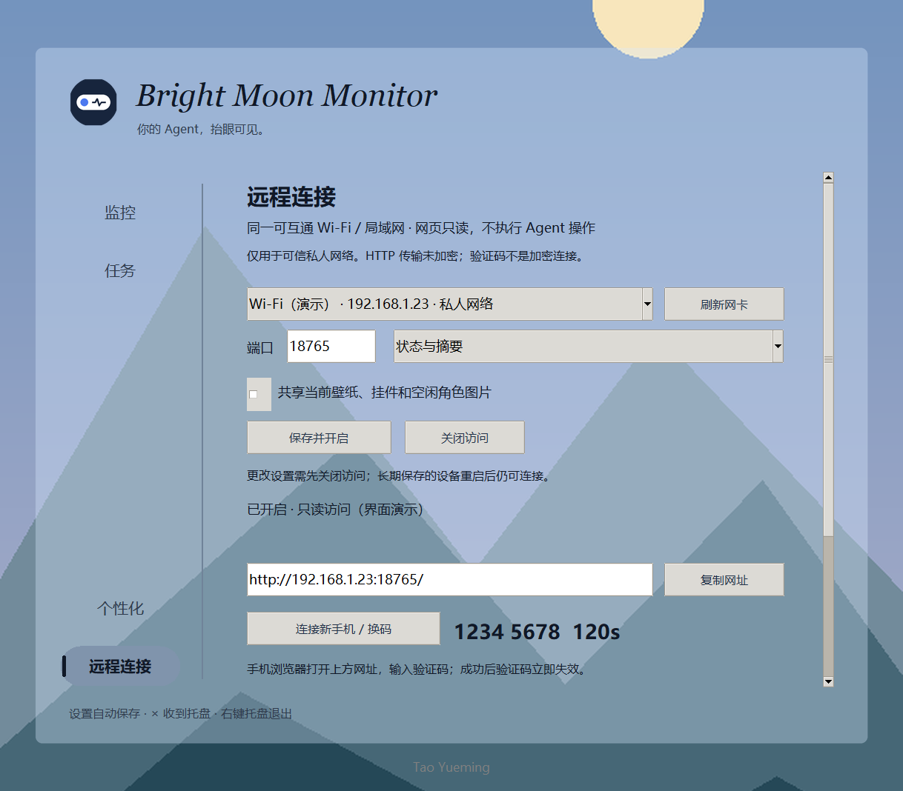
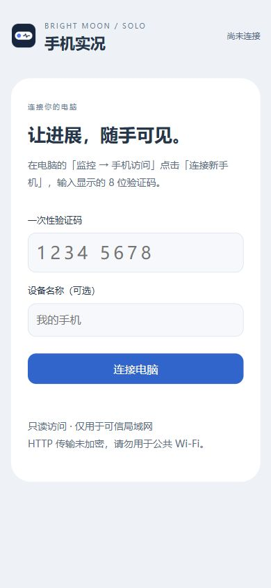
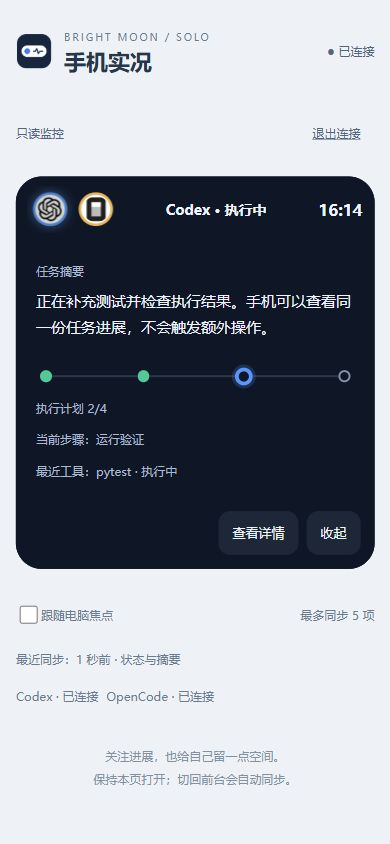
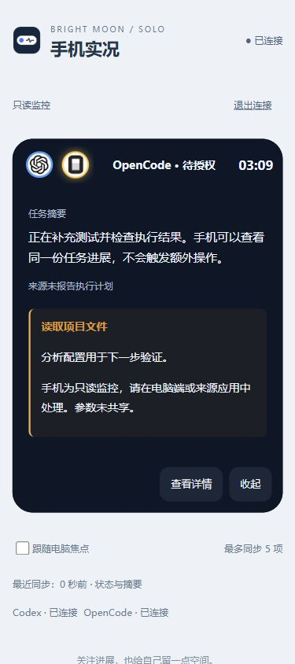

# 手机访问 · 同一局域网只读实况

本功能已加入 Solo 源码；本次没有重新打包，旧版安装包不包含此功能。

## 开始使用

1. 用运行 Solo 的 Python 环境安装最新依赖：`python -m pip install -r requirements.txt`。请在 `monitor_solo` 目录执行；新依赖是 aiohttp（要求 3.14.5 或更新的 3.x）。手机不需要安装任何库。
2. 同一环境执行 `python run.py`，点击控制面板左侧「个性化」下面的「远程连接」。右侧直接显示设置，不再弹出独立窗口。
3. 选择电脑正在使用的 **私人网络 IPv4 网卡**。Wi-Fi 和同一路由器的有线网络均可；默认端口 18765，可换成 1024–65535 内未占用的端口。
4. 选择「状态与摘要」或「仅状态（隐藏正文）」。共享壁纸/挂件/空闲角色图片默认关闭，可单独启用。开启后，网页背景跟随应用壁纸，展开卡片使用灵动岛壁纸（未设时使用应用壁纸）；面板颜色/透明度也同步。
5. 点击「保存并开启」。看到「已开启 · 只读访问」后，复制窗口显示的实际网址，例如 `http://192.168.1.23:18765/`。示例不能直接当作你的网址。
6. 点击「连接新手机 / 换码」。手机连到可互通的同一局域网，用浏览器打开上述网址，输入电脑显示的 8 位验证码，点击「连接电脑」。验证码有效期 120 秒，用一次即失效；连接第二台手机需重新生成。
7. 修改网卡、端口或隐私选项时，先「关闭访问」，等关闭完成，再「保存并开启」并重新配对。

开关、选定网卡、端口和共享偏好自动保存。下次运行 Solo，之前启用的服务会尝试在同一网卡启动；验证码和临时手机会话不保存；电脑确认长期保存的设备，重启后可自动连接。任何启动失败都不会改成监听全部网卡。

## 手机上能看到什么

- 胶囊：来源 Logo、状态色、当前任务计时、任务数量；最多同步桌面当前选出的 5 项。
- 第一次展开：任务摘要先于执行链，待授权时有「请在电脑端处理」提示。
- 进一步展开：来源报告的步骤、近期工具摘要、上下文指标；待办显示重复周期与计划时间。
- 点击任务圈独立切换关注对象；可勾选跟随电脑焦点。已展开时优先提示最早未处理的请求，之后允许手动切换。
- 空闲：显示桌面常驻模式提供的最近一小时提醒预告。桌面未开启常驻预告时，手机也不会另查待办库。
- 桌面任务退场、停止监控来源后，手机同步撤下；任务来源没有报告的进度不会编造百分比。

网页不会播放提醒音，不会重复领取待办提醒，不会审批、停止 Agent、执行命令或编辑任务。刷新手机网页不会影响 Agent。任务圈多时可以横向滑动；标题较长会省略，展开后阅读摘要。

图片均来自本地合成任务，不是个人 Agent 数据。

## 设备、断线和退出

- 最多 3 台已配对设备（长期设备包含在内）；每台最多 2 条实时流。电脑可以逐个撤销或删除设备。
- 临时会话最长 8 小时，无请求/无活动实时流 30 分钟后过期。电脑确认长期保存后不受此临时期限限制。
- 刷新页面可继续使用未过期会话；手机切后台会暂停连接，回来后重新取完整快照。
- 网络失败时自动重连；连续失败后退化为每 2 秒读取完整快照，切回前台重新尝试实时流。
- 页面明确标记断线或桌面停止刷新，停止推算运行计时。旧状态持续 60 秒后清空正文，等待恢复。
- 点击窗口 × 进入托盘时服务继续；右键托盘「退出」时停止服务。关闭访问清除临时会话，长期设备记录保留；重新开启后可以自动连接。
- 电脑网卡地址/网络类型改变时服务停止，需回电脑重新选择并开启。若 IP 改变，浏览器不会把旧 IP 的 Cookie 发给新 IP，需要重新配对；请删除旧记录腾出名额。

## 长期保存手机（需电脑确认）

1. 手机先用验证码完成临时配对，保持网页打开。
2. 电脑「远程连接」设备列表中，点击该手机旁的「长期保存」，在确认框点击同意。
3. 页面自动接收保存结果并写入浏览器持久 Cookie。电脑显示“长期 · 在线”；若显示“等待手机保存”，请保持网页打开或刷新一次再关闭浏览器。
4. 之后同一浏览器访问同一电脑地址即可自动连接，电脑重启 Solo 也无需重新输入验证码。
5. 点击电脑端「删除」可删除长期设备，正在看的连接也会失效；服务关闭时仍能删除离线设备。手机主动点击「退出连接」也会删除自身长期记录。

长期不代表永远不会丢失：浏览器清理 Cookie、无痕模式、换浏览器、IP 或端口改变等会要求重新配对。浏览器 Cookie 按最多 400 天保存，每次有效连接续期，浏览器自身也可能更早清理。电脑只保存 SHA256 凭据摘要和设备名称/ID，位置为用户数据目录 `phone/devices.json`，不保存验证码、原始 token 或任务内容。

## 壁纸与资源加载

资源只在首次连接、网页重新打开或切换选中图片时请求。任务快照仅携带图片内容哈希，不把图片放进实时订阅消息。相同图片不反复设置 URL；个人图片按 ETag 条件校验，不变时返回 304，不重新传图片正文。鉴权始终先于 304，所以删除设备后不能继续读取缓存接口。公开应用 Logo 可以短期缓存。

没有配对的页面不会公开你的私人壁纸；配对成功后才加载。关闭图片共享会清除网页背景及角色资源；状态更新不会重新下载壁纸。

## 连不上时检查

1. 确认使用设置弹窗中显示的实际网址与端口，不是 `127.0.0.1` 或 `localhost`。
2. Windows 当前网络需设为可信的「专用/私人」。可在「Windows 设置 → 网络和 Internet → WLAN → 当前连接属性 → 网络配置文件类型」选择「专用网络」（Windows 版本不同名称略有区别）。公共热点不要改成私人来绕过限制。公司域网络当前不自动接入。
3. 如果 Windows 弹出防火墙提示，仅允许实际运行 Solo 的 Python/应用通过 **专用网络**。本功能不会自动修改防火墙；不要整体关闭防火墙或开放公网端口。
4. 检查路由器访客网络、AP 隔离、VPN/公司策略。连到同名 Wi-Fi 不代表设备之间必定互通。
5. 检查端口是否被占用；关闭访问后可换一个端口重试。一个物理网卡有多个候选 IPv4 时会拒绝歧义，不自动随便选择。
6. 若应用提示缺少 aiohttp，应在运行 `run.py` 的同一个 Python 环境安装依赖，不能装到另一个环境。

## 边界与隐私

本版是可信局域网内的 **HTTP 只读查看**。验证码是配对门槛，**不提供传输加密**；不要用于公共 Wi-Fi、端口转发或敏感企业数据分享。服务只绑定所选私人 IPv4 地址，拒绝子网外访问、错误 Host 和跨来源请求。验证码和原始设备凭据均不写入用户设置；长期设备摘要独立保存；正文经过字段白名单、长度限制与常见凭据/本地路径过滤，但这不等于能识别所有秘密。需要更严格隐私时选择「仅状态」并关闭图片共享。

它是手机网页，不是手机系统灵动岛、后台常驻悬浮窗或锁屏实时活动。本轮完成了 Windows 本地服务与手机尺寸浏览器测试；Android/iPhone 真机、实际路由器/防火墙以及未来冻结安装版还需要你实机验收。

## 页面布局与桌面外观

桌面「远程连接」与「个性化」共享主面板已合成的壁纸、面板颜色及透明度。滚动时仅滚动文字和控件，背景保持与主面板对齐；输入框和按钮保持独立的可读表面。切换颜色、透明度和窗口尺寸不会重建正在编辑的输入框。

手机已连接页面从上到下为：无边框标题、实况灵动岛（及已启用的挂件）、统一的「连接与同步」卡片。连接状态、退出连接、跟随电脑焦点、同步时间和提示均在这张卡片中；底部不再列出各 Agent 的连接状态。具体任务的来源仍显示在灵动岛内部。卡片跟随桌面面板颜色及透明度，资源加载与缓存规则不变。
