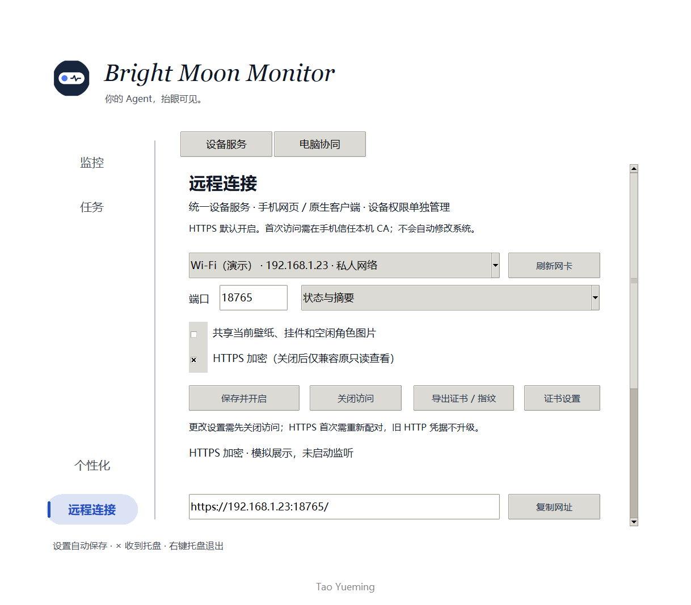
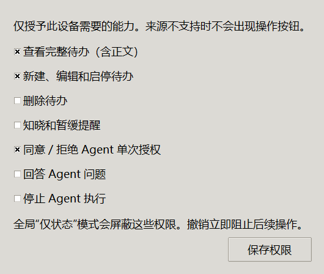
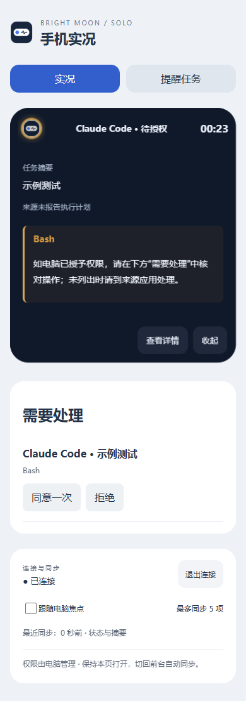
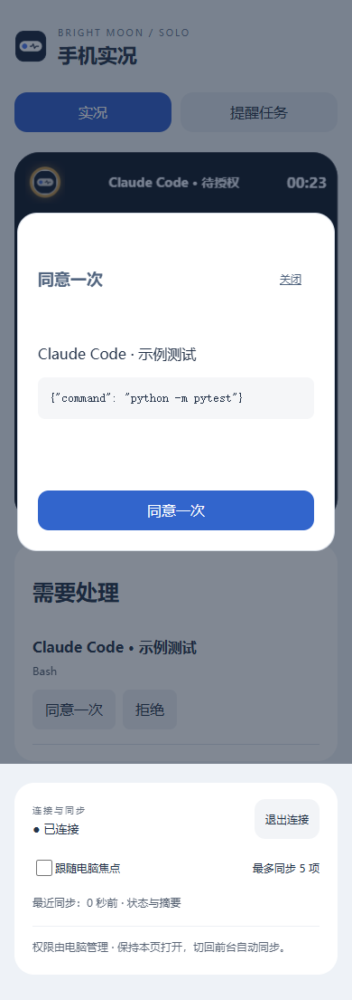
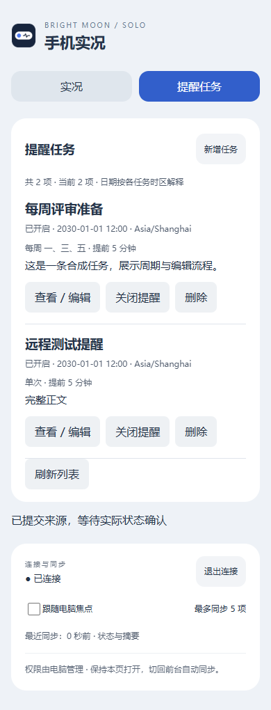

# 用手机浏览器验证 SOLO 设备服务

适用于 2026-10-24 更新后的源码。旧安装包不会自动包含这些改动，本次未重新打包。

## 1. 在电脑开启服务

运行 SOLO，进入 **远程连接 → 设备服务**：

1. 选择电脑的私人局域网网卡。手机和电脑需要能够相互访问；访客 Wi-Fi 或网络隔离可能阻断连接。
2. 保持 **HTTPS 加密** 开启，选择合适的端口。
3. 点击 **保存并开启**，等待状态显示已开启，复制访问网址。
4. 按下一节建立证书信任，再在手机浏览器打开网址。

服务内置于 SOLO，不需要另开终端。× 隐藏到托盘会继续服务；“关闭访问”或彻底退出会断开。设置的 enabled 状态持久化，下次启动 SOLO 会尝试恢复服务。

## 2. 首次 HTTPS 信任

默认本地 CA 模式：点击 **导出证书 / 指纹**，得到不含私钥的 `SOLO-device-CA.crt`。通过可信文件传输方式送到手机，核对电脑显示的 SHA-256，再按手机系统的证书管理能力安装并信任。

手机系统可能限制用户 CA。若鸿蒙浏览器不接受该方式，请使用 **证书设置** 导入组织受信任或公开受信任的站点证书链和匹配私钥，填写正确解析到本机的主机名。证书 SAN 必须精确包含访问名称。DNS、受信任证书的签发与手机组织策略由实际环境决定，应用不会替你改系统策略。

开启 HTTPS 只是提供加密通道；浏览器正确验证证书才能确认电脑身份。**不要以跳过证书错误作为正式使用方式。**原生 APP 后续可以通过扫码绑定身份实现更适合普通用户的首次信任流程。

如果地址打不开，检查：服务状态、两端可互通、防火墙是否允许 SOLO 在专用网络访问、地址是否变化、证书是否匹配。不要为排障关闭全部防火墙。

## 3. 配对并长期保存

1. 电脑点击 **连接新手机 / 换码**。
2. 手机输入 8 位验证码和设备名称，连接后先获得只读实况。
3. 电脑设备列表点击 **长期保存**；保持手机页面打开，让浏览器保存持久 Cookie。
4. 点击该设备的 **设备权限**，启用所需操作。

完整待办查看、编辑、删除、提醒处理和 Agent 授权是独立权限。启用编辑会同时允许待办查看。全局“仅状态”模式将屏蔽这些敏感能力。最多三台配对设备；可以在电脑删除旧设备。

旧 HTTP 配对记录不会自动获得 HTTPS 权限，需重新配对。HTTP 兼容模式只能只读，不能用来测试编辑或授权。

## 4. 手机查看与操作

**实况页**：保持原有胶囊、进度和详情。来源提供可处理动作且设备有权限时，下方出现“需要处理”。

**授权**：点击同意／拒绝，先阅读任务来源、工具参数，再确认。参数被隐藏或截断、请求已过期、来源离线时，不提供可误用的同意入口。没有出现按钮时，到源应用处理。

“已提交来源”不等于任务已经执行成功。出现“结果待核对”时，用“核对上次操作结果”或回到源应用检查；不要为同一请求反复创建新操作。

**提醒任务页**：显示完整目录，包括未到提醒时间和已关闭的任务。支持新建、查看详情、编辑、启停及删除。

编辑支持单次、每周或按小时重复，提前提醒 2–10 分钟。时间按任务中显示的 IANA 时区解释；手机本地时区不是隐含替代。编辑长内容不会拿岛上摘要覆盖原文。

如果电脑也修改了同一任务，手机保存会提示冲突。保留自己的修改内容，关闭后重新打开最新任务再合并。知晓只处理本轮提醒；暂缓五分钟沿用原调度规则，不宣称业务任务已完成。

## 5. 再次使用

在同一访问主机上，打开原网址即可用已保存的凭据恢复；不用每次输入验证码。Cookie 被清除、设备被撤销、浏览器隐私模式或访问 IP 改变都可能要求重新配对。可选稳定 DNS 名称解决地址变化问题，但网页自身不能进行任意局域网发现。

切回前台会重新同步。浏览器完全关闭、手机锁屏后不保证持续连接，本次没有新增系统后台推送。

电脑之间原有配对和协同继续使用；另一台电脑的浏览器也可以访问本服务，以相同规则管理任务。现有协同面板没有新增跨电脑待办编辑页，不能把浏览器能力理解为该面板已全部改版。

## 6. 建议人工验收

- 证书无警告，首次配对和长期保存成功。
- 手机刷新、重启 SOLO 后恢复连接。
- 手机修改任务后，电脑列表更新；两端同时编辑能看到冲突。
- 有权限才能操作；撤销后正在打开的页面失效。
- 合成或非敏感 Agent 请求的同意／拒绝，确实到达源应用。
- 网络中断后显示旧状态标记，恢复后同步，不重复执行。

本目录图片来自合成测试任务，不是真实业务操作。自动化已验证局部 HTTPS 信任链与桌面 Chrome 手机视口；你的鸿蒙真机证书策略、局域网和实际 Agent 版本仍需要按本清单验收。
