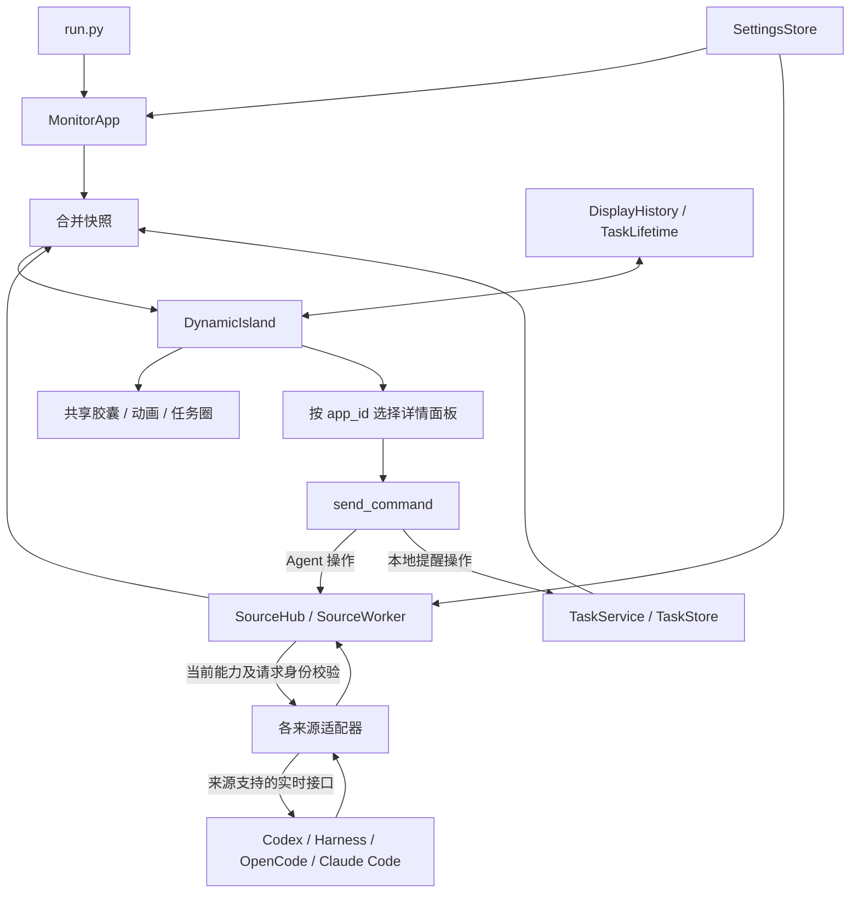

# Solo 源码运行与架构

本目录内容对应独立 Solo 监控器，不依赖 BrightMoon 主工程、登录服务或开发者的 Conda 环境。GitHub 仓库根目录就是源码根目录；本地开发工程中对应 `monitor_solo/`。

## 运行源码

使用 Windows x64 和带 Tcl/Tk 的 Python 3.10+。发布构建使用官方 CPython 3.13.16；本次源码检查也使用该版本。源码没有绑定解释器绝对路径。

```powershell
git clone https://github.com/TYueMing/BrightMoon-Monitor-V1.git
cd BrightMoon-Monitor-V1
py -3 -m venv .venv
.\.venv\Scripts\python.exe -m pip install -r requirements.txt
.\.venv\Scripts\python.exe run.py
```

也可以在创建环境并安装依赖后双击 `start.cmd`。无需激活虚拟环境；若没有 `py` 启动器，将建环境命令中的 `py -3` 换成自己的 Python 路径。

直接运行依赖为 Pillow（图像）、zstandard（压缩日志）、websocket-client（实时连接）、aiohttp（局域网服务）、cryptography（电脑协同加密身份）、tzdata 和 tzlocal（时区调度）。Tkinter 来自 Python 安装程序；Claude Hook 助手本身仅使用标准库。请在运行应用的同一个 Python 环境安装 requirements.txt。

首次启动会生成自己的 `data/`，来源监控默认关闭。源码仓库不携带个人设置、任务数据库、会话或上传图片，因此挂件和空闲角色列表可能为空。可把自己的图片放入 `data/rope/`、`data/cartoon/`，或使用界面支持的上传入口；运行时图标与声音已随源码保留。`packaging/assets/` 是构建用的固定资源，不是个人数据备份，源码启动不会自动将其复制到 `data/`。

## 模块职责

- `run.py`、`monitor/app.py`：入口与应用装配；创建设置、来源汇总、提醒服务和灵动岛，将来源快照与提醒合并；用户操作经 `send_command()` 分流。
- `monitor/src/source_hub.py`：每个启用来源独立工作线程，轮询、异常处理、快照汇总、能力校验与命令路由；一个来源的读取阻塞不会同步阻塞其他来源。30 秒读取超时由快照端识别。
- `monitor/codex_monitor/`：日志读取、App Server 发现与通信、事件投影、Codex 详情面板。
- `monitor/deepseek_monitor/`：Harness 日志、交互桥、授权/问题状态合并、专属详情。`bridge/` 是可选 Node 交互桥，普通日志监控不要求安装它。
- `monitor/opencode_monitor/`：本地数据库读取、服务发现、实时客户端、状态补全及专属详情。
- `monitor/UI/`：共享胶囊、动画、任务圈、任务选择、授权展示、背景和挂件；`detail_panels.py` 以 `app_id` 注册可信详情渲染器，各 Agent 的业务阶段不写死在共享胶囊里。
- `monitor/phone/`：局域网手机实况、配对与最多三台长期设备、受鉴权的个性化图片、SSE 状态同步，以及桌面远程连接页和手机网页。使用说明见 [手机实况](PHONE_VIEWER.md)。
- `monitor/remote/`：HTTPS 身份、设备权限、任务目录与版本校验、共享 AgentGate、命令回执；手机网页在权限允许时可编辑提醒和处理本机来源操作，协同来源只读。
- `monitor/tasks/`：本地任务 SQLite 存储、日历/间隔调度、提醒生命周期与声音领取；`monitor/UI/tasks/` 提供列表、编辑弹窗和提醒详情。
- `monitor/src/task_identity.py`、`task_presentation.py`、`display_history.py` 与 `monitor/UI/task_lifetime.py`：任务身份、状态呈现、持久去重和独立退场。退场是撤下监控卡片，不等于停止来源 Agent。
- `monitor/settings.py`、`monitor/src/paths.py`：配置校验与保存、源码/安装版路径分离。源码写本地 `data/`，安装版写 `%LOCALAPPDATA%/MonitorSolo/data`。
- `monitor/src/desktop.py`、`startup.py`、`lifecycle.py`：托盘、窗口唤回、登录自启及单实例锁；原生托盘事件经队列回到 Tk 主线程。
- `monitor/music/play/`：提示音枚举、试听、完成音、提醒音及停止播放。
- `tests/`：适配器、任务状态、SQLite、路径边界、桌面生命周期和 Tk 界面回归测试；`render_*_preview.py` 生成示例预览。
- `packaging/`：PyInstaller/Inno Setup 配置、固定版本依赖清单、资源允许列表、许可证和构建验收工具。

- `monitor/claude_monitor/`：Claude Code 本机 Hook 事件采集、阶段投影、单次授权、设置和详情面板；不包括普通 Chat / Cowork。
- `monitor/multi_diverse/`：两台及以上电脑的配对、加密状态同步、权限与操作回执，以及独立的远程胶囊布局。
- `Product/APP_design/`：三端 UI 设计与静态交互原型，不是已交付的手机原生应用。

## 数据与操作流



来源快照的主要字段包括 `runs`、`actions`、`source_states` 和 `revision`；每个任务携带 `app_id`、`run_id`、状态和时间等信息。来源私有字段交给对应详情面板，提醒通过 `solo_task` 来源进入同一 UI。

按钮不直接写 Agent 日志或数据库。操作前重新核对任务是否仍有效、连接是否正常、动作是否可用，以及提供时的确认 ID 与版本；具体协议的防重和过期检查继续由适配器/来源负责。只有日志的连接不能伪装成可审批。该监控层不是执行沙箱，也不替代 Agent 自身权限判断。

## 测试

> 2026-10-25 本次发布仅同步应用源码与文档，仓库已有测试和打包文件未更新。下方是开发工作区的测试方法，不能将仓库历史测试视为覆盖本次新增功能。

在源码根目录执行，建议使用 Windows 桌面会话以覆盖 Tk 原生界面：

```powershell
.\.venv\Scripts\python.exe -m pip install -r requirements-dev.txt
.\.venv\Scripts\python.exe -m pytest tests -q
node --test monitor/deepseek_monitor/tests/bridge.test.mjs
```

Node 命令仅用于可选桥测试。测试以临时目录、模拟来源和请求验证行为，不需要个人 API 密钥或账号。没有桌面时部分 Tk 测试会跳过，不能据此声称已通过完整桌面验收。预览生成器生成的 `preview/` 不纳入源码提交。

## 构建与数据排除

GitHub 保留此前发布的 ZIP；本次源码提交不新增程序二进制或离线环境。源码所需静态图片/音频、构建默认资源和许可证属于项目资源。

以下内容不提交：`data/`、`.env*`、SQLite 数据库、Agent 会话/运行记录、交互桥 `runtime/`、`.artifacts/`、虚拟环境、`node_modules/`、构建输出和 `packaging/vendor/` 下载缓存。`.gitignore` 是防误提交措施，不会替代发布前对暂存文件的检查。

克隆仓库不等于已获得离线构建环境。重新打包前按 [构建指南](WINDOWS_PACKAGING.md) 准备官方 Python、Inno Setup 和依赖缓存。`dependency-manifest.json` 记录下载 URL 与哈希；`download_dependencies.py` 是刷新依赖材料的维护工具，会重新生成清单和锁文件，不应把运行它误认为严格复现旧版本依赖。构建前复核版本与校验值，再执行验证和构建脚本。

源码公开不自动授予某种开源许可证；本次没有替作者选择许可证。第三方依赖和图片来源说明见 [THIRD_PARTY_NOTICES](../packaging/THIRD_PARTY_NOTICES.md)，保留其原始许可证与使用边界。
