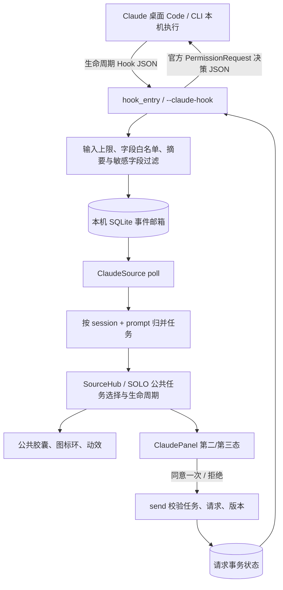

# Claude Code 监控接入说明

本目录为 Monitor SOLO 的独立 Claude Code 适配器。核心逻辑、Hook 助手、安装与卸载、阶段投影、详情面板和设置弹窗均位于本目录。共享层仅增加来源注册、图标、设置路由及手机/多设备的来源白名单。没有改动 BrightMoon 主工程的 monitor 或 Agent 循环。

## 支持范围

- Claude 桌面应用 **Code 标签页的本机会话**，以及使用相同配置的 Claude Code CLI。
- 普通 Chat、Cowork 不视为已支持。WSL、SSH、云会话需要在执行端部署采集器和传输适配，当前本机文件邮箱不会跨主机连接。
- 无需 Claude API Key，不调用模型，不读取 Claude 凭据、会话全文或内部推理内容。
- 当前源码可直接运行；本次未生成安装包。打包入口已增加 `--claude-hook` 分支，冻结应用可以走同一可执行程序的 Hook 模式，但需要新包验收后才能宣称安装版验证通过。

## 使用方法

1. 从 `monitor_solo/run.py` 启动当前源码。
2. 打开 **监控 → Claude Code → 设置**。
3. 保持事件目录为空使用默认路径，或者指定一个本机目录。
4. 点击 **安装 / 修复 Hook**。安装器只修改 Claude Code 的用户设置中属于 SOLO 的 Hook 条目，其他 Hook、权限策略和配置保留，并生成修改前备份。
5. 如需从灵动岛授权，勾选 **允许在灵动岛同意 / 拒绝本次工具授权**，保存。默认是只观察，不代替用户处理授权。
6. 在监控页面开启 Claude Code 开关，并在 Claude 桌面 Code 中**新建会话**。旧会话可能尚未加载新配置。
7. 发起任务，灵动岛会显示 Claude 图标、执行状态、耗时与已观察阶段。

首次安装和后续移动源码/解释器/事件目录后，都应点击安装 / 修复，更新 Hook 的绝对路径。当前源码 Hook 使用运行 SOLO 的 Python，不绑定 chroma 环境。用户不必手工输入终端命令。

默认 Claude 设置路径由 `CLAUDE_CONFIG_DIR` 决定；没有设置时为用户目录下 `.claude/settings.json`。默认事件邮箱位于 `%LOCALAPPDATA%/MonitorSolo/data/claude/events.sqlite3`。这些都是本机数据，不属于发布的源码。

关闭监控开关只停止 SOLO 监控并释放授权等待，不停止 Claude 任务。卸载 Hook 按钮会移除 SOLO 拥有的 Hook，并关闭该来源。其他应用的 Hook 不会被删除。

## 架构与数据流

- `events.py`：对 Hook 输入进行字段白名单处理；记录实际阶段、工具结果摘要、子 Agent 和压缩次数。
- `spool.py`：SQLite 事件日志、监控租约、短期授权请求、原子决定和一次性消费。多个 Hook 子进程同时写入不会交错损坏 JSON。
- `hook.py` / `hook_entry.py`：命令 Hook 入口。普通事件快速返回；只有显式开启授权桥、参数完整且监控在线时才等待授权。
- `process.py`：Windows 可选进程证据，仅查找 Claude 祖先进程及创建时间，不读取命令行和环境变量。PID 被复用时也不认为是原进程。
- `adapter.py`：读取新事件，生成 SOLO 标准 runs/actions；稳定请求 ID 与 revision；处理断开、关闭、过期。
- `installer.py`：合并安装、精确移除、备份、配置检测；保留用户配置。只生成本地已知 helper 命令，不执行 Hook 内容。
- `panel.py`：Claude 专属阶段轨迹、工具详情、摘要、上下文与环境信息、原生可滚动授权参数。
- `settings_ui.py`：Claude 来源设置、安装、修复、检查、卸载与授权开关。

事件源的 `poll()` 和 `send()` 从不等待用户。等待发生在独立 Hook 子进程，避免 SourceWorker 的适配器锁造成审批死锁。

## 阶段与呈现规则

- `SessionStart` 只更新会话模型/目录信息，不凭空建立执行任务。
- `UserPromptSubmit` 建立本轮任务，显示分析任务。优先使用 `prompt_id`；旧版本缺少该字段时，以提交事件 ID 建立独立轮次。
- `PreToolUse` 根据实际工具名称区分读取/检索、文件修改、命令执行、运行验证、任务规划、委派子任务、等待用户回答、其他工具。
- `PostToolUse` 更新该工具的完成状态、结果摘要、已报告退出码。`TodoWrite` 成功返回后，可展示它明确报告的任务计划。
- `PostToolUseFailure` 标记工具失败；除非明确 `is_interrupt`，不会直接判整个任务失败，因为 Claude 可能继续修复。
- `PermissionRequest` 展示待授权卡片。不可控的请求只提示回原应用处理。
- `Notification(permission_prompt)` 是等待权限的观察信号，不能据此制造同意按钮。它可能晚于实际弹窗，也可能覆盖不经过 PermissionRequest 的网络授权。
- `Notification(idle_prompt)` 显示等待用户输入。
- `SubagentStart / SubagentStop` 更新子 Agent 列表，不把子 Agent 结束当作主任务完成。
- `PreCompact / PostCompact` 展示压缩阶段，按观察到的 PostCompact 统计完成次数。
- `Stop` 展示本轮响应结束和最后输出摘要；存在后台任务时显示暂停等待。**响应结束不是目标验证成功。**
- `StopFailure` 展示 API 失败摘要，不冒充完成。
- `SessionEnd` 将仍在进行的轮次标记中断。

第二态为任务当前阶段与真实轨迹，完成后摘要在轨迹上方。第三态可翻页查看阶段列表、工具结果、子 Agent、压缩次数、模型、目录和计时依据。完成任务的详情区可独立折叠，点击顶部仍会收回整个胶囊。

轨迹上的节点表示已观察阶段，不是预先承诺的任务总进度。仅在 Claude 的 TodoWrite 明确给出计划时展示计划完成数。不会用工具数量伪造百分比。上下文 token/占用率没有可靠来源时明确标注未提供。

## 授权安全与并发

- 仅支持单次 `allow` / `deny`，不提交 `updatedPermissions`，不修改参数，也不切换权限模式。
- 请求有随机 ID、固定 revision、到期时间和等待方心跳。`send()` 同时检查任务归属与请求版本；SQLite 条件更新保证重复点击只接受一次。
- Hook 只有在监控器租约有效且开启授权桥时等待。默认等待上限 60 秒，Hook 配置预算 65 秒。
- SOLO 退出/关闭、请求到期、等待子进程死亡、会话结束和新轮次开始会使授权失效。空输出交回 Claude 原有授权流程，绝不默认同意。
- 参数过大、被过滤、过深或不完整时，不开放批准；`AskUserQuestion` 和 `ExitPlanMode` 保留原应用交互。
- Windows 原生参数文本框复用稳定 ID/revision，普通动画重绘不会重复销毁/重建文本框。
- 手机目前继续只读。已有多电脑协同可以展示 Claude 来源，并在双方原有授权权限允许时，将具体请求路由回来源电脑；不新增自动授权权限。
- 未提供通用“停止 Claude 当前任务”按钮。杀死整个 Claude 应用不等价于取消单个任务。

## 生命周期、恢复与边界

- 来源开启时从邮箱当前序号开始读取，不重播已完成历史，也不因为旧事件堆积反复弹岛。邮箱记录使用持久化 SQLite；公共 DisplayHistory 仍保存任务展示收据。
- 如果在任务中途开启/重启监控，等待该任务下一个 Hook 事件后接入，耗时明确使用“首次观察时间”。**当前不会声称重启后立即恢复没有新事件的正在思考任务。**
- 同一会话连续追问使用独立任务 ID；旧轮次的迟到结束事件不结束新轮次。
- 有可靠 Windows Claude 进程证据且该进程消失时，标记中断，公共生命周期保留约 1 分钟后收起。
- 没有可靠进程证据时，不把安静当作失败。超过 15 分钟没有新事件且无有效授权，显示“执行状态待核对”，之后按失联生命周期退场；新事件可恢复显示。
- Claude 官方说明用户中断不保证触发 Stop。工具层 `is_interrupt`、会话退出和进程退出可被确认；如果用户只中断模型思考、进程仍存在且宿主没有发出事件，当前无法即时确认，只能等待后续事件/超时。不能把这点宣传为完整取消 API。
- Stop 是可被其他 Hook 阻止的生命周期点。若同一 prompt 在结束后出现新的主 Agent PreToolUse，会按真实继续执行证据建立新的展示代次；迟到的 PostToolUse 不会复活旧任务。仍需在真实宿主核验其他 Hook 的复杂继续逻辑，不能宣称能窥探全部内部状态。
- 桌面 Code 内置版本与终端 CLI 可能不同；新事件是否触发取决于实际版本。可在 Code 中用 `/status` 核对。组织策略禁用用户 Hook 时不能通过监控器绕过。

## 数据边界

默认只记录有界任务标题、输出摘要、工具名称/结果摘要、进程身份及必要环境信息；不读 transcript_path，不保存整段对话或内部思考。授权时为正确核对会保存有界参数，密码/API Key 等字段做过滤，超长或过滤后的参数不开放批准。过滤不是所有敏感信息的完整识别器；本机文件内容摘要仍属于用户数据，不应随源码上传。

邮箱清理只清除至少一天之前且超出最近 20,000 条的传输事件、过期请求；不删除公共任务展示收据。数据目录不开放 HTTP 监听，也不上传到任何模型服务。

## 验证方式与验收

测试入口：`tests/test_claude_monitor.py`。测试隔离 Claude 设置路径、事件目录与用户个性化，绝不安装到真实用户 profile，不调用收费 API。

覆盖：新轮次与旧事件隔离、阶段与工具失败、摘要、上下文压缩、子 Agent、真实 Hook 子进程的同意/拒绝回传、并发写入、失效与重复决定、关闭与超时、超大参数、敏感字段过滤、安装/修复/卸载保留用户 Hook、来源注册、设置持久化、独立目录导入、手机与多设备投影、Windows 进程退出、原生详情与审批框稳定性。

请在真实 Claude 桌面版验收以下路径：新建 Code 会话后读取文件、编辑文件、执行测试、触发需人工确认的工具、在灵动岛同意一次/拒绝、同会话再追问、并行两个会话、手动中断、关闭监控器。要求任务归属正确、参数完整、决定实际生效、失败有真实依据、没有旧任务重复上岛。

本次自动化测试模拟官方 Hook 输入并运行真实本地 helper 子进程，验证的是 SOLO/Hook 端到端协议，不等价于已经在用户登录的 Claude Desktop 内完成真实模型任务。

官方参考：
- https://code.claude.com/docs/en/desktop#shared-configuration
- https://code.claude.com/docs/en/hooks
- https://code.claude.com/docs/en/hooks#permissionrequest
- https://code.claude.com/docs/en/hooks#stop
