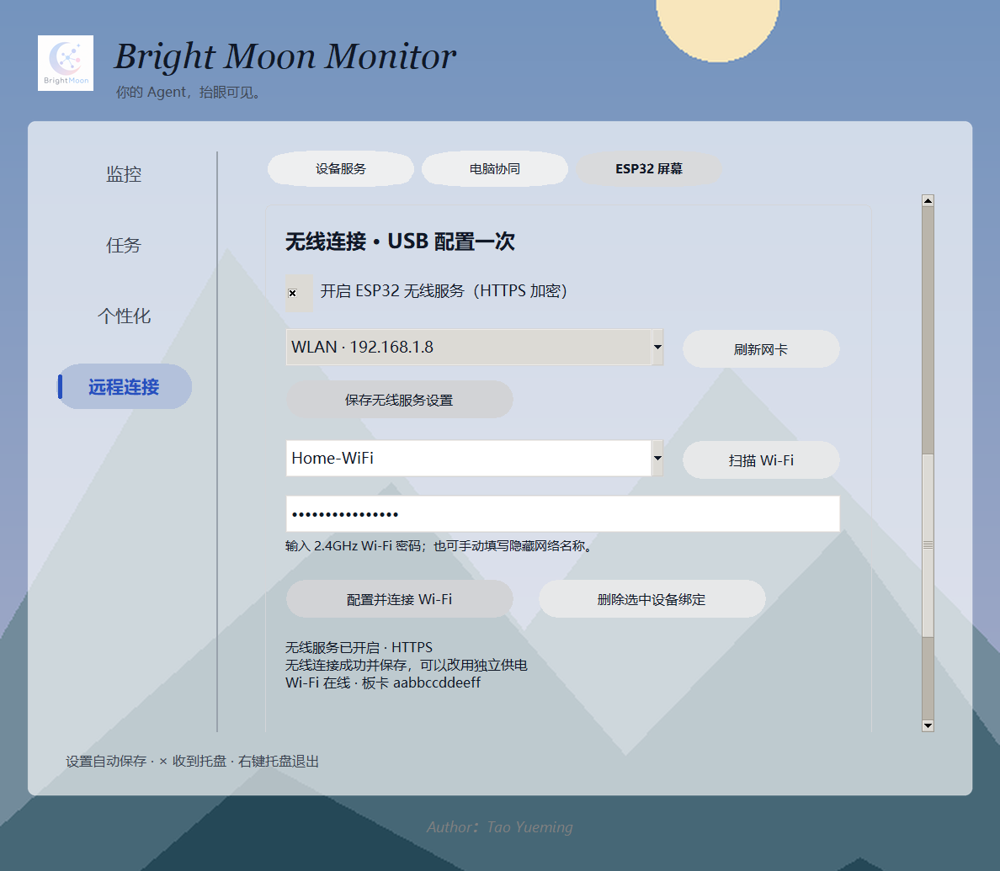

# ESP32：USB 配网与 Wi-Fi 自动连接

本功能属于 SOLO，独立于 BrightMoon 主程序。无线入口位于「远程连接 → ESP32 屏幕」，沿用现有面板壁纸与颜色。需要本次对应的新版固件，不会自动烧录，也不会自动修改 Windows 网络类型或防火墙。

## 用户操作

1. 烧录新版 `Product/Firmware/ESP32-S3-Island` 固件；板卡使用 USB 数据线连接电脑。
2. 在 ESP32 页面刷新并选择串口，点击「保存并连接」，等待 USB 已连接。
3. 向下滚动到「无线连接 · USB 配置一次」，开启无线服务，选择电脑连接的专用网络网卡，点击「保存无线服务设置」。
4. 点击「扫描 Wi-Fi」；网络由 ESP32 扫描，支持 2.4GHz。也可手动填写隐藏网络名称。
5. 输入 Wi-Fi 密码，点击「配置并连接 Wi-Fi」。空密码仅用于开放网络；普通密码为 8–63 字节，也支持 64 位十六进制 PSK。不支持需要网页登录或企业认证的网络。
6. 状态依次显示连接网络、验证 SOLO、成功保存。只有通过 HTTPS 获得有效 SOLO 状态后才写入板卡 NVS。成功后可拔掉电脑 USB，改用电池或独立供电。

电脑不必使用无线网卡：有线电脑和 2.4GHz ESP32 处在可互通的同一子网也可以。路由器 AP 隔离、不同 VLAN 等网络策略可能阻止通信。

桌面配置预览（示例网络与设备，不是实机连接截图）：

若需要在板卡操作审核或待办，在上方勾选「允许设备审核与处理待办（USB / Wi-Fi）」并保存；仅状态隐私模式不开放操作。该权限沿用原设备设置，不额外增加无线权限选择。

## 开机和重连

- SOLO 保存服务开关、网卡身份、板卡绑定。重启 SOLO 后自动恢复服务。
- 板卡保存 Wi-Fi、专属凭据、电脑 CA 和服务身份，通电后自动连接。
- 优先使用 USB 状态；USB 不再新鲜后切换到 Wi-Fi。不会把同一任务显示两份。
- Wi-Fi 配置错误或 55 秒内无法验证服务时，恢复原内存配置，不覆盖上一个已验证的 NVS 配置。
- 电脑 IP 变化时，服务重新绑定选定的专用网卡；板卡通过带随机挑战和 HMAC 校验的局域网 UDP 发现新地址，再验证原 CA。电脑重启和地址变化不要求重新配对。
- USB 配置保存后的 NVS 配置优先于旧 SD 配网文件；用户主动使用旧 SoftAP 配网页保存时，会清除 USB 配置并采用手动设置。

## 删除与关闭

在「已保存的板卡」选择设备，点击「删除选中设备绑定」，可以离线撤销。删除后其旧凭据不能获取数据或执行操作；再次使用需通过 USB 配置。重新配置同一块已绑定板卡会复用受保护的凭据，错误 Wi-Fi 密码不会意外让原绑定失效。

关闭无线服务只停止 Wi-Fi 访问，USB 可以继续监控；「停止设备连接」关闭 ESP32 整体连接。关闭服务不删除绑定，重新打开无需重新输入密码。板卡在线状态来自已认证请求，不能仅凭它在 Wi-Fi 中出现就视为已连接。

设备记录无法读取或损坏时，无线服务停止并显示错误，保留原文件，不影响桌面和 USB 启动。不要直接清空原记录来掩盖错误；修复或恢复记录后重启 SOLO。

## 网络与数据安全

- 专用 HTTPS 端口：TCP **18769**；局域网发现：UDP **18770**。不与手机 18765、电脑协同 18766 共用监听端口。
- 服务只在用户选择的专用网卡地址上提供 HTTPS，并校验请求来自同一子网。UDP 仅处理同子网、已绑定板卡的有界发现请求。
- 若 Windows 提示网络访问，只允许此应用使用专用网络。企业电脑可能需要管理员放行上述端口，不要关闭全部防火墙。
- Wi-Fi 密码只通过 USB 命令传入板卡，桌面不持久保存、不输出日志，提交后清空输入框。
- 每块板卡独立凭据，桌面使用 Windows DPAPI 保护可恢复凭据，并保存摘要用于认证。不要将 `data/esp32/` 复制到其他用户或上传 GitHub。
- CA 经 USB 配置，服务器重新签发叶证书不改变信任根。ESP32 在每次 TLS 建连（包括 HTTPClient 隐式重连）后校验 CA 链，之后才能发送凭据。
- 延续原固件无可靠实时时钟的处理：仅忽略证书起止日期标志，仍检查签名、信任链等。信任绑定到这台电脑的专用 CA，不是公开网站的域名验证；未实现证书吊销服务或可信时钟引导。
- 板端 NVS 不宣称具有物理防提取能力，本次不烧写 Flash Encryption / Secure Boot eFuse。

## 审核与提醒操作

Wi-Fi 读取与 USB 完全相同的紧凑状态。设备点击后读取同一 ControlBroker 的完整分页请求；只对已完整阅读、仍有效且来源支持的请求开放按钮。

HTTPS 控制入口只接受 GET / DO / QUERY 三种固定语义，不接受任意命令或 provider 名称。DO 继续通过 OwnerBridge、AgentGate 和原任务存储执行。USB/Wi-Fi 共用命令日志，重复 command_id 不重复执行；网络不确定时只查询原请求，不自动重发 DO。设备绑定撤销后，尚未执行的操作在 owner 检查时也会拒绝。

网络任务在 FreeRTOS 独立 worker 中执行。主循环继续处理串口与触摸相关事件，审批结果通过有界队列交还 UI；Wi-Fi 连接或 TLS 超时不占用 LVGL 锁。原有物理长按电源任务保留。

## 主要代码

- `wireless.py`：设备信任、独立 HTTPS 服务、HMAC 发现、网卡恢复。
- `serial_service.py`：唯一串口线程上的 CAPS / SCAN / CONFIG / WIFI 命令与回执，Wi-Fi 密码只存在待发送队列中。
- `serial_settings.py`、`config.py`：同一设置页内的无线 UI、持久偏好、离线解绑。
- `control.py`：USB/Wi-Fi 共用审批日志与撤销检查。
- 固件 `usb_wifi.cpp/.h`：芯片身份、异步扫描、候选配网验证与回退。
- 固件 `config_portal.cpp/.h`：单记录 NVS 保存、旧配置兼容。
- 固件 `net_client.cpp/.h`：网络 worker、每次 TLS 建连验证、局域网地址发现、无线控制与结果查询。
- 固件 `serial_client.cpp`、`.ino`：串口配网与状态优先级整合。

## 范围与验收

本次完成无线状态同步、审批/提醒操作通路和桌面 USB 配网。之前规划的 SD 卡通上传仍未实现：本次没有素材上传按钮，也不声称已支持 SD 媒体传输。

自动验证覆盖：真实回环 HTTPS 的认证与状态、来源阻拦、分页读取与审批去重、撤销后拒绝、过期状态、持久绑定/凭据不明文、HMAC 发现、配网报文关联、配置持久化、桌面控件回调、固件编译。真实路由器、板卡无线射频、NVS 断电、USB 拔插及公司网络防火墙需实机验收。

建议实机依次验收：正确密码配网 → 拔 USB 使用 Wi-Fi → 审核一次和确认一次提醒 → SOLO 重启 → 路由器重启 → 电脑地址变化 → 错误密码重配后恢复原配置 → 桌面删除绑定后板端失效。以上任何一步失败时，桌面不能显示已保存成功，板端不能显示审批已成功。

### 本次验证记录（2026-10-30）

- 中途全量 SOLO 回归：433 项通过，日志在 `.artifacts/esp32-wifi-full.log`。
- 最后修改后 ESP32 专项：非 UI 32 项通过；两项真实 Tk 界面测试分别在独立进程中通过，共覆盖 34 项。测试包括扫描列表标签与真实 SSID 分离、企业认证阻拦、绑定损坏时保留文件并允许 USB 启动。
- 当前 Chroma 环境连续创建第二个 Tk 根窗口时曾出现 `init.tcl` / `tk.tcl` 读取异常，因此两项 UI 测试使用独立进程复测；未把失败或跳过计入通过项。
- 最终 Arduino ESP32-S3 编译通过：程序 2,400,812 字节（76%）；静态 RAM 188,532 字节（57%），剩余 139,148 字节不等于运行时实际剩余堆。编译日志在 `.artifacts/esp32-v2/compile-wifi.log`。
- 配网页面预览已渲染并检查。本次没有烧录板卡、连接真实 Wi-Fi、修改防火墙或打包安装程序。
