> 2026-10-24 实施修订：电脑协同改为“绑定即信任、在线自动协同、删除即撤销”，取消逐项权限和暂停界面。旧绑定自动迁移。本文以下为原设计；涉及分别授权、120 秒邀请及必须重新配对更新地址的部分，以 [当前实现与使用说明](IMPLEMENTATION.md) 为准。手机设备服务仍使用独立授权机制。

# SOLO 多终端协同监控架构方案

> 修订日期：2026-10-20。状态：已接入 SOLO 源码，未打包；本机自动化验证与真机验收分别记录。运行说明、已实现范围与测试证据见 [IMPLEMENTATION.md](IMPLEMENTATION.md)。
> 范围：独立 `monitor_solo`，不修改 BrightMoon 主干。第 2–18 节保留设计评审依据，第 19 节说明本次工程落实及明确取舍。UI 沿用 [arc_ui.md](arc_ui.md) 第 4 版布局；新原生预览位于 `monitor_solo/preview/multi_diverse/`。
> 目标：多台安装 SOLO 的电脑配对后，能够相互显示 Agent 执行进展和待办提醒；在明确授权下协同处理提醒和部分 Agent 请求。手机浏览器继续作为轻量查看端。

## 1. 结论与实际使用效果

这个需求可行，而且比单纯远程查看电脑屏幕更适合当前产品：同步结构化任务状态，各设备用自己的灵动岛渲染，而不是远程传输桌面截图。

假设用户有电脑 A（工作站）、电脑 B（笔记本）：

1. A、B 都安装并运行 SOLO，在「远程连接 → 电脑协同」中完成一次互信配对。用户明确选择双向共享哪些来源、正文范围、允许哪些操作。
2. A 上 Codex 开始执行，A 的适配器读取状态并发布；B 收到事件，在自己的灵动岛中显示「工作站 · Codex」。B 不需要安装 Codex，也不需要读取 A 的目录。
3. B 的 OpenCode 同时执行，A 可以显示「笔记本 · OpenCode」。同一条连接可以双向传输，但两个方向的共享权限各自独立。
4. A 的待办到提醒时间时，可以在 A、B 同时显示。B 点击「已知晓」，由 A 验证并确认后，两端同时撤下本轮提醒。点击「忽略 5 分钟」也只修改 A 管理的这一轮，而不是在 B 新建一条任务。
5. A 上 Agent 待授权时，B 默认只能看见提示。只有 A 单独允许 B 进行该类操作，且来源本身支持实时审批时，B 才显示同意/拒绝；日志监控不能被包装成远程可审批。
6. A、B 重启后恢复互信与去重记录；重新连接不会将旧完成任务重新弹出或重播声音。

必须明确的边界：

- **监控协同不是 Agent 迁移执行。** B 看到 A 的 Agent，不代表 B 能继续执行 A 的进程、终端或文件操作。
- **双向通信不是双向完全控制。** 两端互相看进展、处理提醒、审批、停止 Agent 是不同权限。
- **配对不创造网络可达性。** 在同一可互通局域网内可直接连接；不在同一网络时，需要另行部署 VPN 或受支持的中继。本文不承诺连接任意公网设备。
- **A 关机后不能继续观察 A 的执行。** 本方案中，A 拥有的待办也不由 B 自动接管调度。此限制在第 10 节给出明确产品解释，避免同步副本被误认为高可用调度器。

## 2. 当前代码实际具备什么

以下为本地代码核查结果，而非对已经实现多端协同的描述。

### 2.1 本机监控链路

- `monitor/src/source_hub.py`：每个 Agent 来源独立 `SourceWorker`；汇集 `runs/actions/source_states`。当前 `backend_id` 每次启动生成，仅表示进程实例，不能充当永久电脑身份。
- `monitor/app.py::read_snapshot()`：读取来源快照，再调用 `TaskService.read()` 合并本地提醒。
- `monitor/tasks/service.py`：读取待办数据库、调度实例、领取声音播放记录，并产生 `app_id=solo_task` 的展示记录。它是有副作用的业务采样，网络订阅者不能重复调用。
- `monitor/UI/island.py`：更新选择、任务退场、完成声音与渲染。目前在选择之后，向 `PhoneService.publish()` 发布 `selection.runs`。
- `monitor/UI/task_lifetime.py` 与 `monitor/src/display_history.py`：提供每任务退场及持久抑制。停止、失联等使用约 60 秒退场；正常完成使用用户保留时间。桌面观察失联不能被当成 Agent 已失败。

### 2.2 手机远程链路

- `monitor/phone/server.py`：HTTP + SSE；提供配对、快照、心跳、资源和退出接口，刻意没有 Agent 操作路由。
- `monitor/phone/service.py`：单独网络线程，Tk 发布普通数据或入队命令，不由网络线程直接操作 Tk。
- `monitor/phone/publisher.py`：最新快照模型，256 KiB 上限，随机 epoch 和 revision；不是持久事件日志。
- `monitor/phone/projector.py`：白名单裁剪，并以运行期随机密钥 HMAC 生成手机 task key。适合浏览器会话，不能直接拿来做跨重启全局任务 ID。
- `monitor/phone/devices.py`：长期记录最多 3 个；`Pairing.pair()` 同时将临时与长期会话的合计上限限制为 3，长期离线记录也占名额。存储 token 摘要，浏览器通过 Cookie 恢复认证，仍需服务开启、地址可达且 Cookie 有效。这不是双向电脑互信体系。
- `monitor/phone/network.py`：只枚举 Windows 物理、私人、IPv4 网卡。服务还检查子网、Host 和 Origin；不能为了电脑协同直接放开这些校验。
- 手机在线字段目前来自 `Session.streams > 0`：只表示服务端存在 SSE 流。`transport.js` 支持失败后轮询降级，此时 streams 为 0 也可能正在正常查看；SSE 循环会反复更新 touched，因此 last_seen 也不能当作客户端确认收包时间。新图标需要第 12.5 节的专用连接状态。
- `monitor/phone/settings_panel.py` 与 `settings_surface.py`：已有嵌入式远程页及与主界面一致的壁纸合成，可承接协同 UI。

### 2.3 必须解决的结构缺口

1. 手机订阅的是当前桌面选出的最多 5 项，无法代表电脑上全部可共享任务。B 不应该因为 A 没有选中第六项就永远看不到它。
2. `task_identity()` 包含 app、scope、task、generation，却没有永久电脑身份。`TaskLifetime.visible()` 等部分容器还直接以 `run_id` 为键；两台电脑同名任务可能覆盖。
3. `SourceHub.send()` 按 `run_id` 查找来源，本机不同来源也可能出现同名 ID；加入远端后尤其不能直接复用这个路由规则。
4. `TaskStore` 有事务、revision、occurrence、cycle 和声音领取，但没有 owner、远程命令收据、跨端权限和时区字段。
5. 当前手机快照没有可靠的事件补发、订阅集合删除语义、持久序号或远端控制结果。
6. 若把远端任务直接混进现有快照再向外发布，A、B 可能互相回传；声音和退场也可能被反复触发。

因此，需要增加独立协同层，并对身份、采样和命令入口做少量明确改造；不改 Agent 自身循环架构。

## 3. 架构选择：对等互信、来源权威、展示本地化

### 3.1 每台电脑既是发布端，也是订阅端

采用小规模对等直连。每台设备运行一个 `PeerService`，连接已配对设备，发布自己的任务，接收对方的任务。建议首个完整版本限制 **每台最多配对 5 台其他电脑**；这是设计上限，不是当前已验收能力。原有最多 3 个手机浏览器记录独立管理，不占用电脑名额。

一对设备建立一条主要 WebSocket 连接，同时传输两个方向的数据。A/B 同时拨号时，用有序 device_id 对和握手 connection_id 决定保留哪条连接；只有新连接验证并就绪后才关闭重复连接，避免互相关闭导致重连循环。

不需要常驻中央服务器，不需要用户登录，不把任何电脑固定为控制中心。A-B、B-C 的配对不自动授权 A-C；若需要三台相互监控，三对分别配对。禁止自动信任传递。

### 3.2 发布本机事实，合并仅用于展示

```mermaid
flowchart TB
    AA[电脑 A 本机来源适配器] --> AC[LocalCatalog 本机事实目录]
    AT[A 的 TaskService 唯一调度入口] --> AC
    AC --> AP[按设备权限过滤的 ExportProjector]
    AP --> AN[A PeerService]
    AN <-->|已配对 TLS / WebSocket| BN[B PeerService]
    BC[B LocalCatalog] --> BP[B ExportProjector]
    BP --> BN
    AN --> AR[A RemoteCatalog]
    BN --> BR[B RemoteCatalog]
    AC --> AV[A ViewAggregator]
    AR --> AV
    BC --> BV[B ViewAggregator]
    BR --> BV
    AV --> AI[A 灵动岛：本地/远程入口、候选选择、详情]
    BV --> BI[B 灵动岛：本地/远程入口、候选选择、详情]
    BI --> CMD[B CommandRouter]
    CMD --> BN
    AN --> GATE[A 权限与版本校验]
    GATE --> OWNER[A 所有者业务处理器]
```



强制不变量：`ExportProjector` 只接受 `origin_device_id == local_device_id` 的原生记录，不能接收 UI 合并结果。接收端验证消息 origin 与连接认证身份一致。禁止远端声明自己代表第三台设备。

共享目录在本机 UI 的选择、窗口显隐和退场筛选之前生成。它保留有效执行与授权请求，不受本机是否开启“灵动岛常驻”或当前是否展开的影响；终态转为短期保留记录供在线订阅者收尾。来源原始日志中的历史记录必须带历史基线标记，不能将首次扫描到的全部历史运行当作新任务发布。

不直接将 RemoteCatalog 塞进 `SourceHub.factories`，伪装成本地 Codex：这会混淆本地路径、权限、状态与命令目标。远端是来源外的一层命名空间。

### 3.3 业务事实与显示收据分离

- 来源报告的执行状态、请求和待办已知晓结果：由 owner 决定。
- 本设备是否展开、当前焦点、声音选择、保留时间、背景、是否临时隐藏：由本设备决定。
- A 上完成卡片到期退场，不应把任务标成删除，也不强制 B 立刻退场；B 使用自己的已观察完成时刻和保留设置，但重连不重新起算。
- owner 的取消共享/权限撤销是访问变化，B 收到有效撤销通知后立即撤下相关数据，不适用保留展示时间；离线撤销的传播边界见第 6.3 节。

## 4. 模块落点与改造接口

新逻辑放在 `monitor/multi_diverse/`，职责建议如下：

```text
multi_diverse/
  arc.md
  identity.py          永久设备身份、协议身份组合
  config.py            协同配置及严格校验
  trust.py             设备互信、证书指纹、定向授权、撤销
  secrets.py           Windows DPAPI 保护，禁止自制加密
  protocol.py          版本、消息结构、白名单、大小限制
  transport.py         TLS/WSS、握手、重连、背压
  service.py           单网络线程及生命周期
  local_catalog.py     本机事实快照、去重、业务 revision
  projector.py         每接收方权限过滤和详情裁剪
  journal.py           事件记录、序号、重放、快照基线
  remote_catalog.py    原子快照、增量合并、连接健康
  store.py             协同 SQLite，线程内持有连接
  aggregator.py        本地与远端任务合并、选择策略
  commands.py          操作权限、目标、幂等、结果收据
  reminder_sync.py     owner 提醒实例协议与协同操作
  notification.py      多端声音策略与本机播放收据
  panel.py             远端通用详情渲染器
  UI/
    index.html / model.mjs / design.mjs / design.css / remote-layout.css
                       已有独立网页原型，不是 Tk 运行模块
    page.py            远程连接页中的电脑协同内容
    pairing.py         邀请、身份核对和共享方向确认
    device_detail.py   权限、连接、删除与诊断
```

上述为设计文件，不要求为了目录形式拆出空壳；实现时可合并小模块，但须保持职责边界。

现有文件需要的准确改动：

1. `app.py`：组装 PeerService / LocalCatalog / CommandRouter；统一采样一次本地 Agent 和提醒，发布本机目录后再合并远端只读缓存。关闭应用先拒绝新命令，再清理连接和工作队列。
2. `src/source_hub.py`：新增基于完整来源目标的发送方法；在 owner 当前快照重查 action。保留原单机兼容入口，内部统一到新路由。
3. `src/task_identity.py`：增加协议级全局 identity。现有本机显示收据采用兼容映射或迁移，不能简单换 hash 导致历史全部复活。
4. `UI/island.py` 和选择/退场逻辑：新增来源焦点路由与本地/远程分离外壳；保持现有本地连体样式，远程分离样式独立实现。显示唯一 ID、远端健康、远端专属详情和命令 pending。读取手机连接状态快照绘制时间后的图标；现有来源内部阶段解释仍留在各来源模块。
5. `tasks/store.py`：增加命令幂等收据和精确 occurrence 前置条件；事务内完成提醒变更及收据。不要允许网络线程使用现有 Tk 线程的 SQLite connection。
6. `UI/settings_panel.py`：远程连接页增加「手机访问 / 电脑协同」分区；复用透明背景，不新增独立悬浮设置窗。
7. `phone/`：保持现有只读默认语义。增加浏览器收包确认与按会话聚合的在线状态，覆盖 SSE 和轮询；Tk 只读取 `snapshot_status()` 的普通数据。若开放查看聚合后的远端任务，必须同时满足原 owner 的再展示授权与当前电脑允许手机查看；详见第 13 节。
8. 依赖及打包允许清单：增补 TLS 身份材料生成所需的成熟库、离线依赖与许可证，网络密钥绝不能成为打包资源。

推荐边界 API：

```python
local_catalog.observe(local_snapshot)          # 由唯一业务采样者调用
peer_service.publish_local(local_catalog.view())
remote_snapshot = peer_service.snapshot()      # 返回普通数据，不触发网络 I/O
view = aggregator.compose(local_snapshot, remote_snapshot, preferences)
command_router.submit(target, operation, payload, preconditions)
peer_service.drain_results()                   # UI 主线程消费，不执行 Tk 外线程调用
```

可将业务采样调度从 `DynamicIsland._poll()` 抽成 App 的 `MonitorCoordinator`：400ms 一次采样；UI、手机、PeerService 消费同一结果。窗口隐藏、最小化或关闭远程面板不能停止采样。整个过程不改变各 Agent 的执行循环。

## 5. 身份与数据模型

### 5.1 永久设备身份

首次初始化生成随机 `device_id`，与 IP、电脑名称、网卡和进程 ID 无关。用户可修改显示名称，但不改变身份。另有每次启动不同的 `boot_id` 和本地数据库世代 `catalog_epoch`。

- 正常升级/重启保留 device_id、互信和 epoch；boot_id 变化不能清除任务去重。
- 身份材料与 Windows 当前用户的 DPAPI 保护绑定；复制应用源码/安装包到另一台机器会创建新身份。
- 如果用户复制整个数据目录到另一台机器，保护材料无法解开时不静默降级；提供「作为新设备初始化」，清理复制的互信而保留用户主动导入的任务定义。
- 完整备份恢复或存储回滚可能导致序号倒退。握手发现低于已确认水位，拒绝增量，要求显式恢复并生成新 epoch，再发送完整快照；绝不能用旧序号覆盖新状态。

### 5.2 任务的多层身份

协议主键采用明确元组或其规范编码摘要：

```text
AgentGlobalKey = (origin_device_id, source_instance_id, source_task_id, execution_generation)
ReminderKey    = (owner_device_id, task_id, task_revision, occurrence_id, cycle)
AttentionKey   = (AgentGlobalKey, request_id, request_revision)
```

`source_instance_id` 是本机持久来源实例 ID，不发送目录绝对路径；切换为另一个独立 Agent 数据根时分配新实例，修复同一目录的定位时可显式保持实例。`execution_generation` 优先复用来源 turn/completion 身份，不使用网络重连时间。

内部展示 `display_id` 全局唯一；来源原始 `run_id` 保存在不混淆的 `source_run_id`。需要系统审查选择器、计时器、审批队列、完成声音、折叠状态、挂件焦点等所有以 run_id 为键的位置，不能只改一个哈希函数。

### 5.3 传输对象示例

```json
{
  "schema_version": 1,
  "origin_device_id": "device-A",
  "catalog_epoch": "catalog-generation-1",
  "seq": 146,
  "type": "task.upsert",
  "entity_id": "opaque-global-task-id",
  "entity_revision": 12,
  "payload": {
    "source": "codex",
    "source_instance_id": "source-1",
    "generation": "turn-9",
    "status": "running",
    "title": "检查测试",
    "summary": "正在运行验证",
    "started_at_ms": 1792368000000,
    "elapsed_ms": 12000,
    "detail_blocks": [],
    "capabilities": [],
    "is_historical": false
  }
}
```

这是协议示意，字段枚举和长度约束必须在 `protocol.py` 有单一权威定义。不要传来源原始日志、Python 对象、可执行 HTML、动态组件名称、电脑路径或整个配置文件。

详情使用 `summary / step_list / metric_list / tool_list / file_change_summary / attention` 等受限块类型。未知块忽略并显示兼容提示，未知能力默认禁止。接收端不从网络导入代码，也不直接调用本地 Agent 私有 panel 读取其私有 payload。

## 6. 双向通信与配对安全

### 6.1 传输方式

电脑协同使用 **TLS + WebSocket**，与已有手机 HTTP listener 分开，建议默认端口 18766，允许用户修改。每台电脑监听选定可信网卡并可主动连接对端；一个已验证的连接即可双向工作，不要求双方入站端口都可达。

继续只允许显式选择的网络。跨网/VPN 扩展需要额外的接口与地址策略，不能通过放宽 `phone/server.py` 的 guard 偷渡。mDNS 可作为可选发现手段，发现不代表可信，手动地址始终可用。

使用 aiohttp 的 TLS/WSS 能力；证书生成采用成熟 `cryptography` API。不得实现自制密钥交换、加密协议或把 8 位验证码当作长期密钥。浏览器不参与原生电脑证书固定流程，因此不会出现让用户跳过浏览器证书告警的步骤。

### 6.2 首次配对的完整流程

1. A 点击「添加电脑」，生成 120 秒有效、一次性、高熵随机邀请，并展示地址与 **完整 TLS 证书 SHA-256 指纹**。邀请只在配对窗口存在。
2. B 输入邀请（可复制为完整邀请串）并使用固定指纹建立 TLS。邀请串必须通过用户认可的渠道传递；局域网自动发现的指纹不能自证可信。
3. A/B 界面显示双方设备名称及握手摘要校验码，用户核对并确认，再分别选择发布/接收内容和控制权限。验证码负责便捷核对，不替代固定证书和高熵邀请。
4. 握手绑定双方 device_id、证书指纹、随机 nonce、协议版本和权限提议；中途任意字段变化使确认作废。双方确认前不传任务正文。
5. TLS 内交换分方向、至少 256 bit 随机的访问凭据；接收凭据的一方保存受 DPAPI 保护的原值，校验方仅存摘要。不能复用手机 Cookie 或日志里的验证码。
6. 保存互信后才能订阅；首次连上只同步当前状态，不播放历史完成声音。邀请立即失效，日志不记录邀请或凭据。

后续连接固定校验对端证书，并验证与绑定身份对应的凭据，完成双向认证。不能设置 `ssl=False` 或接受任意证书。证书变化必须经已有可信通道进行可验证轮换，或重新人工配对；无法验证时停止连接，不自动接受。

原生 peer 协议默认拒绝带浏览器 Origin 的升级请求，严格校验握手路径、Host 和协议版本；无 Origin 也绝非认证凭据，仍须完成固定证书与身份凭据校验。拒绝普通网页跨站发起的 WebSocket；原生认证与手机 Cookie 域完全隔离。TLS listener 还应限制握手速率、失败次数、并发连接和消息大小。

### 6.3 权限是有方向且分层的

每个 owner 为对方保存明确 ACL：

- `view_status`：任务标题、状态、时间、来源；标题也可能敏感，提供完全匿名标题选项。
- `view_details`：摘要、步骤、工具结果、验证与变更摘要；可按来源限制。
- `reminder_act`：仅已共享的提醒实例「已知晓 / 忽略」。
- `reminder_edit`：可选，修改 owner 的提醒定义，必须单独开启。
- `agent_approve`、`agent_answer`、`agent_stop`：分别授予，默认关闭。
- `reshare_to_phone`：允许接收电脑向它的手机查看端再次展示，默认关闭。

「互相监控」默认仅双向查看状态与允许的摘要；提示用户是否开启提醒处理，不默认授予 Agent 控制权。单向共享也是完整支持的模式。

撤销时本机立即停止该连接的发布/命令、作废凭据和排队操作；可达对端收到撤销通知后清除当前正文并使手机再展示失效。离线也可本地撤销；对端再次连接时拒绝。设备重新加入要重新配对。保留最小去重摘要不意味着保留正文。

上述撤销清理是正常 SOLO 客户端应执行的行为，不等于能够抹除另一台电脑已经截屏、导出或恶意保存的数据。权限撤销前已开始执行的 Agent 副作用也不能保证撤回；返回最终或未知结果，不能以关闭连接伪称已取消。仅暂停一个方向共享时，不撤销无关的反向授权；“移除配对”才撤销整对互信。

## 7. 同步协议、顺序与恢复

### 7.1 需要哪些消息

`hello`、`subscribe`、`snapshot.begin/chunk/end`、`task.upsert/remove`、`reminder.upsert/remove`、`attention.upsert/remove`、`heartbeat`、`command`、`command.result`、`receipt`、`resync.required`、`policy.changed`。

每个 owner 的共享目录维护持久递增 seq。数据变化事务与日志追加必须原子提交。心跳只证明网络活跃，不能伪造任务更新；`entity_revision` 只在业务事实或有效共享视图变化时前进。

权限过滤后的每对设备订阅流独立编号 `stream_seq`，同时携带 `policy_revision` 和目录 epoch；接收端按流序号检测缺口，不能把 owner 全局 seq 中被 ACL 过滤的空洞误报为丢包。事件日志和游标必须绑定接收方身份与当前策略。

权限收紧后，旧策略日志不能继续提供给该 peer；先发策略失效通知，再以新策略全量同步，并删除旧策略包含正文的投影缓存。重放时再次核查当前授权，不能认为“过去允许发送”就代表现在仍可发送。

### 7.2 连接与全量快照

握手交换受支持主版本、能力集合、接收水位和来源 epoch。主版本不兼容时明确提示升级，不模糊降级到可控接口。

初次连接、日志过期、策略改变或序号出现不连续时发送全量快照：

- begin 明确 scope、snapshot_id、base_seq、policy_revision、总数和上限。
- chunk 分块传输；期间新增变化排在 base_seq 之后。
- end 校验完成后，接收端事务性替换这个 owner/订阅 scope 的成员集，再接收后续增量。
- chunk 中断时不应用半份快照，不据此删除任务；旧视图标记同步中。
- 完整新快照中缺失的成员应撤下；缺失只能表示不再可见，不能推断完成或取消。

### 7.3 去重、回放与终态

重放至少一次，按 `(peer_id, catalog_epoch, policy_revision, stream_seq)` 去重。确认收据只在状态与游标持久提交后发送。乱序/重复消息不能倒退 entity_revision。

明确终态不因旧 running 快照逆转；真正新轮次使用新 generation。历史首次同步可展示尚在运行的任务，但已完成记录默认只用于基线，不弹出、不播放。在线已观察任务随后完成，才进入本机保留与声音流程。

显示退场记录持久化，网络重连、进程启动、标题变化、心跳不能唤醒。失联后若只是旧基线重放，不主动再弹；若有明确恢复事件、业务进度或新授权请求，则允许重新展示。需要用户查看的静止长任务可以从「设备详情 → 当前任务」手动打开。

### 7.4 边界与背压

设计默认：每对连接最多共享 200 个当前实体，单条消息不超过 256 KiB，完整快照不超过 4 MiB；命令 payload 不超过 16 KiB。详情按数量/长度截断，并提供 `truncated/omitted_count`，不可静默丢失待授权提示。

活动目录与 UI 5 项自动推荐窗口分离。超过共享上限时优先请求授权和到期提醒，再选活动任务，返回遗漏计数；设备页提示能力上限。

每 peer 采用有界发送队列。普通进度只能在分配持久 stream_seq 之前合并；已经入日志并编号的事件不能直接丢弃，否则接收端会发现序号缺口。编号后需要压缩时，应显式要求 resync 并提供新快照水位。命令结果、撤销、终态不可静默覆盖。持续跟不上的客户端断开后全量同步，不无限堆积内存。建议日志上限 7 天、每 peer 50,000 条或单独的全局日志字节预算（默认 128 MiB），任一先到即裁剪；超出水位必须全量恢复，不能继续使用丢失前缀的旧游标。

## 8. 连接健康、暂停与自动退场

分别记录 `transport_state`、`producer_age` 和 `task_status`：

- 连接正常且任务正常运行：显示执行中。
- WebSocket 活跃但 owner 业务采样停止：显示「来源刷新暂停」，禁用操作。
- 连接断开：保留最后已知状态并显示「工作站离线」，冻结不可靠的执行时长，不标成执行失败。
- 来源明确报告 cancelled/failed/completed：使用其真实终态。

建议 peer 心跳 5 秒，连续 15 秒未收到有效心跳标记断线，随后显示失联提示最多 60 秒后退场；这是电脑协同目标值，不覆盖手机现有约 2 秒 SSE 心跳。生产者超时单独计时：以成功业务采样及各适配器的新鲜度/lease 为依据，不使用“业务内容多久没变”判定失联，否则正常静止的长任务会被误报。网络线程不能替业务采样者刷新 producer 时间。使用 monotonic 衡量本机间隔，UTC 时间只用于跨机展示与事件事实。

网络恢复使用 1/2/4/8/16/30 秒指数退避加随机抖动；系统唤醒、网卡切换触发重新验证，不能把休眠期间的计时累积成一连串警报。重连不重复记为新任务。

接收端不能用自己的墙上时间覆盖 owner 时间。运行时长优先使用 owner 的 elapsed_ms 加健康期间的本机 monotonic 增量；断线冻结。两台电脑时钟差过大时显示提示，排序不能只依赖双方 timestamp。

## 9. Agent 远程操作：可见不等于可执行

命令目标至少包含 owner、source_instance、task、generation；审批还包含 request_id 和来源请求版本，提醒包含 occurrence 与 cycle。命令另外包含全局唯一 command_id、expires_at、action、payload_hash。

owner 校验次序：

1. 连接身份和当前 ACL；目标归属必须是本机。
2. 命令类型和字段白名单、期限、大小、幂等 ID。
3. 重读当前来源状态，确认 generation、请求、能力、权限仍然有效。
4. 在本机串行命令调度中执行；经过本机 adapter，不允许网络请求指定 shell、Python 表达式、路径读取接口或任意工具执行。
5. 返回 `rejected / accepted / executing / succeeded / failed / outcome_unknown` 等结果；接收成功不是执行成功。

同一 command_id 携带不同目标或 payload_hash 必须拒绝，不能误用之前的成功收据。操作有效期以 owner 发出的短期请求/能力有效期和 owner 时钟判断，同时限制本地排队时长；客户端自行填写的 expires_at 只能缩短期限，不能延长 owner 授权。这样不会因两台电脑时间差而允许长期重放。

冲突示例：A 已批准，B 再点击同一请求，B 应收到「请求已处理」并更新卡片，不能触发第二次。B/A 同时停止同一任务时也遵守相同规则。

Agent 外部副作用无法与本地 SQLite 事务原子提交。owner 崩溃在「已发给来源、未保存结果」之间时，记录 outcome_unknown，并查询来源结果；来源无幂等支持时不能自动再次发送。禁止宣称网络命令能通用 exactly-once。

离线时禁用审批/停止，不排队到数小时后自动执行。B 本地仍可「仅隐藏此卡片」，但 UI 必须与「停止远端 Agent」清晰区分。远端反馈未确认前按钮显示处理中，超时显示结果待核对而不是假成功。

## 10. 待办协同的完整语义

### 10.1 单一 owner 是基础

任务在 A 创建则 A 拥有任务定义和调度实例。B 展示 owner 发布的实例，不能复制进本地 `TaskStore` 再各自 `poll()`。A 负责周重复、间隔重复、提前 2–10 分钟和 snooze cycle，B 只展示及发送操作。

「已知晓」作用于当前 occurrence/cycle，全局撤下本次提醒，不删除定义，也不影响未来重复。忽略 5 分钟由 owner 当前时刻计算，更新同一 occurrence 的 cycle，重连后旧周期不得覆盖新周期。

多个端同时操作同一实例：owner 事务按 expected_revision/cycle 串行校验，先提交有效操作者成功，后续旧版本命令返回冲突并携带最新状态。不采用客户端时间最后写入覆盖。

本机 UI 也要进入相同命令处理路径，避免本机按钮绕开远端事务规则。幂等收据和 occurrence 更新写入同一个 `tasks.sqlite3` 事务；同步事件可通过该库内事务 outbox 再投递到协同日志，不能把跨两个 SQLite 库的写入假装成原子提交。

### 10.2 创建、编辑和删除

新建任务默认「归属本机」；可选择共享给哪些已配对电脑。远端新建必须明确选择目标 owner，并具备编辑权限；owner 离线时保留本地草稿，不显示为已经创建。

编辑携带 task_revision；冲突时要求重新加载核对，不把两份周期设置自动拼接。删除创建 tombstone 并终止有效实例，收到后其他端立即撤下；删除权限独立于提醒已知晓；本版本由单独开启的 `reminder_edit` 权限涵盖创建/编辑/删除，界面必须明示这一范围。删除后重连不能从旧快照恢复。

### 10.3 时区与重复规则

当前 `schedule.py` 使用本机时区，直接复制定义到异地电脑会产生不同提醒时刻。升级时为任务保存 IANA timezone 和必要的 UTC interval anchor，Windows 构建补充 `tzdata`。既有任务迁移到创建机器当前确认的时区，保留实例身份和已知晓记录。

- 每周重复以 owner 任务时区的日历计算，夏令时不存在的时刻跳过，重复时刻只触发一次，延续现有规则。
- 每 N 小时以 UTC anchor 加固定间隔推进，不因换时区改变。
- 接收端显示本地换算时间，并标注归属设备/任务时区；不独立推导实例 ID。
- 正在运行中系统时钟或时区改变要重算未来实例，已领取和已知晓不能再次提醒。

### 10.4 来源电脑离线时的产品承诺

本方案选择 **在线 owner 调度**，不包含自动接管：A 离线后，B 可以看已同步的未来计划，但标为「来源离线，无法确认提醒」，不能把缓存中的所有未来计划自行生成新提醒。已发布实例可按它的有效期显示并退场；离线操作只能「本机隐藏」，不能伪称跨端已知晓。

原因是没有中心仲裁的两台离线电脑，无法同时保证自主调度、全局只提醒一次和操作即时一致。让双方都照缓存响铃会在网络分区时双响，已删除的旧计划也可能复活。

如果用户要求「A 关机，B 仍按 A 的计划准时提醒」，必须另立明确能力：

- 固定常在线调度端（家庭服务器/受控服务），或
- 所有者在线参与的显式任务转移：冻结旧 owner、提交所有权世代、接收确认后切换；转移不确定时停止双端调度并待核对。

不以“自动选主”四个字掩盖双节点分区问题。不在当前最终版本中暗中实现离线双主。任务页和配对说明必须说明需要 owner 在线。

## 11. 多端声音与通知去重

默认策略：**各端显示，只有 owner 发声**。这是无需猜测用户位置、且最不易多台电脑同时响的默认值。用户可以按来源选择「此电脑也播放远端提示音」，启用时明确提示可能与来源同时发声。

不在该版本承诺「自动判断用户正在哪台电脑，只在那里响」；若增加，需要短租约和存在感机制，并定义网络分区取舍，不能凭最后一次鼠标事件推断全局唯一。

每设备持久收据：`(origin, entity, generation/occurrence, cycle, notification_kind)`。Agent 完成一次；已启用远端提醒声音时每周期最多请求播放三遍，继承现有播放器机制。快照基线、旧事件重放、重新打开面板均不能领取新声音。

播放是不可事务化的物理副作用。先领取收据后播放可避免崩溃重播，但崩溃可能漏播；文档与测试使用“每设备至多一次播放领取”，不承诺恰好响一次。已知晓/撤销共享及时停止本机仍在播放的提醒。

## 12. 桌面交互与灵动岛 UI

### 12.1 远程连接页

保留左侧「远程连接」入口，右侧增加顶部分段选择：`手机访问`、`电脑协同`。背景、输入、颜色和透明度沿用现有设置页。

电脑协同默认布局：

```text
电脑协同                               [开启/关闭]
这台电脑：工作站                     [修改名称]
连接状态：私人网络 · 已就绪           [添加电脑]

笔记本               在线 · 双向查看        [管理]
  已共享 Codex、待办；允许处理提醒；Agent 操作关闭
家用电脑             离线 · 最后同步 10:32   [管理]
  仅接收状态

共享范围 · 声音策略 · 当前任务与诊断
```

每台设备详情包含连接地址、身份指纹、最近同步、双向权限、共享来源、设备重命名、本机暂时断开、移除配对。诊断显示连接失败原因，不展示原始 token、正文或文件路径。

同一 Wi-Fi 自动发现仅显示候选；必须经过添加/核对/确认。设置开关要区分「停止协同服务」「暂停向某设备共享」「不在本机弹出远端任务」，不能用一个开关隐式停止所有本地监控。

### 12.2 两套独立外壳：本地连体、远程分离

以 [arc_ui.md](arc_ui.md) 第 4 版和 `UI/renders/v4/` 为已确认布局，不再使用“为每个远端任务追加顶部图标/小胶囊”的旧设计。

**仅本地内容**：首态沿用现有约 300×62 胶囊；第二、第三态维持本地连体卡片、原有来源布局与尺寸策略。只连接手机不会创建远程任务入口，也不会让本地卡片变成分离样式。

**有可展示的远程内容**：顶部固定两个来源入口，本地在左、远程在右；当前来源是长胶囊，另一个来源为圆圈。不是每台远程电脑各占一个圆圈。

```text
本地聚焦： [ 本地 Logo · 当前阶段   00:42  手机图标 ]  (远程电脑)
远程聚焦： (本地 Logo)  [ 远程电脑 · 当前阶段          03:24 ]
           <----------- 组合总宽 W = 420 ----------->
                           间隔 12px
           [       当前来源的独立详情卡片             ]
           <-------------- 宽 W = 420 -------------->
```

- 三个阶段顶部均为 `348px 长胶囊 + 10px 间距 + 62px 圆圈 = 420px`，与下方详情卡片左右边界对齐。
- 第二、第三态顶部仍保留各自完整背景与圆角；上下留白 12px，横向留白 10px，留白处露出壁纸，父容器不能填成一整块。
- 下方只有一张独立详情卡片，四角圆角 26px。普通 Codex 演示下方区域为第二态 420×182、第三态 420×518；加头部和间距后总包围高度为 256/592。不要压缩内容来抵消新增留白。
- 244/580 是原有 Codex 普通连体卡片总高度，不是所有来源的固定高度。待授权、完成及其他来源遵循其专属尺寸；在同一来源/内容类型下，分离外壳只增加间距，不擅自重写内容高度。
- 正式集成按逻辑像素和 DPI 缩放，受屏幕工作区限制。窄屏将 W 限制到可用宽度减两侧 16px；顶部与下方共用 W，优先截断文字，不挤掉计时、状态环或手机图标。高度不足时正文可滚动，操作区保持可达。
- 有远程内容的条件是存在授权内、未退场的展示候选（含保留中的终态/失联提示），而不是“已配对”或“网络连接正常”。最后一项远程候选退场后回到本地外壳，保留本地焦点；电脑连接状态仍在设置页管理。

### 12.3 来源切换、任务选择和第二/第三态

1. 点击未聚焦圆圈：切换本地/远程，长圆宽度对调，保持当前展开层级；点击已聚焦长胶囊：第一态与第二态切换，展开中可完整收起。
2. “查看详情”进入第三态，“返回进度”回第二态；Esc 优先关闭选择器，再收起卡片。任务按钮、滚动区域和选择器点击要消费事件，不冒泡造成意外收起。
3. 顶部时间始终属于长胶囊当前聚焦的任务。切换时正文、计时、权限、动作目标和 pending 状态必须作为同一视图更新，不能短暂把远程正文配成本地审批按钮。
4. 远程第二态首先展示“电脑符号 + 远程 · 设备名”，然后摘要、当前步骤和进度链路；底部固定权限提示和合法操作。第三态增加详细步骤、工具/验证/上下文/变更摘要等受限块。远程路径不作为本地可打开路径。
5. 多个远程设备在详情内“切换来源”选择；设备内多任务另用任务列表。顶部圆圈不是任务数量，来源数与任务数分开标注；未聚焦来源有待处理事项时只提示状态/计数。
6. 单机选择器当前最多 5 项；此限制不是共享目录的容量。协同保留最多 5 项自动推荐窗口，排序为到期提醒、未处理授权、运行、保留终态，同级稳定排序。另提供从完整目录查询的来源/任务选择器：切换来源时必须可选其代表任务，即使它不在全局前 5；手动选择将其固定为当前项，并替换一个非聚焦推荐项，而不伪造结束事件。顶部仍只有两类入口。仅本地时保留原来的多任务 UI。
7. 候补任务必须可从详情任务列表或设置页“全部当前任务”访问；新事件不能抢走用户手动选择。自动授权焦点仅在当前来源内按先来先处理规则执行，不跨本地/远程抢焦点。
8. 当前版本默认各端独立焦点，不提供电脑之间双向焦点镜像，避免循环；手机已有“跟随焦点”只影响手机自己的查看状态，不回写桌面。

远端断开时在原卡片中显示来源离线、最后同步，冻结不可靠时间并禁用操作；权限撤销则清空正文。背景、透明度、边缘和动画均使用本机设置。来源切换约 420ms，两个宽度同步变化且和恒定，不缩放文字；详情展开复用弹簧动效，减少动态效果设置下关闭位移动画。

### 12.4 待办特有 UI

卡片明确显示“来自工作站”，第二态保留“忽略 5 分钟”“已知晓”，等待 owner 确认期间禁用重复提交。仅查看权限时显示“请在来源设备处理”。对提醒的已知晓不是删除任务定义。

编辑页显示归属、共享目标、时区；列表可筛选本机/全部/指定设备。共享任务只有一份逻辑定义，不因接收到另一台设备而增加本地任务计数。

### 12.5 本地胶囊中的手机连接图标（新增，待实施）

**展示位置**：本地第一态长胶囊的执行时间之后放置 16×16px 手机轮廓图标，与时间间隔 6px，右侧保留原有内边距。图标使用清楚的绿色/主题适配色，悬停和可访问名称为“手机已连接 · N 个浏览器设备”，不能只靠颜色表达状态。N 按认证设备 ID 去重，多个标签页不重复计数；浏览器记录不等同于可验证的物理手机身份。

- 只在本机至少有一个已认证且活跃接收的手机查看会话时亮起。仅开启服务、生成验证码、保留长期设备、配对成功但尚未订阅，都不亮起。
- 占用长胶囊内部空间，压缩/省略阶段文字，不增加总宽，不缩小 Logo/状态环和时间；本地空闲无执行时间时放在相同的右侧状态区，不伪造计时。
- 有远程内容且本地聚焦：`本地阶段 → 本地时间 → 手机图标`；远程聚焦使本地缩为圆圈时，隐藏该内联图标，不放到远程时间之后，避免误示手机连接了那台远程电脑。本地圆圈的提示/可访问描述仍可包含本机手机连接数。
- 分离外壳第二、第三态仍保留首态顶部，因此本地长胶囊也保留该图标；仅本地的展开布局保持原样，不要求新增第二个连接指示器。
- 图标只表示连接，不表示 Agent 执行、审批权限或同步成功；任务状态环与手机连接状态独立。连接活跃但业务采样陈旧时，提示“手机已连接，任务数据暂未更新”。
- 不新增顶层圆圈、不计入任务数量、不播放任务提示音、不触发任务切换。手机连接本身不强制唤醒原本应隐藏的灵动岛；用户可在设置页查看连接状态。
- 图标为状态提示而非审批入口；不在图标 tooltip 中显示 token、IP、设备正文。连接失效、撤销或服务停止后隐藏，不能保留绿色的离线图标。

**必须修正的状态来源**：现有 `snapshot_status().devices[].online` 基于 SSE streams，存在轮询漏报和僵尸连接误报；SSE 循环也会刷新 `touched`。因此不能直接把该字段接到图标并宣称可靠在线。

建议扩充 `Session` 的运行期连接记录，增加客户端收包确认，不改任务协议：

- 增加经认证的 `POST /api/v1/viewers` 以注册查看页，服务器对每个订阅/轮询 tab 发放运行期随机 `viewer_id`，绑定当前认证 session 与服务启动世代；每设备最多 2 个活跃 viewer，总计最多 6 个，SSE 与轮询共用限额，旧页刷新后可过期回收。
- 每条 SSE 心跳或轮询快照附带该 viewer 的最近接收确认 challenge；前台页面成功接收并处理后，最多每 5 秒调用新增、需认证与同源校验的 `POST /api/v1/presence` 回传。该接口只更新连接存在状态，不包含 Agent 命令；Cookie/Origin/子网及请求限额继续生效。challenge 绑定服务世代及 viewer，保留至多 15 秒的有界待确认窗口，消费后重复提交不延长活跃期限，过期确认拒绝；允许窗口内较旧 challenge，避免 2 秒心跳与 5 秒确认竞争。不能由服务端发送动作自我续期，也不将它写入持久日志。轮询 304 响应也要通过响应头携带连接确认材料，不能要求业务数据必须变化才算在线。
- 定义活跃为最近 15 秒收到有效客户端确认；使用 monotonic 计时，取同一 session 下任一活跃 viewer 即为一个在线设备。界面可先显示“连接中”，首次确认后才亮图标。确认只证明浏览器在处理流，不证明人在看屏幕。
- SSE 断开后若轮询继续成功并确认，图标保持在线；页面隐藏/退出时停止确认，关闭订阅，尽力发送暂停通知，但不能依赖 unload/beacon 必然到达。最迟确认超时后撤掉图标，不能承诺物理断网瞬间识别。
- 本机显式撤销、停止服务或服务报错，应立即将 presence 标为不可用（下一个 UI tick 撤下）；旧响应不能复活已撤销设备。服务重启后 presence 全部为离线，长期信任只恢复认证资格，不能恢复在线状态。
- `PhoneService` 网络线程聚合并通过锁保护的 `snapshot_status()` 返回 `connected_device_count`（按会话设备去重）、`presence_state` 和最小状态摘要；Tk 不遍历网络线程的 sessions，也不触发读库/调度/网络请求。为每个订阅和全部 presence 请求设置有界队列与限频。

presence 元数据不进入任务 revision、ETag 的业务摘要或壁纸资源 hash，只通过轻量心跳/确认通道更新；不能因连接图标闪动而重复发送整张快照或下载壁纸。旧浏览器未升级且没有收包确认时只标记“连接状态未确认”，不得以 streams 冒充已确认在线。

该手机标识描述本机查看端连接，不同步给 peer、不创建远程任务，也不改变最多 3 条手机会话记录的现有限制。

## 13. 与现有手机查看功能的关系

手机依然是浏览器查看端，不承担来源采集、永久设备私钥、后台调度或对等选主。页面退出或后台冻结后连接可能被系统挂起，不作为“在线电脑”的依据；长期保存的是认证资格，不是永远存在的网络连接。手机连接图标按第 12.5 节的活跃接收状态显示。

默认手机仅看其所连接电脑允许发布的本机内容。若用户在 A 开启“手机查看聚合任务”：

1. B 明确允许 A 的 `reshare_to_phone`；A 另外开启手机展示远端任务。
2. B→A 只传 B 允许的字段；A→手机再按手机 privacy_mode 缩减。权限只能收紧，不扩大。
3. 手机卡片显示真实来源「笔记本 · Codex」，不能变成「工作站执行」。
4. B 断开时，手机可保留先前获准的最后状态并标为离线，按退场策略撤下；这与第 8 节一致。B 撤销授权、收紧隐私或 A 删除 B 时，A 清理对应正文并发布缩减后的手机快照。离线时不能承诺对端立即收到撤销；授权再验证前不得恢复旧正文。
5. 手机此时仍无 Agent 控制接口。原有最多 3 条临时/长期浏览器会话与电脑配对相互独立。

禁止将允许转给手机的任务再通过 PeerService 转发给 C。此处是用户明确授权的终端展示，不是对等路由。手机资源继续 hash + ETag，图片不随每次事件发送；默认使用连接电脑自己的外观资源。当前手机 listener 是 HTTP，Private 网卡与 Host/Origin 防护不提供链路加密；电脑 WSS 的保护不会自动延伸到手机。开启再展示前须说明该边界，仅在可信 LAN 使用；不承诺 HTTPS 或公网安全访问，更不要求用户跳过浏览器证书警告。

## 14. 持久化与线程模型

新增用户数据位置：

```text
data/multi_diverse/
  identity.json          非秘密设备身份和存储版本
  secrets.dpapi          当前用户保护的私钥和出站凭据
  peers.sqlite3          互信、ACL、游标、事件、缓存、命令收据
```

逻辑表：`peers`、`peer_grants`、`local_entities`、`journal`、`peer_streams`、`remote_entities`、`snapshot_staging`、`command_receipts`、`notification_receipts`、`tombstones`、`schema_migrations`。身份摘要和最小 tombstone 长期保留；正文默认仅保留当前任务及短期结束缓存，不无限存储全部 Agent 输出。

建议结束正文最多保留 24 小时，事件日志最多 7 天或数量上限；这些是待实现的可配置策略。清理游标/旧日志时同时标记必须全量同步；重连全量历史不能再触发提示音。删除设备立即清理正文、凭据和权限，可保留不可用于访问的最小终态摘要以防显式重新配对后旧结果弹窗。

远程实体缓存的默认磁盘预算建议 64 MiB（不含第 7.4 节单独限额的事件日志、SQLite WAL 和临时快照）；与 4 MiB 快照、每 peer 200 个实体的限制一起执行，超额优先移除终态正文，仍超额则缩减详情并报告截断，不能删除活动授权身份来凑空间。源数据库里的任务定义不属于远端缓存清理范围。临时快照只允许每 peer 一份，连接与崩溃恢复后及时清理；限制 WAL 增长并检查点，磁盘不足走只读/暂停策略。这些预算不能被理解为整个数据库文件永远小于 64 MiB。SQLite 的删除不等于安全擦除磁盘，因此敏感正文应先在发布端最小化，不依赖事后清理提供保密保证。

Tk 线程拥有现有 TaskStore/UI；PeerService 单独网络线程持有自己的 SQLite connection，不跨线程共享 connection。网络操作进入有界命令队列，由本机业务处理器执行后回传结果。阻塞来源适配器调用放在工作线程/序列执行器，不能阻塞 Tk；提醒事务留在 TaskStore 所在线程。

协同磁盘损坏或只读时，禁用远端控制与需要可靠收据的自动声音，提供只读/暂停状态，不静默在内存中“假持久化”。本地 Agent 监控和已有提醒应继续工作。

## 15. 实施依赖与兼容约束

这是一份完整目标设计，以下是实现依赖，不是多个缩水产品阶段：

1. 先定义稳定身份、数据结构和不变量，建立协议 fixture；否则网络传输会固化错误的 ID。
2. 建立设备互信/凭据保护、存储事务和版本迁移；UI 配对操作使用真实服务结果。
3. 建立唯一采样与 LocalCatalog、每 peer 过滤发布、RemoteCatalog、恢复与删除语义。
4. 将聚合目录接入 UI，审查所有 run_id 索引及退场、提示音、审批焦点；保留本机收据兼容。
5. 实现 owner 提醒事务与命令结果，再接入有权限的 Agent 命令；默认查看模式必须完全可用。
6. 集成远程连接页、来源标识、候补列表、授权提示和可选手机聚合。
7. 通过下述测试矩阵与两台真机验收后才能把此能力标为可用；构建材料更新和实际发布分别验收。

版本迁移须备份并原子提交，失败不覆盖旧数据。旧手机客户端继续使用 v1 只读字段；电脑使用单独 `/peer/v1` 协议。未知新字段可忽略，未知主版本/操作必须拒绝。用户关闭协同时不修改本地来源设置或任务。

## 16. 测试设计与通过标准

### 16.1 身份和状态模型

- A/B 同时使用同样 app、run_id、turn_id：两个不同实体，切换来源时计时与命令目标正确，互不覆盖；顶部是来源入口而非为每个实体追加图标。
- 相同电脑重启/改名/IP 改变：原任务去重仍有效；新 generation 能正常出现。
- 本机旧 `display_history.sqlite3` 迁移：已退场完成/失败/停止不再出现，本地未处理授权仍可显示。
- 相同事件重复、乱序、旧 running 晚到、快照中断、新 epoch、数据库回滚：终态不倒退，游标不跳过。
- 属性测试随机消息顺序，验证单一 owner、禁止重发远端事实、无未授权 action、展示 ID 唯一。

### 16.2 传输与权限

- 两个/三个独立临时 data root，真实本地 TLS/WSS 连接；双方同时拨号最终仅一条主连接。
- 邀请过期、重复使用、错误指纹、未确认、证书变化、凭据撤销、重放、Origin 攻击：均拒绝，不泄露正文。
- A 只允许状态、B 允许摘要：两个方向严格不同；审批权限关闭时即使手造命令也失败。
- 权限撤销时存在慢客户端/在途事件：客户端策略世代更新并清除旧正文，旧游标不得重新获取正文。
- 消息尺寸、字符串长度、数组数量、嵌套深度、NaN、未知类型、队列溢出：可控失败，不让网络线程退出或 UI 假死。

### 16.3 恢复、退场与防循环

- A-B-C 三端互联，A 产生一项任务：每台最多一条，全局不会指数增长；B 不再发布 A 的记录。
- 拔网、杀进程、睡眠/唤醒、网卡切换、电脑时间偏差：连接健康与业务状态分离，失联约 60 秒后撤下。
- 重连 100 次、重复相同快照：已结束项不重弹，已处理提醒不复活，声音领取次数不增加。
- 进度真实恢复/新授权出现：可重新弹出；仅网络心跳恢复不伪造新任务。
- owner 从全量快照删除任务、清空列表、关闭共享：接收端按该 scope 正确移除，其他 owner 不受影响。

### 16.4 提醒与命令一致性

- A 创建周重复/间隔/一次提醒，B 只展示不重新调度；A/B 同时已知晓或忽略，最多一条有效事务。
- 已知晓并关闭 A/B，再启动：本轮不出现，下一次周期仍正常。
- 忽略 5 分钟不改变间隔锚点；旧 cycle 的已知晓被拒绝。
- 正文变更、周期变更、删除同时遇到远程操作：revision 冲突明确，不误改下一轮。
- DST、跨时区、时钟跳变和休眠：无重复实例，过期窗口不补发。
- Agent 批准后断线、owner 发出命令后崩溃：不盲目重试；能查证则同步真实结果，否则 outcome_unknown。
- 远端离线点击不能显示成功；在另一电脑查看不会改变本地任务声音领取次数。

### 16.5 UI、手机与性能

- 两台物理 Windows 电脑实际测试 100%/150%/200% 缩放，确认壁纸、Logo、远端标识、呼吸灯、三态动画、命令 pending、焦点与滚动。
- 只有远端任务、混合待办/授权、超过 5 个任务、无任务、设备离线等场景生成预览，确认候补可访问。自动推荐 5 项全为本地时，仍可点远程圆圈选择远程实体；任务数与来源数不能混淆。
- 有远程时三态顶部与下方同宽 420（窄屏同幅收缩）、上下留白 12、左右对齐；切换来源不改变层级和面板尺寸。仅本地仍为连体。手机图标出现不增加组合宽度、不挤掉时间；远程长胶囊后不显示本机手机图标。
- 手机状态覆盖：已保存但未连接、配对后未订阅、SSE 正常、SSE 降级轮询、同设备两个标签页、最后一页退出、后台冻结、断网、过期 challenge、重启、撤销与恢复竞争。确认在线去重正确，最多 15 秒无确认退为离线，显式撤销即时失效，旧确认不能复活。
- 手机 320/390/430px：来源标识清楚，聚合授权关闭时不泄露远端；手机刷新不触发调度或额外声音。
- 建议性能目标：5 个 peer、每 peer 200 当前实体下，正常状态变化到接收渲染 p95 ≤ 1 秒（局域网正常时）；Tk 不进行阻塞网络/来源操作；慢设备不拖累其他设备。
- 连续 8 小时稳定性测试，覆盖连接反复切换；观测 CPU、队列长度、内存和磁盘增长。以上是目标，不能在未实测前宣称通过。
- 运行现有全部 Python/Node 测试，增加多设备集成测试；单机未开启协同时行为必须与现版本一致。

所有自动化测试使用临时数据和模拟 Agent，不使用个人 API、真实任务或真实长期设备凭据。真实网络/防火墙/安装版另行人工验收。

## 17. 逐项设计审查

1. **另一台电脑能否显示 Agent？** 可以。同步结构化本机事实，经 RemoteCatalog 和独立远端详情渲染；接收电脑无需安装该 Agent。
2. **是否真正双向？** 是。一条连接双向流，双方独立授权和发布；不是两个手机页面套壳。
3. **是否和现有代码兼容？** 可行。已有 aiohttp、来源快照、任务事务、来源 panel 和持久退场可复用，但当前手机 SSE 不能直接代替 peer 协议。
4. **会不会发错审批/停止？** 完整 owner/source/task/generation/request 目标和 owner 实时校验，禁止单纯 run_id 匹配。
5. **会不会无限回传？** 本机发布源与合并视图严格分开，origin 与认证身份一致；不提供 peer 间转发。
6. **会不会重复提醒或重启复活？** 单 owner 调度、事务收据、持久身份与终态基线共同解决；网络重连不作为新周期。
7. **owner 关机还会不会准时提醒？** 本方案不承诺。缓存不是自动接管；界面必须说明，真正高可用调度需要固定在线 owner 或另一套完整所有权协议。
8. **是否会扩张手机权限？** 不会默认扩张。浏览器保持只读，远端内容再展示需要两个条件同时满足。
9. **协议是否安全可实现？** 使用标准 TLS、固定指纹、成熟库和 DPAPI；邀请、身份核对、权限与凭据分离，不自行发明密码协议。
10. **是否有不可实现的一致性承诺？** 没有。网络至少一次、提醒事务幂等、外部 Agent 副作用结果可能未知；不承诺任意副作用恰好一次或离线双主强一致。
11. **是否需要修改 Agent 循环？** 不需要。改造 SOLO 的监控、网络、任务操作和 UI 边界，来源 Agent 继续使用现有接口。
12. **能否独立交付和测试？** 可以。业务层可用两个临时 data root 和假时钟验证，传输层用真实回环 TLS/WSS，最后补两台电脑和手机真机验收。

审查结论：推荐以 **“永久设备互信 + 本机事实目录 + 双向受限同步 + 单 owner 提醒事务 + 本地独立展示”** 作为最终实现方案。不要以共享 SQLite 文件、同步整个 data 目录、开放任意远程执行接口或直接复制手机显示快照来替代协同层。

本文多端协同服务与手机图标仍为待实施设计。现有源码具有单机监控、局域网手机只读查看，以及独立多来源 UI 原型；未集成真实 peer 传输。本次仅修改本文档，没有启动新服务、改变网络权限、打包或推送仓库。


## 18. 2026-10-20 文档复核记录

本轮依据现有源码和已确认原型逐项复核，修正如下：

1. **实现状态**：区分已实现手机查看、已存在 UI 原型、尚未实现 peer 服务/手机图标，移除“仅新增文档”的过时描述。
2. **UI 基线**：第 12 节改为一长一圆、三态等宽 420、上下间隔 12、独立详情；仅本地仍沿用连体，正文高度按来源策略保留。手机图标是新要求，未被旧截图或原型测试覆盖。
3. **手机连接事实**：核对 `phone/service.py`、`pairing.py`、`server.py`、`web/transport.js`，修正“保存即在线”和“streams 等于全部在线端”的错误推导，补充收包确认与轮询兼容。
4. **设备数量**：3 是当前临时/长期浏览器会话合计限制，5 台 peer 是设计值；两者不是同一配对体系。
5. **任务选择**：核对 `UI/task_selection.py` 的 LIMIT=5，明确其为推荐窗口而非发布目录容量，避免本地占满导致远程入口无内容。
6. **消息顺序**：明确合并只能在流编号前执行，编号后不能静默丢事件；控制消息和策略变更保留可靠处理。
7. **健康检测**：任务长时间无业务变化不等于生产者失联；分别检测采样活性、来源 lease 和传输活性。
8. **断连与撤销**：断连可保留获准的最后状态，撤销则清除；无法保证离线对端立刻获知撤销，也无法擦除恶意留存的历史数据。
9. **权限和安全**：提醒编辑涵盖定义删除，明确与已知晓权限分离；补充原生 WSS 的 Origin 策略及手机 HTTP 的真实保护边界。
10. **存储和时区**：核对 `tasks/schedule.py` 的本地时间行为，IANA timezone/UTC anchor 仍为目标升级；区分 64 MiB 实体缓存与独立日志预算，避免把全量数据库大小误称受 64 MiB 限制。

保留的核心设计为单 owner、禁止 peer 转发、受限详情块、持久去重、版本校验、提醒事务幂等与外部副作用 outcome_unknown。这些设计具备实现路径，但不是已经通过多机验收的保证。已有 UI 模型测试只证明布局和选择策略，不证明 TLS、跨机审批或手机 presence 正确；第 16 节是实施后必须执行的验收清单。


## 19. 2026-10-20 源码实施核对

本次已新增 `PeerService`、DPAPI 身份、固定证书指纹的 WSS 配对、方向独立的来源/详情/控制权限、受限投影、SQLite 流水位与命令收据、来源端命令校验和原生分离外壳。未创建安装包，也未改系统防火墙策略。

### 19.1 关键工程取舍

1. **同步采用有界完整视图替换。** 每对订阅拥有持久递增 seq 和 policy_revision；每个完整 snapshot 自足，可从任意旧水位恢复。由于单份视图正文限制为 180 KiB，加上能力信息仍小于 256 KiB，当前没有启用第 7 节的增量消息与多块快照。接收端在 SQLite 事务提交后才发送 receipt，同序号不同事实、同 epoch 序号倒退、终态倒退均拒绝。断线中途不会应用半份快照；重连重新发送完整视图。不要把它描述为已实现逐事件补发。
2. **有界日志保留更保守。** 每 peer 保留最多 33 份、最长 24 小时的完整投影尾部；最多 5 peer 的正文尾部预算约 30 MiB，另有索引、当前视图、SQLite 空闲页和 WAL。命令收据保留 7 天、全局最多 50,000 条，容量达到上限则拒绝新增命令。权限改变删除旧投影日志；新策略只发送当前允许内容。该策略不等价于原建议的 7 天完整事件历史。
3. **当前仍只在 owner 发声。** 不开放自动通知接管或远端额外提示音。避免两台电脑一起响；手机继续只读本机允许的内容，不转发收到的第三方内容。`reshare_to_phone` 目前是关闭的协议预留项，不是已经开放的 UI 能力。
4. **提醒只开放实例处理。** 已知晓/延后由 owner 事务提交，客户端没有第二套定时器。可选 `reminder_edit`、远程创建/编辑定义及离线调度接管未开放；日期和重复规则在来源电脑编辑。已有本机提醒迁移为 schema 3，保存 IANA 时区，迁移前有备份，重复实例与已知晓状态保留。
5. **配对通过邀请，不做公网发现。** 两台电脑分别开启私人网卡、交换邀请、核对相同校验码、分别确认共享权限。记住互信后自动重连；IP 改变且旧地址不可达时，当前需要移除后重新配对。没有声称实现 mDNS、NAT 穿透或中继。

这些取舍保留了来源权威、防循环、去重、原子同步与不确定操作不自动重试的核心约束；相应的未开放项不能在界面或说明中宣称已具备。

### 19.2 UI 与操作核对

- 有远程时是 348 + 10 + 62，总宽 420；详情独立、12px 真透明间隙，本地在左、远程在右，互换只变宽度。
- 仅本地走原有布局。通过可信本地尺寸适配器复用 Codex、DeepSeek、OpenCode、待办的高度规则，不让网络数据选择渲染器或指定任意尺寸。
- 选择器嵌在原详情卡片里，Esc 先关闭选择器。完整目录另可在电脑协同页查看；显式手动查看退场项不会抹除原来的持久退场收据。
- 手机 16px 图标位于本地时间之后，6px 间隔；来自真实前台收包确认，按浏览器会话去重。已保存但离线的手机不点亮，切到远程长胶囊时隐藏。
- Agent 控制须经过 owner 发出的短期能力、本次请求版本、方向权限、当前来源轮次等校验。能力过期以 owner 的 monotonic 时钟判断；Tk 到来源执行队列再次检查权限和队列期限。
- Codex 只开放适配器确实报告的实时能力；OpenCode 支持原生授权/问答/停止；Harness 通过已有本机交互桥接验证实例和 generation，日志本身不产生操作能力。输入格式无法完整、安全投影时只读。
- 操作回执区分“已提交来源”“已完成”“已拒绝”和“结果待核对”。未知结果不自动重发；提醒处理和远程命令 ID 有持久收据。

详见 [IMPLEMENTATION.md](IMPLEMENTATION.md) 的测试与验收步骤。真实两台电脑的 Wi-Fi、防火墙和手机浏览器还需要用户现场验收，回环测试不能替代该项。
