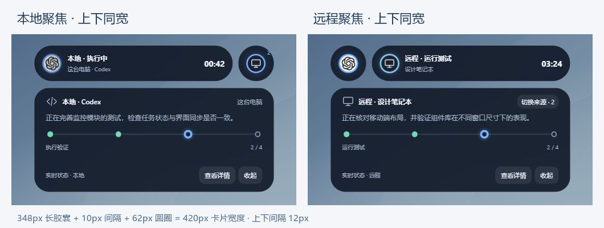
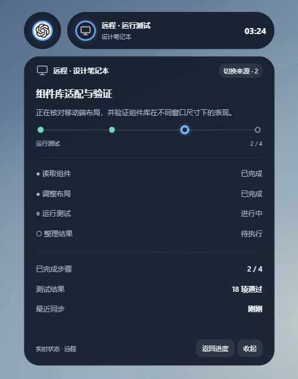
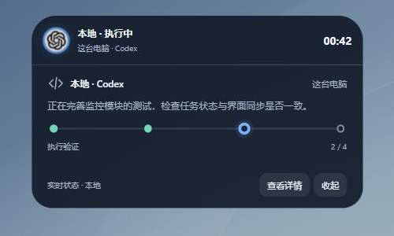
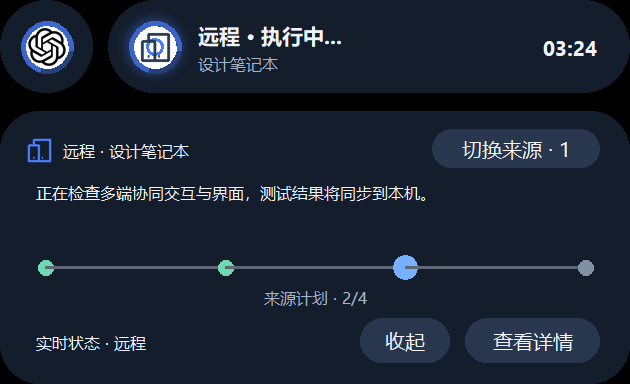
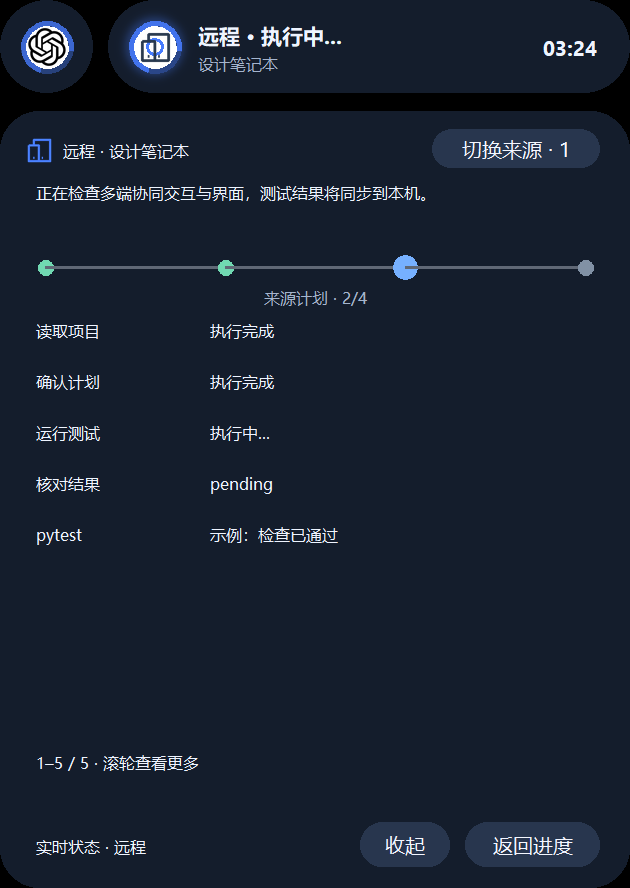
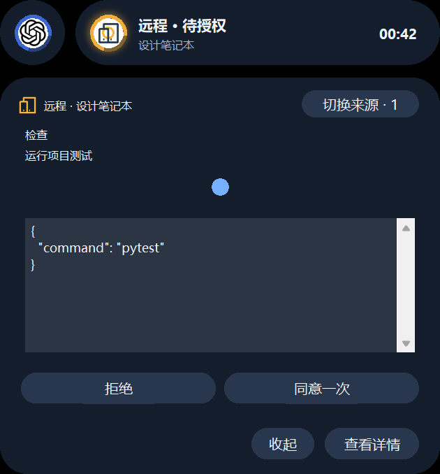
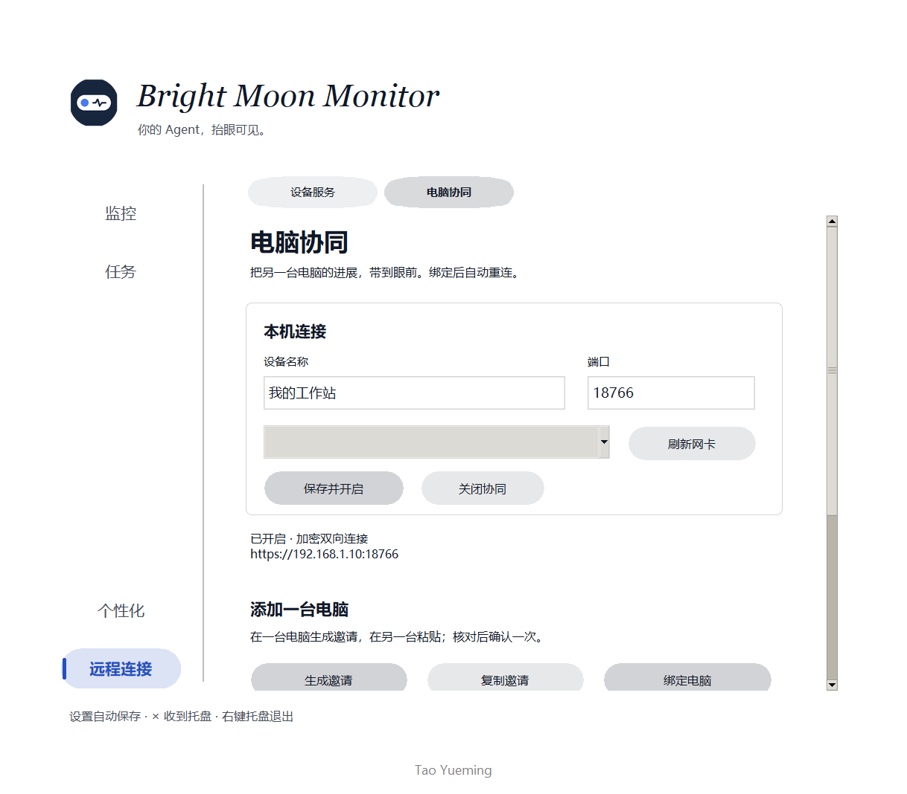

# 多终端灵动岛 UI：一长一圆与独立详情卡片

> 修订日期：2026-10-19 · 第 4 版：有远程时采用分离布局，仅本地时保留连体布局。
> 第 1–8 节为布局基准和原型验收记录；2026-10-20 已新增原生实现并接入 SOLO，见第 9 节。网页原型与原生源码分开保留；数据与控制约束见 [arc.md](arc.md) 第 19 节。

## 1. 本次修正的核心

第一阶段只有两类入口：**本地、远程**。本地固定在左，远程固定在右。当前查看的一侧是长椭圆，另一侧是圆圈；点击切换时两个入口交换宽度，整个组合的左右边界保持不动。

默认聚焦本地：

```text
╭────────────────────────────╮    ╭────╮
│ ◉ 本地 · 执行中     00:42  │    │ ▣  │
╰────────────────────────────╯    ╰────╯
         本地长胶囊                 远程圆圈
```

点击远程圆圈：

```text
╭────╮    ╭────────────────────────────╮
│ ◉  │    │ ▣ 远程 · 运行测试   03:24 │
╰────╯    ╰────────────────────────────╯
本地圆圈              远程长胶囊
```

两种状态**总宽相同、中心相同、左边界相同**。不再向右追加 148px 的领域胶囊，也不再在首态增加 `+N` 按钮。远程多个来源使用同一个远程入口，从展开详情中切换。

第二、第三阶段沿用原有下方内容区尺寸和内容结构。只要有远程信息，不论当前聚焦本地还是远程，顶部保持一长一圆，其组合总宽与下方卡片一致，与下方独立卡片间隔 12px；仅本地时继续使用原有连体样式。切换本地/远程只改变标题、摘要、进度、步骤、时间与合法操作目标，不改变对应阶段的面板宽高。远程详情开头优先显示“远程符号 + 远程 · 设备名”，让用户知道当前查看的内容来自哪里。

## 2. 精确布局与尺寸

### 2.1 第一阶段

本地模式沿用现有 `MINI_WIDTH=300`；有远程时使用与详情区域一致的 420px 总宽，高度仍为 62px：

- 有远程时，三态组合总宽均为 420，高 62。
- 圆形入口 62×62。
- 两入口间距 10。
- 长椭圆宽 `420 - 62 - 10 = 348`，高 62。
- 本地聚焦：`348 + 10 + 62 = 420`。
- 远程聚焦：`62 + 10 + 348 = 420`。
- 无远程信息时只显示原有 300×62 本地胶囊，不保留空白圆圈。

远程模式的首态和展开态共用 420px 宽度：长胶囊、横向间隔和圆圈的总和，严格等于下方卡片宽度。展开或切换来源均不改变左右边界；仅本地首态仍为 300px。

长胶囊内部：来源图标/状态环 → “本地/远程 · 当前阶段” → 执行时间。可用次行显示设备/应用名。文字省略而不挤压圆圈和时间。

圆形入口只保留可辨认的来源图标和状态灯。本地使用现有来源 Logo，远程使用电脑符号；同色状态环表达运行、待处理、失联等状态。多个远程来源可用角标显示数量，但不新增第三个首态控件。

### 2.2 第二、第三阶段

现有各来源面板高度不是完全一致的，不能声称整个项目第二态永远是 244px。本轮选用已核实的 Codex 普通执行场景作为演示基线，来源为 `monitor/codex_monitor/panel.py::size()`：

- 普通执行第二态：总卡片 420×244。
- 展示执行列表的第三态：总卡片 420×580。
- 现有待授权、完成等特殊场景仍采用原来的高度策略（例如该面板待授权 440、普通完成 310），不因为“远程”身份增加新的尺寸规则。
- 62px 头部计入上述总高度；普通第二态的下方区域为 420×182，第三态下方为 420×518。
- 有远程时，头部为 420×62（348 + 10 + 62），与下方 420px 卡片左右边缘完全对齐，三个阶段宽度保持一致。
- 下方内容区仍为第二态 420×182、第三态 420×518，四角均为 26px 圆角；顶边距离头部底边 12px。包含头部和间隔的整体包围高度为 256 / 592，不通过压缩正文抵消这段留白。
- 仅本地时，头部展开至 420px，保持无间隔连体布局，总尺寸依然为 420×244 / 420×580。

有远程时，上方两个入口各自保留独立背景和完整圆角，中间间隙以及上下 12px 间隙露出壁纸，不能被父容器背景填满。下方始终只有一个详情卡片，本地/远程共用它的空间。仅本地时才将头部与下方连成同一背景。此规则取决于远程入口是否存在，而不是当前是否选中了远程。

正式集成必须继续调用来源原有的尺寸计算，包括屏幕工作区限制；这里的演示尺寸不应覆盖其他来源原有的专属布局。判断是否“尺寸不变”应比较**同一阶段、同一内容类型**下本地和远程两个视图，而非禁止原本就存在的阶段展开。

## 3. 交互规则

状态模型：`selected_origin`（本地或远程）、`remote_source_id`、`focused_entity_id`、`stage`（第一/第二/第三态）、`picker_open`。来源切换与阶段展开是两个独立动作。

1. 第一态点击远程圆圈：保持第一态，变为本地圆圈 + 远程长胶囊，显示远程当前阶段和时间。
2. 第一态点击当前长胶囊：进入该来源的第二态。
3. 第二或第三态点击另一侧圆圈：交换长圆形状，替换详情内容，**保持当前阶段和面板尺寸**。
4. 第二或第三态点击当前长胶囊：整张卡片收回第一态，选中的来源不变。
5. “查看详情”进入第三态，“返回进度”回第二态，“收起”回第一态。
6. Esc 优先关闭远程来源列表，再收起详情；键盘焦点返回对应入口。
7. 第一态没有新增来源列表按钮；多个远程来源在远程第二/三态头部通过“切换来源 · N”访问。
8. 用户手动选择后，新快照、计时刷新、新任务不能强行切回本地，也不能打开另一个详情窗。

点击未选中的圆圈仅切来源，不同时展开，是为了让用户可以稳定停留在“本地圆圈 + 远程长胶囊”的第一形态。用户能先浏览远程阶段，确有需要时再展开。

## 4. 下方详情如何明确区分远程

远程第二态优先顺序：

```text
[电脑符号] 远程 · 设计笔记本          [切换来源 · 2]

正在核对移动端布局，并验证组件库……

●────●────◎────○
运行测试                                      2 / 4

实时状态 · 远程                    [查看详情] [收起]
```

本地对应位置为：`[本地符号] 本地 · Codex`。符号放在文字之前，不只依靠颜色表达来源。主胶囊的时间属于**当前长胶囊的任务**：本地长胶囊显示本地时间，远程长胶囊显示远程时间；另一个圆圈不显示时间。

第三态在相同卡片宽度内增加原有步骤列表和指标。切换到另一来源时，摘要、链路、步骤、计时、权限说明及动作目标必须一起更新，不允许出现远程正文配本地按钮的中间状态。

只读来源依然不提供审批按钮。待授权、停止、提醒操作需要遵守 `arc.md` 的 owner、请求版本和权限校验。此次原型只有查看/切换/收起按钮，不会执行真实操作。

## 5. 远程多个来源的收纳

本次用“远程入口”聚合所有合法外部来源，不再为每台电脑、构建服务或开发板各画一个首态胶囊。

- 远程入口默认代表上次仍有效的远程焦点；首次可选最早待处理请求，否则选活动任务。
- N 表示可查看的远程来源数，不是全部历史任务数。
- 来源选择器只占原有展开内容区域，选中后返回同一阶段。
- 单个远程来源内部多任务仍需要独立的任务选择器，不能将来源数量与任务数量混为一谈。本轮代表任务 fixture 不实现完整来源内多任务浏览。
- 构建服务和开发板仍仅是 UI 示例，不代表项目已经有这些真实监控适配器。

## 6. 边界、生命周期与动画

### 固定边界

本地/远程互换期间使用相同 easing，同时增减两个入口宽度，使它们的和始终恒定。整个组合不重新计算居中位置；只在展开层级或工作区尺寸变化时调整总宽。

有远程时，三态顶部总宽均为 420，与展开态下方卡片宽 420 一致；仅本地展开态头部与下方同宽 420。窄屏按可用宽度减去两侧 16px 安全边距缩小。相同窄屏下两个来源仍共用相同尺寸。

### 动画

- 长圆互换约 420ms，保持入口顺序、图标可见和总宽不变。
- 只对宽度/位置做动画，不缩放文字，避免模糊；缩回圆形时隐藏文字与时间。
- 展开仍沿用弹簧风格；正式应用复用现有 `spring_progress`，原型仅做视觉演示。
- 圆环呼吸表示执行/当前焦点，键盘焦点样式不作为鼠标选中外框。
- 高频业务刷新不重建入口，不重复播放形态动画；原型按钮节点保持固定。
- 系统减少动态效果时取消呼吸和位移动画。

### 生命周期

- 本地空闲但远程有任务：保留本地 Solo 圆圈/胶囊，远程内容可正常聚焦。
- 远程最后一条可见任务到期：移除远程圆圈，当前若在远程则回到本地，避免空白详情。
- 失联为灰色和“来源失联”，冻结远程计时，不冒充任务失败；已有退场/持久去重规则仍有效。
- 授权撤销立即清除远程内容，不等待保留时长。
- 全局待处理提示只改远程灯和计数，不自动抢走用户正在看的本地内容。

## 7. 代码落点与原型范围

所有本轮设计代码保留在 `multi_diverse/UI/`：

- `model.mjs`：固定总宽计算、选中来源与阶段转换、fixture。
- `design.mjs`：两个固定入口、来源详情、第三态、来源选择器、主题及键盘交互。
- `design.css`：原有基础样式、本地连体详情、宽度互换和减弱动画适配。
- `remote-layout.css`：仅匹配 `data-layout="remote-split"`，独立实现与详情等宽的头部、上下间隔、分离圆角，不影响 `local-connected`。
- `index.html`：设计展示页和交互入口。
- `test_model.mjs`：尺寸、边界、转换及身份回退测试。
- `serve.py`：标准库回环预览服务。
- `renders/v4/`：本版真实浏览器截图与对比图。

旧 `renders/` 根目录的图片是上一版设计历史，不作为本次交付依据；以 `renders/v4/` 和本文为准。不要将这份网页原型直接当作已经接入 Tk/PeerService 的应用功能。

从 `monitor_solo` 启动：

```powershell
python monitor/multi_diverse/UI/serve.py
# http://127.0.0.1:18790/multi_diverse/UI/index.html
node --test monitor/multi_diverse/UI/test_model.mjs
```

后续实际集成只新增/修改头部来源切换和全局焦点路由，复用现有第二/三态详情尺寸与渲染能力。主 Agent 循环、网络协议和权限规则不因 UI 形状变化而修改。

## 8. 本轮检查与渲染

5 项模型测试通过，覆盖 108 组来源切换配对、来源移除回退，以及新增的分离/连体布局规则：

- 有远程时，所有阶段顶部总宽保持 420 并与下方卡片相同，长圆宽度随来源互换。
- 第二、第三态上下间隔 12；仅本地时为 0。
- 相同阶段下，分离式与连体式下方内容高度相同。
- 来源切换不改变当前展开层级。

浏览器实测：远程存在时第二、第三态头部均约 420×62，上下间隔约 12px，下方分别为 420×182 / 420×518；仅本地第二态头部宽 420、间隔为 0。来源切换与第三态展开操作正常，未观察到控制台错误或警告。JavaScript 语法检查通过。

新版浏览器截图以 `UI/renders/v4/` 为准；v2、v3 图片为历史设计，不代表当前方案。







本轮仍是独立 UI 原型，没有接入真实监控或修改正式应用布局。原生 DPI、透明命中和真实事件刷新留待正式集成验证。


## 9. 原生实现与源码验收

正式外壳位于 `UI/island.py`，详情位于 `panel.py`，尺寸适配位于 `UI/geometry.py`，图标位于 `UI/icons.py`，系统减少动画选项位于 `UI/motion.py`。`UI/index.html` 等仍是设计原型，不是生产界面。

原生实现复用既有弹簧展开、挂件、壁纸/透明度、来源状态环与任务退场机制。分离布局在完整像素边界内绘制 62px 圆圈和 12px 透明间隙，避免旧版 5px 内边距造成视觉间隔变大。顶部宽度 420px 与下方一致；长圆互换约 420ms，系统关闭客户端动画时直接切换并停用新外壳的呼吸位移。

使用仓库现有 `苹果手机_iphone.svg` 和 `设备_devices.svg`，按 DPI 放大绘制后降采样，保留清晰度。手机图标只代表已确认的前台接收页面，不等同于长期配对。授权 Text 复用原生组件，刷新不重复隐藏重建；可选文字、滚动和问答草稿保留。

原生预览：









预览使用临时目录和模拟任务，不能作为真实 Agent 或真机局域网已验收的证据。自动化会检查实际 Tk 窗口的像素透明间隙、尺寸、来源切换、内嵌选择器、手机图标位置与授权组件稳定性。
