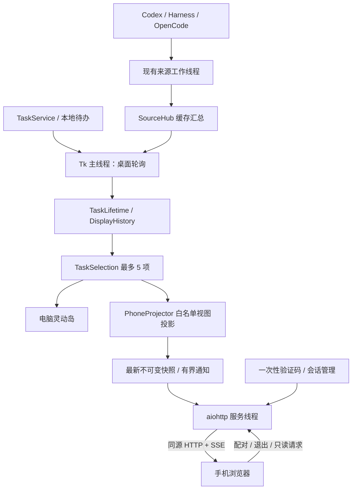
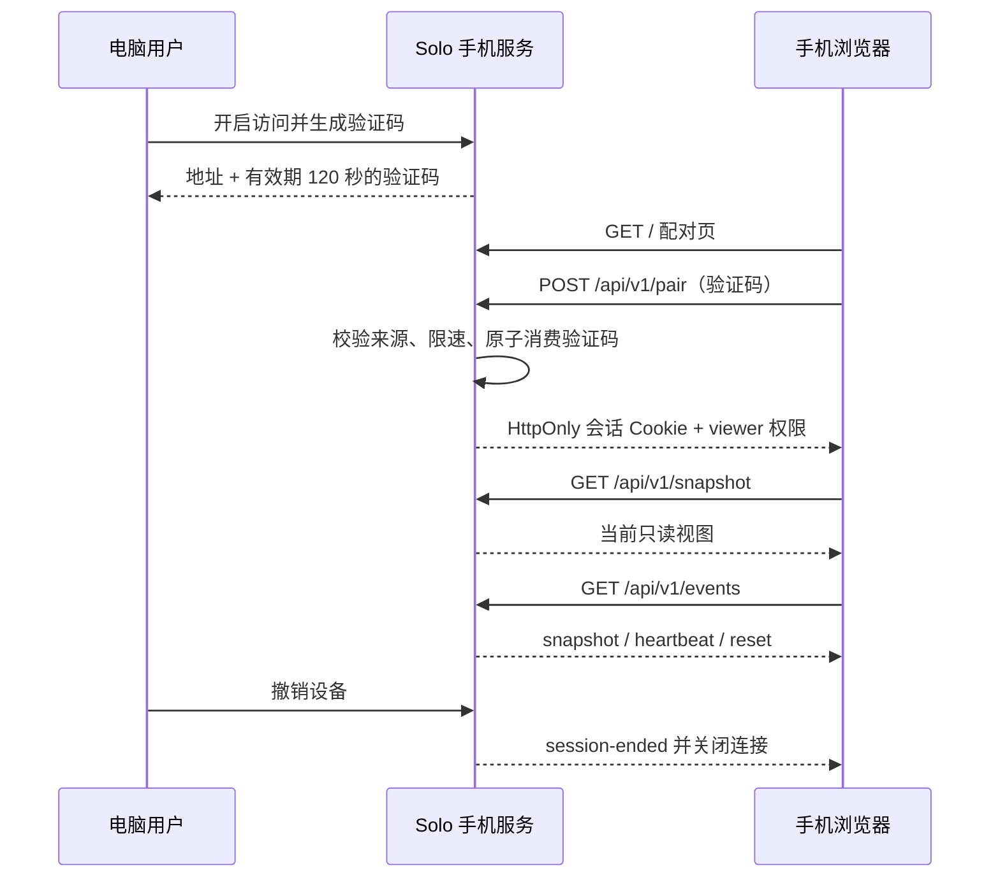

# Solo Phone：同一局域网内的手机浏览器监控方案

> 2026-10-24 更新：本文件以下保留早期只读方案的历史记录。当前实现已新增 HTTPS、逐设备权限、完整待办管理与来源支持的授权操作，现行架构及边界以 [统一设备服务](../remote/README.md)、[v2 接口](../remote/API.md) 和 [使用指南](../../docs/REMOTE_SERVICE_GUIDE.md) 为准。旧 HTTP 模式仍只读，既有 HTTP 凭据不会升级为控制权限。

编写日期：2026-10-18。状态：**设计已落地为源码，默认关闭。实现记录、调整及验收边界见第 19 节；本轮不打包。**

范围：独立 `monitor_solo`；新增功能主要放在 `monitor/phone/`。本文不改 BrightMoon 主工程，不改变被监控 Agent 的循环、日志格式或权限系统。本次需求是手机查看监控信息，不自动包含手机审批、停止 Agent 或编辑待办的权限。

## 1. 结论与最终使用效果

**可行。推荐让电脑端 Solo 内置一个默认关闭的局域网只读 Web 服务，手机用浏览器打开电脑提供的网址，输入电脑显示的一次性验证码后，查看当前灵动岛的任务内容。**

不需要购买云服务器，不需要手机安装 Python、Agent、Solo 客户端，也不需要公网穿透。手机与电脑通过可互通的局域网连接；电脑运行 Solo，Solo 继续负责连接 Codex、DeepSeek Harness、OpenCode，手机只连接 Solo。

用户路径：

1. 电脑开启 Solo，在「监控 → 手机访问」开启局域网访问。
2. 电脑显示可访问地址，例如 `http://192.168.1.23:18765/`。这是示例地址，实际以检测结果为准。
3. 用户点击「连接新手机」，电脑显示有效期 2 分钟的一次性 8 位数字验证码。
4. 手机连到同一可互通网络，在浏览器输入该网址，出现配对页；输入验证码。
5. 验证成功后进入监控页，看到任务圈、任务状态、计时、摘要、执行链和来源专属详情。
6. 手机点击任务圈切换关注对象，点击卡片展开或收起，不改变电脑上的焦点。
7. 电脑结束任务、超过保留时间、关闭监控来源时，手机同步撤下对应任务；刷新手机网页不会影响 Agent 或桌面监控。
8. 电脑可以查看已连接设备、撤销单个设备或关闭整个手机访问。

**手机网页只在浏览器页面内显示。** 不能承诺它成为 iPhone 的系统灵动岛、跨应用悬浮窗、锁屏实时活动，也不能承诺切后台、锁屏后仍持续运行和播报。网页返回前台时自动重新同步。

电脑可通过 Wi-Fi 或网线接入同一路由器；关键是网络互通，不是两端必须使用同名 Wi-Fi。访客网络、AP 隔离、公司网络策略、防火墙可能阻止设备相互访问。

## 2. 当前源码的实际情况

以下保留设计前的代码基线，函数名用于定位；实施后的接口与变更以第 19 节为准。

### 2.1 已有数据入口，但读取不完全是只读操作

- [`MonitorApp.read_snapshot()`](../app.py) 调用 `SourceHub.read()`，再调用 `TaskService.read()`，合并 `runs`、来源状态、偏好、下一条提醒和提醒数量。
- [`TaskService.read()`](../tasks/service.py) 会轮询待办、领取声音播放记录、启动或停止提醒音；不能让每个手机请求各调用一次。
- [`SourceHub.read()`](../src/source_hub.py) 会根据配置建立/关闭工作线程，并且每次读取增加 `revision`。这个版本号不是「展示内容真的变化了」的保证。
- `DynamicIsland._poll()` 约每 400ms 更新桌面状态；`MonitorApp.refresh_status()` 约每 700ms 也调用 `read_snapshot()`。现在已有两个桌面读取入口，扩展手机时应减少重复读取，不再增加第三个。

### 2.2 可见任务与原始来源快照不相同

- [`TaskLifetime.visible()`](../UI/task_lifetime.py) 执行结束保留、失联/暂停/停止退场和持久去重。
- [`TaskSelection.update()`](../UI/task_selection.py) 在上述结果上处理待办优先、授权排队、当前焦点和最多 5 条显示任务。
- 来源可能仍保留历史运行记录，因此直接将 `SourceHub.read()['runs']` 发给手机，会让已经从桌面退场的任务重新出现在手机。
- [`task_identity()`](../src/task_identity.py) 包含来源、监控范围、任务与运行代次；不能只把 `run_id` 当成跨轮次身份。
- [`DisplayHistory`](../src/display_history.py) 保存显示记录；新手机连接不应该另建一份历史，也不能修改「已经展示过」的判定。

### 2.3 桌面 UI 不能原样搬到浏览器

- [`DynamicIsland`](../UI/island.py) 使用 Tk 窗口、Canvas、字体测量和 Windows 窗口透明度。
- [`detail_panels.py`](../UI/detail_panels.py) 按来源注册详情面板；Codex、Harness、OpenCode 各有自己的 `panel.py`。
- 各 `panel.py` 会调用 `ui._text()`、Tk 原生控件、尺寸和滚动状态；这些方法不能直接输出 HTML。
- OpenCode 的 `chain_model()` 等函数已有纯数据部分，可提取并复用其语义；不能为了复用数据而初始化 Tk 面板。

### 2.4 线程和关闭流程有明确边界

- 每个来源有自己的 `SourceWorker`，当前约每 700ms 轮询；超过 30 秒的阻塞读取可由快照端标记异常。
- [`TaskStore`](../tasks/store.py) 和 `DisplayHistory` 使用 SQLite 连接，当前没有允许任意线程共享连接的设计。
- 关闭主窗口是隐藏到托盘，`MonitorApp.close()` 才关闭灵动岛、来源和待办服务。
- 当前运行依赖是 Pillow、zstandard、websocket-client，**websocket-client 是客户端，不是 Web 服务端**。
- [`resource_files()`](../../packaging/release_files.py) 是打包资源允许列表，新增网页后必须显式纳入资源，不能只保证源码模式能运行。

## 3. 设计边界：什么共享，什么独立

### 3.1 共享监控事实

手机和电脑共享任务身份、状态、摘要、计划/轨迹、来源健康状态、退场规则，以及当前桌面显示集合。

本方案将手机定义为 **当前桌面灵动岛的内容伴随页**：

- 同步桌面 `selection.runs` 最多 5 条任务；包含桌面省略号背后的任务，不只复制当前绘制出的前三个圈。
- 不默认返回全部 Agent 历史、全部会话或整个待办数据库。
- 任务超出 5 条时，沿用桌面选取策略；手机不会为了显示第六条再连接一次 Agent。可显示“当前同步桌面窗口，最多 5 项”的提示。
- 桌面选取集合变化时，手机更新集合；手机焦点不在新集合内时提示“此任务已离开当前监控窗口”，不能据此断言该任务已经完成。

### 3.2 手机独立的浏览状态

手机自己保存聚焦任务、展开层级、滚动位置和「跟随电脑焦点」选项，默认不跟随电脑焦点。浏览状态只放内存或 `sessionStorage`，不上传桌面配置，也不保存任务文本。

默认首次连接聚焦桌面当前任务；之后用户手动切换不会控制电脑。任务身份使用独立 `task_key`，包含运行代次，避免同一会话第二轮沿用第一轮详情。

### 3.3 不扩张控制权限

本版是 **只读 viewer**：

- 可以切换任务、展开详情、查看待授权和待输入状态。
- 待授权区域显示来源、原因、经过隐私策略处理的参数预览，并提示「请在电脑端或来源应用中处理」。
- 不提供可执行的同意、拒绝、停止、发送消息、新建 Agent 任务、忽略提醒或已知晓操作。
- 后端不注册 Agent 命令路由，不能仅靠隐藏按钮实现只读。
- 本地待办按钮在手机上由说明文字代替；不改变现有电脑端操作。

后续远程控制必须单独设计更强传输与授权策略，见第 17 节，不将其偷偷纳入本次实施范围。

## 4. 推荐总体架构

采用 **Tk 主线程更新业务状态 + 不可变手机视图快照 + 独立异步 Web 服务线程 + 响应式网页**。



这里的「不可变」指发布后不能被桌面或 HTTP 请求继续修改：采用构造后冻结的数据模型，或完成序列化的 UTF-8 字节缓存。不把当前 `run` 字典引用直接交给另一个线程。

### 为什么不采用截图串流

截图方案看似可以复用桌面外观，但手机文字会缩小模糊，难以滚动与复制，读屏和交互命中也很差，还需要不断截图编码。截图可能意外带入桌面其他内容。结构化 JSON + HTML/CSS 能保留内容语义，独立适配手机尺寸。

### 为什么使用 SSE

需求以服务器向手机推送为主，配对和退出走普通 HTTP；采用 Server-Sent Events 可使用浏览器原生 `EventSource`，断线处理简单。暂时无需引入双向 WebSocket 的消息协议。

推荐 Web 服务库为 **aiohttp**，放在专用 asyncio 线程中，支持 HTTP 和有界 SSE 连接。前端采用本地 HTML/CSS/ES module，不需要引入 Node 构建链或外部 CDN。未来增加双向控制也应先走明确的 HTTP 命令接口，并不必然需要 WebSocket。

新增依赖必须在实施时选择兼容 Python 3.10+ 的已维护版本、固定 Windows 发布锁和依赖哈希，补充许可证。本文不虚构尚未验证的版本号。

## 5. 桌面代码如何改进

### 5.1 保留现有生命周期所有者，新增发布钩子

给 `DynamicIsland` 新增可选的只读回调，例如 `view_publisher=None`：

1. `_poll()` 仍在 Tk 主线程调用原有快照读取器。
2. 接受快照、执行 `selection.update()`、退场/空闲转换，得到最终显示集合。
3. 基于这次接受的快照和 `selection.runs` 构造有大小限制的 PhoneView。
4. 非阻塞发布给手机缓存；继续桌面绘制和下一次调度。

发布点应在业务状态确定之后、可能失败或较慢的图片绘制之前。手机投影失败只能显示诊断，不中断桌面绘制、声音和 400ms 轮询。下一轮调度放在受控的 `finally` 路径，防止一次可恢复错误永久停止刷新。

手机服务不在 `DynamicIsland` 内初始化。由 `MonitorApp` 创建 `PhoneService`，再把发布回调注入，避免共享 UI 依赖 aiohttp。手机功能关闭时，回调直接返回，不做正文投影、图片处理或网络启动。

### 5.2 收敛设置页的重复读取

将 `MonitorApp.refresh_status()` 改为读取最近一次桌面已接受快照的缓存，不再每 700ms 独立调用带副作用的 `read_snapshot()`。

- 首次显示前由主线程触发一次业务采样，或显示“正在加载”；不能由 HTTP 线程补采样。
- 开关来源、修改待办、修改配置时，在 Tk 主线程调度现有轮询立即刷新，多个连续变更合并调度。
- 修改设置后到下一轮采样之前，桌面控制立即反映本地开关状态，来源结果标记等待刷新，不能先展示旧的有效动作。
- `_tick()` 的呼吸/动画计时不生成网络快照；桌面的每帧绘制不能变成手机每帧推送。

这是手机接入需要的局部整理，不把整个桌面业务循环改成 Web 服务驱动。

### 5.3 不重复执行生命周期与声音

手机投影只消费已经筛选的任务，**不调用** `TaskLifetime.visible()`、`TaskSelection.update()`、`TaskService.read()` 或 `DisplayHistory.put()`。

同一任务在电脑和三个手机上可同时显示，但只由原有电脑逻辑判断退场、写历史和播放提示音。刷新网页不能重新领取声音，断线重连不能延长保留时间。

桌面仍持有和关闭 `DisplayHistory`；手机服务不持有数据库连接。保留现有 UI 所有权，可减少为本次功能迁移历史数据库和计时器的风险。

### 5.4 隐藏窗口也必须发布

现有桌面 `_poll()` 在 `_hidden` 状态下仍继续调度，这一行为必须保留。关闭控制面板至托盘、空闲时隐藏岛、主窗口最小化，都不能停止手机数据更新。

真正退出 Solo 才停止服务。手机没有活动任务时仍显示在线空态，而不是关闭网页或白屏；桌面窗口透明度为 0 时手机仍须可读。

## 6. 文件布局与接口

以下目录是拟实现结构，本次仅新增本文档。

```text
monitor/phone/
  arc.md                  本方案
  __init__.py             无网络/线程的导入入口
  service.py              PhoneService 启动、关闭、桌面事件队列
  config.py               设置归一化、旧配置迁移
  network.py              网卡、地址、网络类型、监听范围判断
  server.py               aiohttp 路由、鉴权、安全响应头
  pairing.py              验证码、会话、限速、吊销
  publisher.py            最新视图缓存、版本、有界通知与订阅
  schema.py               PhoneView/TaskView/Block 类型和协议版本
  projector.py            桌面显示集合 → 有限且脱敏的 PhoneView
  privacy.py              内容开关、路径处理、敏感字段过滤
  assets.py               授权资源 ID → 受限图片副本
  settings_panel.py       桌面“手机访问”专属区域组件
  presenters/
    common.py             共通标题、时间、摘要、状态
    codex.py              Codex 数据到手机内容块
    deepseek.py            Harness 数据到手机内容块
    opencode.py            OpenCode 数据到手机内容块
    reminder.py            待办和空闲预告
  web/
    index.html            配对页与监控页入口
    styles.css            响应式布局、状态环、动画
    app.js                页面状态、认证失效、重连
    transport.js          SSE / 后备轮询、版本检查
    renderers.js          白名单内容块渲染
    icons/                必要的静态品牌/功能图标
```

核心接口约定：

```python
# 拟定接口，不是当前可直接调用的代码。
PhoneService.start(config)                 # 异步启动，状态返回事件队列
PhoneService.stop()                        # 有界异步关闭，不阻塞 Tk
PhoneService.publish(view, producer_tick)  # 非阻塞，接收不可变视图
PhoneService.open_pairing_window()         # 只由电脑端调用
PhoneService.revoke(device_id)             # 只由电脑端调用
PhoneService.drain_events()                # Tk 定时处理服务状态
PhoneProjector.project(display_state, policy) -> PhoneView
SnapshotPublisher.current() -> PublishedView
```

`display_state` 由桌面主动传入，只包含这次快照、最终可见任务、当前焦点、空闲信息和时间，不传 Tk 控件。`PhoneProjector` 是纯函数组件，不读 Agent、不联网、不写库。

对共享文件的必要改动仅有：

- `monitor/app.py`：组装和关闭 PhoneService、缓存快照、派发桌面事件。
- `monitor/UI/island.py`：可选发布钩子与必要的刷新异常保护。
- `monitor/UI/settings_panel.py`：嵌入手机设置入口，其具体 UI 实现在 `phone/settings_panel.py`。
- `monitor/settings.py`：保留并归一化 `phone` 配置。当前白名单式 normalize 会丢弃未知字段，不能只写 JSON 而不修改归一化。
- 个别来源的数据纯函数：如复用现有 `chain_model()`，将不依赖 Tk 的部分下沉到该来源的 `view_model.py`，桌面与手机共同调用；不要求重写已有绘制器。
- `requirements*.txt`、发布锁、许可证和 `packaging/release_files.py`：纳入服务依赖及网页资源。
- `tests/phone/`：新功能专项测试；现有桌面测试继续保留。

## 7. 配对与身份设计

### 7.1 三个概念分开

- **访问地址**：电脑当前局域网 IP 与端口，不是密码。
- **一次性验证码**：仅用于新设备首次换取会话。
- **设备会话**：配对后浏览器携带的高熵令牌，后续看数据不重复输入验证码。

不把验证码永久当 API 密码，也不把验证码、令牌放到 URL、二维码参数或浏览器 localStorage。

### 7.2 验证码规则

- 默认未开启配对窗口，不接受新设备加入。
- 电脑用户点击「连接新手机」后，用 `secrets` 生成 8 位数字码，允许前导零。
- 有效期 120 秒，以单调时钟计算；显示为 `1234 5678`，输入时仅去除空格后校验数字格式。
- 一次成功后立即消费；并发两个请求时只能有一个成功。再次配对必须在电脑端生成新码。
- 重新生成、关闭服务、网络绑定变化、退出进程都撤销旧码。
- 单 IP 每分钟最多 5 次失败；该配对窗口全局累计失败达到 20 次则作废，电脑显示原因并允许手动重新开启。
- 服务端只记录结果代码和匿名设备 ID，不打印验证码、Cookie 或配对请求正文。
- 码的值仅在进程内，比较使用常量时间比较；不写 `settings.json`。

验证码防止同网段其他普通访问者直接读取内容，但不能阻止能够监听明文流量的人，见第 11 节。

### 7.3 会话规则

- 成功后生成至少 256 位随机令牌，服务端保存其哈希和会话元数据；浏览器通过 Cookie 自动带回。
- Cookie：`HttpOnly; SameSite=Strict; Path=/`，不设置跨域 Domain；HTTP 模式不能虚假声明已使用有效的 `Secure` Cookie。
- 会话权限固定为 `viewer`，不接受浏览器自报 `admin` 或 `control`。
- 绝对有效期 8 小时，30 分钟无有效认证活动失效；在线 SSE 的鉴权心跳计为活动，但不能延长 8 小时绝对期限。
- 服务启动期内可支持刷新/重连。浏览器 Cookie 只是会话凭证，不保证手机系统不会清理它。
- 默认最多 3 个配对设备，每设备最多 2 条实时流，总计不超过 6 条；拒绝额外连接时给出明确提示。
- 电脑端显示设备自定义名称、连接/离线状态、最近访问时间和撤销按钮。名称按普通文本限长处理，不当成可信身份。
- 手机主动退出、电脑撤销、会话到期或服务停止后：后续 API 立即拒绝，活动 SSE 在下一个服务检查周期内主动关闭。
- 设备会话表只在内存，重启需重新配对；首个实现不增加“永久信任此手机”的跨重启秘密存储。

### 7.4 配对时序



## 8. 通信协议与快照模型

### 8.1 路由白名单

- `GET /`、固定 `/static/...`：公开配对页面与必要样式脚本，不包含任务、验证码或本地目录。
- `POST /api/v1/pair`：验证一次性验证码；唯一未认证的业务写入口。
- `GET /api/v1/session`：返回当前 viewer 会话、到期时间、协议版本；未认证 401。
- `POST /api/v1/logout`：吊销当前会话并清除 Cookie。
- `GET /api/v1/snapshot`：返回最新完整只读视图，支持 `If-None-Match`，无变化可 304；鉴权必须早于 304。
- `GET /api/v1/events`：认证后的 SSE 数据流。
- `GET /api/v1/assets/{asset_id}`：认证后的有限展示资源，不能把请求参数拼接成磁盘路径。

不注册 `/command`、`/approve`、`/files`、`/exec`、`/proxy` 或数据库下载接口。未知路径返回 404，非法方法返回 405；不能让 aiohttp 静态路由递归暴露项目根目录。

配对与退出要求同源 JSON POST 和允许的 Origin；响应同源、不开 `Access-Control-Allow-Origin: *`。手机由这台电脑的服务加载页面，因此不需要额外跨域配置。

### 8.2 发布内容白名单

不要直接 `json.dumps(snapshot)`。现有快照可能包含完整设置、来源路径、工具参数、日志输出和带凭据的字符串，应经过手机专用投影。

PhoneView 的示意结构：

```json
{
  "schema_version": 1,
  "epoch": "随机的本次服务实例标识",
  "revision": 42,
  "generated_at_ms": 1792252800000,
  "mode": "viewer",
  "desktop_visible": true,
  "desktop_focus_key": "opaque-task-key",
  "tasks": [
    {
      "task_key": "opaque-task-key",
      "app_id": "codex",
      "title": "整理项目测试",
      "status": "running",
      "connection_state": "ready",
      "icon_id": "source-codex",
      "timer": {
        "started_at_ms": 1792252788000,
        "ended_at_ms": null,
        "basis": "reported"
      },
      "summary": {"text": "正在检查测试结果", "truncated": false},
      "chain": {
        "kind": "plan",
        "completed": 2,
        "total": 5,
        "label": "执行计划 2/5 · 按来源报告",
        "nodes": [
          {"id": "step-1", "label": "读取项目", "status": "completed"},
          {"id": "step-2", "label": "执行测试", "status": "running"}
        ],
        "windowed": true
      },
      "detail_blocks": [],
      "attention": null,
      "truncated": false
    }
  ],
  "idle": {"upcoming_count": 0, "next_reminder": null},
  "source_health": [{"app_id": "codex", "status": "ready", "read_only": true}],
  "appearance": {"background_color": "#141d2c", "background_alpha": 1.0}
}
```

示例节点只是可视窗口，不代表 total 个节点都已输出。字段还应以 schema 明确可空性、枚举和上限。

身份与版本：

- `task_key` 由本次服务密钥对 `task_identity(run)` 计算 HMAC 得到，不直接发送本机路径或原始会话 ID；同次服务内同一运行稳定，新轮次必须变化。
- `epoch` 在服务重启、重新绑定、隐私策略切换时变化，浏览器必须丢弃旧任务状态和旧资源引用。
- `revision` 是手机内容版本，仅语义内容改变时增加；不直接使用 SourceHub 每次读取增加的版本。
- 内容摘要计算排除生成时间、网络心跳时间、逐秒计时数字；终态时间、来源状态和显示集合的变化必须纳入。

### 8.3 内容与进度要诚实

- Codex 有明确 `steps` 时显示“计划完成 x/y”；没有就显示“未报告计划”。工具数量不是任务完成百分比。
- Harness 的模型轮次链标明“已观察模型轮次”，不能把“已调用 6 次模型”说成“完成 6/6”。
- OpenCode 有待办计划优先展示任务链，没有时展示观察到的阶段，仍保留“执行轨迹”标签。
- 上下文最近输入量、会话累计 token、窗口大小、压缩次数分别命名；累计用量不能当当前上下文占用。缺少分母时不生成百分比。
- 文件变更、验证结果只显示来源实际报告的信息；工具退出码 0 不自动等于“整个项目验证通过”。
- 手机只展示适配器当前已经获得的内容，不通过读取项目文件来补造缺失摘要。

### 8.4 推送、重连与时间

- 首次认证先获取完整快照，再连接 SSE；SSE 建立时总是发送最新完整快照。即使两次请求间发生变化也不会丢失最终状态。
- SSE `id` 为 `epoch:revision`；事件类型为 `snapshot`、`heartbeat`、`reset`、`session-ended`。
- 采用“全量替换当前最多 5 项”的消息，不实现复杂增量补丁。断线期间无需无限积累历史事件。
- 单订阅待发送队列容量 1，慢客户端丢弃旧快照只保留最新快照。写超时 5 秒即关闭；连接总数受限。
- 内容推送最多每秒 2 次，最终状态与退场不被永久合并掉；没有内容变化只每 10 秒发心跳。
- 心跳必须带 `producer_age_ms` 与 `server_time_ms`。HTTP 线程自己还活着，不代表 Tk 主线程仍在刷新：生产者超过 5 秒未采样标记状态滞后，超过 15 秒显示“电脑监控刷新暂停”。
- 页面 25 秒没有收到任何消息标记连接中断；收到心跳但生产者滞后也必须停止“实时”标识。
- EventSource 错误时关闭旧连接，先检查会话状态；401 回配对页，不进入无穷重试。可重试错误按 1、2、4、8、15 秒上限加随机抖动退避。
- SSE 连续失败 3 次且普通认证请求成功时，降级每 2 秒 GET 快照并使用 ETag；标签页在后台时暂停轮询，回到前台先取完整快照。
- 显示计时用服务器校准的时间锚点加浏览器 `performance.now()` 差值；任务结束冻结计时。来源只知道首次观察时间时明确标注“观察计时”。
- 心跳断开/生产者滞后时，计时冻结并标明“上次已知用时”，不让界面继续暗示任务在运行。
- 重连后的当前完整快照具有权威性：不重播过去动画、完成音或已退场任务。

## 9. 手机 UI：保留灵动岛风格，适配触屏

### 9.1 页面基本结构

目标宽度覆盖 320～430 CSS px 常见竖屏，兼容横屏与平板。网页顶部留出 `env(safe-area-inset-top)`，底部使用 `safe-area-inset-bottom`；使用 `100dvh` 并为旧浏览器保留 `100vh` 后备。

页面是完整的浏览器阅读页，不复制 Windows 桌面透明窗口。外层用可读背景，内层卡片采用用户的颜色/壁纸，文字保持清晰。

```text
┌──────────────────────────────────┐
│ Bright Moon · 手机实况   ● 已连接 │
│ 电脑：我的电脑       只读 · 退出 │
│                                  │
│  ╭────────────────────────────╮  │
│  │ ◉  ◉  ◉   3 项任务   00:12 │  │  A 胶囊
│  ╰────────────────────────────╯  │
│                                  │
│ 最近同步：刚刚                   │
│                                  │
└──────────────────────────────────┘
```

主连接状态固定可见，不能只有任务颜色。绿色“已连接”说明手机与电脑之间的通道；来源自己的“监控失联”可以同时出现，两者不能混淆。

### 9.2 配对页

- 显示 Solo Logo、标题“连接电脑灵动岛”和“请在电脑端开启连接新手机”。
- 单个 8 位输入框，`inputmode="numeric"`、支持粘贴和前导零；不用八个独立输入框制造焦点困难。
- 可选设备名称如“我的手机”，最多 32 字；一个主按钮“连接”。
- 错误提示区分格式错误、验证码已失效、次数限制、电脑服务不可达，不显示请求堆栈。
- 浏览器只拿到空壳与公共品牌图，未认证不能预取任务、壁纸或设备列表。

### 9.3 A 态：胶囊概览

- Logo 保持视觉大小，状态环、白色间隙和聚焦呼吸光晕与桌面风格一致，CSS/SVG 实现而不是截图放大。
- 正在运行用蓝色，待授权/输入用橙黄色，完成绿勾、失败红色提示；同时保留文字和无障碍标签。
- 右侧时间对应当前手机焦点任务。
- 320px 宽度时压缩标题到单行省略，不能缩小触控目标；每个图标点击区域至少 44×44 CSS px。
- 4～5 个任务时在展开态使用可横向滚动图标条并显示“1/5”等位置提示；胶囊可沿用前三圈加省略入口。有待办时优先顺序保持桌面语义。
- 单待办状态显示对应 Logo、状态环与最多 5 字标题；不要变成不同尺寸的裸图标。

### 9.4 B 态：进度卡片

```text
╭──────────────────────────────────╮
│ ◉ Codex          执行中     00:12 │
├──────────────────────────────────┤
│ 任务摘要                         │
│ 正在补充测试并检查执行结果……     │
│                                  │
│ ●────●────◎────○────○             │
│ 执行计划 2/5 · 按来源报告         │
│                                  │
│ 当前步骤：检查测试输出           │
│ 最近工具：pytest · 执行中        │
│                         查看详情 │
╰──────────────────────────────────╯
```

- 摘要在进度链上方，首次展开即可看到；正文默认约 200 个 Unicode 字符，截断标识清楚。
- 完成后显示结果摘要，不只显示执行步骤；点卡片空白或顶部可折回胶囊。
- 一个明确“查看详情”入口进入 C 态，也可点击非交互区域切换。点链接、复制、滚动、选择文字不能触发折叠。
- 小屏上的执行链最多显示 6 节点，超过时围绕当前节点窗口化，并标“步骤 4–9 / 共 12 步”；不画虚假固定六阶段。

### 9.5 C 态：可滚动详情

使用同一张卡片增加可滚动内容，顶部任务选择条保持可达：

- 执行步骤列表和当前节点。
- 近期工具名称、状态、退出码及允许共享的结果摘要。
- 来源实际报告的上下文、压缩、模型与连接方式。
- 文件变更统计和文件名摘要；默认不显示完整本机路径。
- 待办的到期时间、提前提醒和重复规则。
- 未报告项展示“来源未报告”，不要把空值渲染成 0、100% 或成功。

手机页面可以整体滚动，不把所有内容塞入一个固定高度的内嵌滚动框；工具/参数长内容可独立展开，但只能在服务端返回的边界内查看。

点顶部/卡片非交互区域按 A→B→C→A 循环；另提供明确“收起”按钮和 `aria-expanded`，便于触屏与读屏。状态更新只更新稳定 keyed 节点，不反复替换整张卡片，保留阅读位置。

### 9.6 待授权、待输入与只读提醒

```text
╭──────────────────────────────────╮
│ 🟠 OpenCode              待授权  │
├──────────────────────────────────┤
│ 需要读取项目文件                 │
│ 原因：用于分析配置               │
│                                  │
│ 参数预览（部分内容已隐藏）       │
│ config.json                      │
│                                  │
│ 本页为只读监控                   │
│ 请在电脑端或来源应用中处理       │
╰──────────────────────────────────╯
```

只有手机已展开且出现新的队首待处理项时才自动聚焦；当前未处理队首不被新请求抢走。用户手动切换后保持选择，直到队首变化或明确重新跟随。匹配桌面已有排队意图，但浏览状态独立。

每个请求以稳定身份和版本更新；数据没变不能每次推送重建参数区域，避免之前桌面发生过的频闪问题。

### 9.7 空闲、退场与断线

- 桌面无任务并隐藏岛：手机显示“电脑已连接，当前没有任务”，网页和连接状态不消失。
- 桌面开启常驻时，手机可显示对应空闲胶囊和未来 1 小时提醒预告。
- 当前代码只在常驻且任务提醒开启时计算 upcoming 预告；若未启用，手机标明“未开启空闲预告”，不能把缺失数据解读成未来一小时没有任务。
- 最后一个任务退场时，手机自动收回 A 态，再显示空态；展开状态不能卡住已结束任务。
- 手机离线只说明“与电脑连接中断”，不把 Agent 改成失败；来源失联使用来源的独立状态。
- 离线/生产者滞后时短暂保留上次内容并加遮罩，最多 60 秒后清空任务正文；退出、会话吊销立即清空。
- 默认手机不播放声音，避免电脑/手机重复提醒。将来如增加声音，需要浏览器用户手势解锁并单独设置，不能承诺自动播放。

### 9.8 背景与动画

- 普通 CSS 圆角、状态环、有限光晕即可，不把桌面窗口 alpha 直接应用到整个网页，否则文字也会透明。
- 桌面的 `monitor_opacity` 是不透明度值；映射为背景层 `alpha = opacity / 100`，不要与界面“透明度”反向文案混淆。
- 网页为文字增加可读衬层，任务文字和按钮保持不透明；壁纸共享默认关闭，在电脑明确打开后才发送。
- 壁纸使用顶部对齐的统一裁切，展开显示更多区域；手机视口比桌面窄，保留风格而非承诺像素完全一致。
- 挂件、空闲角色默认只使用公共资源；用户个人角色图也需要“共享个性化图片”开启。动画尊重 `prefers-reduced-motion`。
- 常规开合 250～400ms，轻量两次衰减弹性；长文更新不触发布局弹跳。无障碍关闭动画后直接改变形态。

## 10. 桌面设置、地址与网络生命周期

建议在「监控」页增加可折叠“手机访问”，不与个性化混为一体。具体布局代码留在 `phone/settings_panel.py`：

```text
手机访问                                 [关闭 / 开启]
状态：未开启
监听网卡：Wi-Fi · 私人网络                [选择]
网址：http://192.168.1.23:18765/           [复制]
[连接新手机]   验证码：1234 5678    01:52
分享内容：● 状态与摘要  ○ 仅状态
[ ] 共享个性化图片
已配对设备：我的手机 · 在线               [撤销]
```

- 默认关闭；开关是访问服务开关，不是停止 Agent 开关。
- 端口默认建议 18765，设置范围 1024～65535。端口占用时报明确错误，用户修改后重试；不默默换地址。
- 优先枚举已连接的物理网卡与 Windows 网络配置类型。默认只允许用户选择 Private 网络的有效 IPv4 地址，不自动绑定 VPN、虚拟机网卡或公网网卡。
- 服务绑定选定的具体地址，不默认 `0.0.0.0`。仅显示可从手机访问的地址，不显示 `127.0.0.1`、`localhost` 或 `0.0.0.0` 让用户误用。
- 除监听地址限制，检查客户端来源位于选定网卡的允许直连子网；不用“所有私网地址”作为无条件信任标准。安全边界仍是配对，不是 IP 本身。
- 公司 Domain 网络或无法识别网络类别时不自动开放，提示由用户和公司网络策略决定；不能偷偷将系统网络改为 Private。
- Windows 防火墙提示时说明只允许需要的私人网络；如需要新增规则，交由明确的用户操作，限制到应用、端口和本地子网，不自动关闭防火墙。
- 可选二维码只编码访问地址，不包含配对码或令牌。为保持首个实现依赖简洁，复制地址即可满足本次需求，二维码不是必要阻塞项。

持久配置示意，存于现有 `settings.json` 的 `phone` 节点，不能把配对秘密放进去：

```json
{
  "phone": {
    "enabled": false,
    "interface_id": "",
    "port": 18765,
    "privacy_mode": "summary",
    "share_personalization_images": false
  }
}
```

IP 会变化，因此记录网卡稳定标识而非只保存旧 IP。重新启动若之前开启，须先验证同一网卡和网络类型；验证失败保持停止状态，桌面提示原因，不回退到监听所有网卡。

运行中断网、IP/网络配置改变：停止旧监听、撤销验证码与会话、产生新 epoch，重新验证后展示新地址。不能把原家庭 Wi-Fi 的会话静默带到公共热点。支持同路由器 IP 改变后的重新配对是可接受行为。

× 隐藏到托盘不停止服务；真正退出时停止接受新连接、通知并关闭 SSE、吊销会话、清空缓存、释放端口。网络线程不得调用 Tk；通过事件队列汇报，Tk `after()` 在主线程定时取消息。关闭等待有上限，不能因为一台手机的慢连接让电脑无法退出。

## 11. 安全与隐私：HTTP + 验证码能做到什么

### 11.1 明确传输边界

普通 `http://局域网IP` **不加密**。验证码控制谁可以正常配对，但配对码、Cookie 和任务内容可能被具备网络监听能力的人看到，主动中间人也可能替换网页。

因此本方案的 HTTP 模式仅面向用户信任的家庭/工作局域网，桌面开关旁必须简短说明“仅用于可信局域网，传输未加密”。只读不等于没有隐私风险。

不采用“在明文 HTTP 页面加一段 JavaScript 加密”来声称解决中间人问题：页面本身可被替换，而且非安全上下文下 Web Crypto 能力也不应假定齐全。

需要强机密性或手机操作授权时，应使用经过手机验证的 HTTPS，或有明确安全边界的加密隧道/可信接入方案。自签证书会带来手动信任步骤，不能声称所有手机直接输入 IP 就拥有无提示 HTTPS。该产品取舍需要明确，不能在实施时隐去。

### 11.2 不直接外露 Agent 服务

手机只访问 Solo 的只读网关。Codex App Server、OpenCode 服务和 Harness 交互桥继续按原有本机连接工作，不把监听地址改为全网卡，不把来源凭据给手机，也不提供任意 URL 代理。

只读网页不改变来源的授权模型。手机配对码不是 Agent 账号，也不赋予文件执行或终端权限。

### 11.3 数据共享策略

默认 `summary`：共享任务标题、约 200 字摘要、步骤标题、工具名/状态、有限结果摘要、指标和已报告结果；这些本身也可能敏感，电脑开启时需让用户知道共享范围。

可选 `status_only`：标题替换为来源+任务序号，不分享自由文本摘要、步骤名、工具输出、待办正文或参数，仅保留运行状态、用时、来源、数量和安全状态标签。

无论模式如何，都不分享：

- `settings.json` 原文、来源连接地址/凭据、环境变量、API key、Cookie、验证码、服务堆栈。
- 完整对话记录、原始 JSONL、任意文件内容或整个数据库。
- 原始绝对路径；按允许规则转成文件名或项目内相对路径，无法确定则隐藏。

先字段白名单，再对允许自由文本做凭据形式过滤与限长。正则脱敏不能保证识别所有秘密，不能在宣传中承诺“共享正文绝不会泄露敏感信息”。

### 11.4 Web 防护和资源边界

- 校验 `Host` 为实际监听地址与端口的允许集合；同源敏感请求严格校验 Origin，抵抗恶意站点跨源请求与 DNS rebinding，不信任客户端指定的 forwarded headers。
- 不开放 CORS。配对/退出只接收 `application/json` 并设置请求体上限 2KiB；拒绝 form 和跨站 fetch。
- Cookie 与内容不会写 URL；服务访问日志过滤 Cookie/Authorization/正文，仅保留最小诊断。
- API、SSE、个人图片响应使用 `Cache-Control: no-store`；页面不注册离线 Service Worker，不把任务正文存浏览器持久缓存。
- 安全头包含 CSP（仅本站脚本/样式/图片/连接）、`frame-ancestors 'none'`、`X-Content-Type-Options: nosniff`、`Referrer-Policy: no-referrer`；当前无需要摄像头、麦克风、定位的功能。
- 所有 Agent 文本按不可信数据渲染，使用 `textContent`，不插入原始 `innerHTML`；文件名、摘要、参数中的 `<script>` 必须显示为文字。
- 图片必须通过不透明 asset ID 映射到允许列表，不接受 `path=`。对用户图片重新编码为有限尺寸 PNG/WebP，移除 EXIF；拒绝符号链接/junction 越界和非图片内容。
- 个人图片只有当前共享选择的副本可读，不提供壁纸目录枚举；退出/撤销后新请求必须 401。复制过或截屏保存的内容无法远程抹除，应如实理解。

## 12. 资源限制与线程实现细节

为 1 台电脑和最多 3 台手机设计，不把它做成高并发公网服务：

- 快照最多 5 个任务；每任务标题最多 120 字符、摘要 200 字符、步骤 50 项、近期工具 20 项、单个文本详情块最多 2,000 字符。
- 整体序列化 UTF-8 上限 256KiB。按确定优先级保留身份/状态、待处理提示、摘要、当前步骤，再裁剪次要工具详情；所有裁剪必须标识 `truncated`，不能简单切断 JSON 字节流。
- 进度链可视节点最多 6 个，但可返回有限完整步骤用于 C 态；列表截断后保留来源报告总数，不能以截断长度当总数。
- 静态 JS/CSS 可按构建哈希缓存；任务、鉴权与个人图像不缓存。普通 Logo 可作为公开资源，但不能公开用户上传图。
- 个人图片最大输出边 1,280px、单张输出限制 1MiB；按内容哈希缓存，缓存大小有上限并在变更/撤销时失效。
- Tk 主线程只做有界视图投影与一次无阻塞投递，不等 HTTP/SSE、不解码手机图片、不执行网络认证请求。
- 主线程到服务线程的邮箱也只保留最新一份；不能每 400ms 无条件向 `call_soon_threadsafe` 排入无限回调。设置“已有唤醒待处理”标记，合并后续发布。
- Web 线程在自己的事件循环中持有会话表和订阅者；桌面撤销/配对操作通过安全队列进入该循环。
- 桌面需要显示服务状态、验证码、设备列表时，通过返回队列处理；服务线程不能直接 `root.after()`、配置 Tk Label 或访问 ImageTk。
- 不通过 `check_same_thread=False` 强行绕过 SQLite 线程规则。设计上手机根本不需要数据库操作。

## 13. 各来源详情复用策略

共用协议只描述可渲染内容，不统一不同 Agent 的执行阶段。

`detail_blocks` 支持固定类型：`text`、`step_list`、`tool_list`、`metric_list`、`file_summary`、`notice`、`reminder_schedule`。每个 block 有稳定 ID、标题、有限字段与可空值，不包含任意 HTML 或可执行 JS。

Codex projector：从现有 `steps`、`tools`、`codex.usage`、`compactions` 等提取计划、工具状态和指标；保留“日志只读/实时连接”的说明，手机自身仍为 viewer。

Harness projector：读取 `steps`、`monitor_detail`、工具与交互描述；显示“第几次任务/观察到几轮模型调用”。深层问题结构变成只读问题摘要，不创建真实回答表单或维持输入 lease。

OpenCode projector：复用或提取 `chain_model()` 与指标的纯数据语义，保留任务计划、阶段、子任务、上下文和文件变更区别；不把其 `WeakKeyDictionary`、Tk UI 状态移到服务器。

待办 projector：只读显示标题/正文、到期时间、提前分钟、每周或每隔 N 小时规则、是否延后；不泄露整个任务表。

未知来源：显示来源名、状态、摘要与“暂无详情适配”，不能崩溃，也不能自动导入网络传入的 Python 类。

实现时通过 fixture 检查各 projector 与桌面面板展示语义一致。若共享某个纯计算函数，在来源文件夹下提取；不为了避免几行代码重复就让浏览器服务依赖 Tk 字体测量。

## 14. 打包、安装和运行环境

源码启动与安装版使用同一 PhoneService，不依赖外部 Python Web 服务进程。程序退出时没有残留监听子进程。

- `web/` 的 HTML、CSS、JS 和明确列出的图标加入 `packaging/release_files.py`；禁止递归把 `phone/` 全目录打包，从而带入测试记录或开发文件。
- 资源按 `__file__` / 已有资源根定位，不能使用当前工作目录；安装后的桌面快捷方式可能从任意目录启动。
- aiohttp 及传递依赖进入目标 Python 的锁文件与校验清单；核实 PyInstaller 对其 native 模块/hidden imports 的收集，不凭猜测添加大量包。
- 运行设置写现有用户数据目录；源码的 `data/`、安装版 `%LOCALAPPDATA%/MonitorSolo/data` 规则不变。
- 安装不自动开启手机服务，不自动添加宽范围防火墙规则，不修改第三方 Agent 地址。
- 打包自测默认使用回环临时端口、虚拟会话和模拟数据；真手机验收另在用户明确开启的 Private 局域网执行，避免 CI 无意开放真实会话。
- 构建后验证静态页面、配对、快照、SSE、退出释放端口，不能只检查文件被复制。

## 15. 完整实现依赖顺序

下面是同一最终方案的实现依赖，不是交付多个缩水版本。只有满足最后验收条件才算本功能完成。

1. 定义 PhoneView/schema、共享模式和来源 projector，写 fixture 验证纯投影不读库、不出网。
2. 完成非阻塞 SnapshotPublisher、语义版本与生产者 freshness；注入桌面最终显示集合，设置页改读缓存。
3. 完成选定网卡监听、服务线程生命周期和配对/会话；此时所有数据路由已强制鉴权。
4. 实现快照与 SSE、背压/限速、撤销关闭、后备轮询和完整快照重置。
5. 实现手机三态、来源详情、空态、断线、无障碍与响应式样式；只读约束前后端一致。
6. 完成桌面“手机访问”设置、持久配置迁移、地址变化处理和隐私选项。
7. 完成隐私图片边界、打包资源、依赖/许可证及自检。
8. 在导出独立源码、冻结 EXE、Android/iPhone 真机上验证，再复查桌面生命周期与全部旧测试。

实施前无需把 Agent 循环、审批后端或 BrightMoon 主项目改成 Web 应用。若发现现有 `_poll()` 很难维护，允许提取“小型桌面快照协调器”，但它必须保持单一业务状态所有者，不能让手机开启与否决定待办是否调度。

## 16. 测试设计与验收标准

### 16.1 代码级专项用例

P01 配对：无配对窗口、错误码、前导零、过期、已用码、重新生成、并发消费，确保只成功一次。

P02 限速：单 IP 超限、多个 IP 全局超限、错误 JSON、超长正文、异常 Content-Type，拒绝请求且不阻塞桌面。

P03 鉴权：所有快照/SSE/个人资产请求无 Cookie、伪造 Cookie、过期 Cookie 均失败；会话退出后仍持有旧 Cookie 也失败。

P04 撤销：正在使用 SSE 的手机被电脑撤销，活跃流关闭，后续资产与 304 路径不能绕过认证。

P05 Web 边界：恶意 Host、跨源 Origin、DNS rebinding 模拟、iframe、脚本注入、目录遍历、编码后的 `..`、Windows junction/symlink 越界。

P06 内容投影：原始偏好、密码字段、路径、带凭据 URL 不外发；`status_only` 不包含标题/正文/工具输出；summary 文本限长且裁剪 JSON 始终合法。

P07 来源语义：Codex 没有计划、Harness 只有模型轮次、OpenCode 有 tasks 或只有 stages、未知来源和损坏字段，不能编造百分比或成功结果。

P08 可见集合：来源历史很多但桌面仅显示 3～5 项时手机严格匹配；任务完成、失败、暂停、失联、停止、再次运行都沿用桌面代次与退场规则。

P09 无副作用：同时 3 台手机反复刷新，`TaskService.read()`、声音领取、来源 poll 和历史写入次数不随 HTTP 请求次数增加。

P10 主线程：在网络线程访问 Tk/SQLite 的测试替身直接报错；正常请求完全不触发它们，投影失败不导致 `_poll()` 停止。

P11 稳定版本：SourceHub revision 改变但内容相同，手机 revision 不变；计时变化不需要每秒新全量快照；完成、退场、隐私策略变化必定被发布。

P12 重连：SSE 获取初始快照时恰遇更新、旧 epoch、旧 ID、慢客户端、断线超时、401、降级轮询，最终状态一致、队列有界。

P13 主循环滞后：Web 心跳持续而 Tk 停更，手机必须提示生产者滞后；不得仅因收到心跳就展示“实时运行”。

P14 时间：手机与电脑时钟偏差、终态没有 ended_at、观察计时、休眠恢复、时区变化；验证码与会话过期使用单调时钟。

P15 UI：A/B/C 切换、滚动与文字选择不误折叠、换任务不残留摘要、授权队首不被抢占、完成后最后一项退场自动回 A。

P16 资产：未开启个人图片共享时不可获取；开启后只允许当前图片；EXIF 已移除、大小有界、选择改变使旧映射失效。

P17 生命周期：服务关闭/开启、端口冲突、IP 变化、Private→Public、× 到托盘、真实退出、重复启动、退出时慢连接。

P18 持久化：旧 settings 无 phone 节点迁移为关闭；未知/非法字段安全归一化；不会把验证码、session token 和测试数据写进设置。

P19 桌面回归：原有 285 项 Python 和 12 项桥测试基线继续跑，并增加实际新增测试；不能为了手机功能放宽已有授权、去重与挂件断言。

### 16.2 浏览器与真机用例

- Android Chrome、iPhone Safari 各至少一台真机；记录 OS/浏览器实际版本。
- 320、375、390、430 CSS px 竖屏与横屏；200% 字体、系统深浅色、减少动态效果、读屏标签。
- 首次打开、错误验证码、刷新网页、同一手机多标签、浏览器返回/前进、关闭标签再打开。
- 锁屏 2 分钟、后台 10 分钟、切断 Wi-Fi、切到移动网络再回来、路由器换 IP；不承诺后台持续联网，恢复后结果必须准确。
- 电脑接网线/手机接 Wi-Fi；普通家庭网、开启访客隔离、防火墙拦截的失败提示。
- 连续运行至少 2 小时，3 台设备同时订阅、一个慢客户端反复重连，检查内存、线程、连接数没有持续增长。
- 用模拟 Agent/待办完成真机展示，不以真实审批和私人任务验证网络边界。

### 16.3 可量化验收目标

- 无拥塞同局域网、页面前台：**从桌面接受快照到手机更新 p95 ≤ 1.5 秒**；来源自身产生事件到 Solo 读到的延迟单独记录，不混为同一个指标。
- 健康未变化状态只发 2 秒轻量心跳（短于 5 秒滞后阈值），绝不因 55ms 桌面动画发送快照。
- 撤销设备后 1 秒内关闭其活动流，新请求立即拒绝；验证发生在所有敏感路由和缓存返回之前。
- 慢连接不阻塞 Tk；新增投影耗时目标 p95 ≤ 5ms，若超出，优化投影或把纯序列化放到网络线程，不能把数据库读取搬过去。
- 服务关闭后 2 秒内释放监听端口；对退出流程设置明确超时和可见诊断。
- 手机端在所有展示状态中可返回胶囊，摘要、任务名和待授权内容没有乱码、重绘闪烁或跨任务混用。
- 重启手机页面不重播已经退场任务，不增加电脑提示音次数。
- 安装后的 EXE 在不依赖开发 Python、无源目录的环境中通过手机服务自检；源码测试通过不能代替此项。

本节是未来验收标准，**本次只写方案，未声称已经通过这些测试**。

## 17. 如后续需要手机审批，必须增加的约束

本次不要实现命令 endpoint。以后明确要求时，可在相同网关上增加权限受控的操作，但必须同时满足：

1. 使用可验证 HTTPS 或经过明确评估的安全传输；普通 HTTP viewer 不开放高权限操作。
2. 电脑端对该设备单独授予 controller 权限，默认仍只读；不能仅因输过验证码就永久可执行。
3. 服务端提供固定命令集合，不透传任意 Python 方法、Agent RPC 或终端命令。
4. 每个命令带稳定请求 ID、任务代次、确认 ID 和 expected_revision；后端检查原请求仍有效，记录幂等结果，处理电脑与手机同时同意的竞争。
5. 通过主线程/专用命令队列调用现有 `MonitorApp.send_command()` 或经核实的路由，不能在 HTTP 协程直接访问 SQLite/Tk。
6. 手机必须展示足够完整的操作范围与参数；不能对被截断/隐藏的危险操作直接同意。
7. HTTP 返回“已受理”不等于 Agent 已执行。等待来源确认；断线和超时显示未知结果，不自动重试非幂等命令。
8. 配对/设备撤销立即取消尚未分发的命令；已交给 Agent 的动作不能承诺靠撤销网络会话回滚。

这部分只是扩展边界说明，不是本需求已有能力，也不应让首个只读版本出现误导性的可点审批按钮。

## 18. 方案逐项复核

**可行性：通过设计审查。** 现有 Python/Tk 进程可以带一个独立异步 Web 线程；手机只需要标准浏览器。需要新增服务依赖、路由与页面，不需要重写 Agent。

**代码准确性：已对照源码。** 快照读取有副作用、两处桌面读取入口、SourceHub revision 每次读取递增、历史退场属于 UI 生命周期、SQLite 当前线程约束、来源面板依赖 Tk、隐藏窗口继续轮询、打包允许列表均在本文明确处理。

**交互准确性：满足本次范围。** 地址+电脑验证码完成配对，手机三态展示、任务切换、摘要先于执行链、只读待授权、空闲与断线状态都有定义；不声称网页是手机系统灵动岛。

**一致性：采用单一业务状态所有者。** 手机只看已筛选显示集合，不重跑待办、历史或声音。手机浏览状态独立但任务事实共享，刷新不控制 Agent。

**安全可行性：有明确条件。** HTTP 方案适用于可信局域网只读使用，不保证传输机密性；配对、会话、限速、同源、Host、数据白名单和资源边界需要一起实现。企业敏感数据或操作控制场景应另选安全传输，不能仅靠验证码。

**资源与平台边界：不隐瞒缺口。** 手机后台保活、系统悬浮、无提示 HTTPS、跨网络访问、所有网卡自动可达均不作承诺；Windows 防火墙与网络隔离要有可操作提示。

**验证状态已更新。** 源码实现与本地验收见第 19 节。冻结程序、Android/iPhone 真机和实际局域网验收不属于已完成项。

最终建议：以“当前桌面灵动岛的只读伴随页”为产品定位，先把现有真实状态稳定、安全地传到手机；保留清晰的来源适配和控制扩展接口，避免把局域网网页做成没有权限边界的 Agent 远程终端。


## 19. 实施记录与审核（2026-10-18）

### 19.1 本轮交付与实际接口

已经实现源码级只读手机访问，入口为 Solo 控制面板「监控」右下角「手机访问…」。默认关闭、不要求 Solo 登录；未改 BrightMoon 主工程，未打包、未发布 GitHub、未开启本机真实局域网服务。测试只使用回环接口和合成数据。

实际模块：

- `config.py`：持久偏好白名单，旧配置迁移默认关闭，settings schema 5。
- `network.py`：Windows 私人物理网卡 IPv4 发现、指定接口绑定和子网检查；不改系统网络或防火墙。
- `pairing.py`：8 位 120 秒一次性码、5 次/IP/分钟与单次码 20 次全局失败上限、最多 3 设备、8 小时绝对期限及 30 分钟不活动期限。
- `privacy.py`、`projector.py`：桌面选定任务到 PhoneView 的有界白名单投影；HMAC 隐藏内部任务/授权标识；路径和常见凭据过滤。
- `publisher.py`：单个最新不可变 JSON 字节快照，内容版本与服务 epoch 分开；生产时间持续更新，动画不产生业务版本。
- `assets.py`：固定公开来源 Logo；只有明确开启共享的当前壁纸/挂件/角色转码后提供，去除元数据、限制尺寸与大小、禁止任意文件路径请求。
- `server.py`：同源 HTTP、鉴权、SSE、会话退出、授权图片；没有 Agent 命令接口。
- `service.py`：唯一网络线程、16 项有界桌面命令队列、最新媒体请求、网络变化停止服务。
- `settings_panel.py`：桌面设置及设备管理，可滚动，避免设备列表超出小屏高度。
- `web/index.html`、`styles.css`、`app.js`、`transport.js`：配对、三态、独立焦点、待处理队列、空闲预告、过期清空、重连与轮询降级。

实际接口为 `PhoneService.start(config)`、`stop()`、`publish(snapshot, visible, focus, desktop_visible)`、`command("pair")`、`command("revoke", device_id)`、`snapshot_status()`。状态返回使用短锁保护的最新状态槽，未采用不断积累的返回事件队列。正文快照是序列化值；不跨线程传 Tk 控件或 SQLite 连接。

现阶段来源投影集中在 `projector.py`，渲染集中在 `web/app.js`；未为了很小的函数强制创建设计草图中每个 presenter/renderer 文件。扩展新来源应继续在 `phone/` 内增加纯数据适配，不复用 Tk 绘图实例。现有各 Agent 的桌面适配器与审批逻辑不变。

### 19.2 对设计的明确调整

1. SSE 业务快照最多每 0.5 秒发布一次；内容不变时每 **2 秒**发轻量心跳。原草案 10 秒心跳会超过手机 5 秒生产滞后阈值，导致健康状态被误报，已经修正并加入测试。
2. 默认摘要最多 200 字符，工具名/步骤名 120 字符，工具详情 500 字符、最多 20 条，步骤最多 50 条，任务最多 5 项；整体 UTF-8 256KiB。超限时清除次要详情并显式标记截断。执行轨迹不算总计划百分比；累计 token 不冒充当前上下文。
3. 不共享完整审批参数；保留工具名、理由、只读问题摘要，并提示到电脑处理。仅状态模式进一步隐藏任务标题、正文、指标与问题内容。过滤不能证明任意文本绝对无秘密。
4. 源码最低 aiohttp 3.14.5；Windows CPython 3.13 发布依赖固定版本并带 SHA256。采用该版本的 RequestKey，避免低版本 API 不兼容。
5. 全部响应使用 no-store，普通静态文件也不启用缓存。手机页面本地仅保存展开/焦点偏好，不保存任务正文和认证 token。
6. 手机内容不同于桌面像素复制：保留状态环和三态语义，触屏目标至少 44px；多任务条横向可滚动，320px 窄屏标题适当省略。透明度加可读性底色，不假装网页可以透出手机桌面。
7. 媒体转码在独立工作任务完成，不阻塞撤销/心跳；关闭按钮立即阻止新请求，服务循环清会话并释放监听。启动发现期间关闭也能回到 stopped。
8. 设置页不自动选择任意备用网卡。地址或网络配置改变最多在下一次约 10 秒网卡检查（加发现耗时）后关闭，原会话不能转移到新地址。
9. 旧正文超过 60 秒后清空；生产恢复时强制取完整快照，即使语义 revision 未变化也可恢复。失联时计时冻结在最近生产时刻，不能随着服务心跳继续增加。
10. 资源、锁、许可证已配置，但按本次要求 **不执行 PyInstaller / Inno Setup、不更新既有 EXE/ZIP**。冻结后的 native 模块收集仍需打包时验证。

### 19.3 保持原业务语义

`DynamicIsland._poll()` 接受桌面快照并完成 TaskSelection/TaskLifetime 处理后，才调用手机发布钩子。已退场历史任务不会因为连接新手机而重放。`MonitorApp.refresh_status()` 改读 `island.snapshot`，不再额外调用会触发待办领取的业务读取器。发布异常被隔离，桌面绘制后的 finally 继续调度下一次轮询。

手机服务不访问提醒数据库、不触发声音、不操作来源连接、不改变桌面焦点。电脑设置更改后沿原有桌面刷新路径更新，HTTP 请求不会补采样。窗口 × 收托盘不会停服务；真正退出与关闭手机访问会停服务并失效所有会话。

### 19.4 检查与验收记录

- 专项 Python 覆盖配置迁移与非法值、验证码单次/过期/限速、设备上限与撤销、身份隔离、Unicode 和大小限制、图片越界、HTTP Origin/Host/鉴权、缓存前鉴权、拒绝控制接口、SSE 最新快照/心跳/流数量、网络变化、启动中关闭、端口冲突/释放，以及桌面发布故障隔离。
- Node 覆盖完整快照接收、心跳、重试、撤销、HTTP 401、停止后的迟到响应，以及过期清空/计时冻结/同版本恢复；同时运行原 Harness bridge 测试。
- 浏览器实测 390×844、320×740：配对、刷新无需重复配对、两/五任务、待授权自动聚焦与手动切换、进度链、详情、空闲、仅状态、收起和退出。截图保存于 `preview/phone-*.png`。
- 所有网络测试使用临时回环端口、临时数据目录和虚构任务；未使用个人账户/API、真实审批或真实 Agent 数据。
- 离线依赖检查验证 28 个兼容 wheel 的哈希与依赖闭包，包含 9 个新 Web 服务依赖；原安装工具哈希继续有效。新增许可证被纳入资源允许清单。

复现实验命令（在 `monitor_solo` 内）：

```powershell
& .build-venv/Scripts/python.exe -m pytest tests -q -p no:cacheprovider --basetemp=.artifacts/phone-regression
node --test monitor/deepseek_monitor/tests/bridge.test.mjs tests/phone/test_transport.cjs
& .build-venv/Scripts/python.exe packaging/verify_dependencies.py
& .build-venv/Scripts/python.exe tests/phone/preview_server.py
```

预览服务器只监听 127.0.0.1，每次生成随机临时验证码，最长运行 20 分钟。`--scenario-file` 是测试脚本的本地 fixture 选择开关（tasks/five/idle/private/stale），不是生产网络控制接口。不要把预览地址当作手机地址。

### 19.5 尚需用户实测的项目

Android Chrome / iPhone Safari 真机、实际 Wi-Fi/网线互通、Windows 防火墙策略、电脑休眠/换网和未来冻结安装版本仍需单独验收。本轮不声称在真实手机上已跑过，也不声称支持 HTTPS、远程审批、跨网访问、手机系统悬浮窗或锁屏常驻。使用步骤与故障排查见 [手机使用说明](../../docs/PHONE_VIEWER.md)。


### 19.6 最终测试结果与本机条件

最终源码共收集 **314 项 Python 测试**。最后一次全量运行结果是 **312 通过、1 失败、1 跳过**：原 SourceHub 的 2 秒异步时序断言未及时得到 fast 来源结果，另一项原常驻 UI 用例因 Tcl/Tk 偶发初始化报错跳过。随后对 `test_standalone.py`、`test_resident_island.py` 及全部手机专项一起复测，**51 项全部通过**；手机专项单独运行 **29 项全部通过**。这些记录不能写成“最后一次全量运行零异常”。保留结果在 `.artifacts/phone-tests.xml` 与 `.artifacts/phone-retry.xml`。

Node 的原 12 项 bridge 测试及新增 2 项手机传输/页面恢复测试合计 **14 项通过**。Python 编译、JS 语法、pip 依赖一致性、28 个 wheel 的离线哈希和闭包检查通过。资源允许清单现有 **104 项**（新增网页和许可证），没有实际生成安装包。文档本地链接已检查。

本机只读网络检测成功，但当前 **WLAN = Public**，因此可用私人网卡数为 0。本轮没有修改它；用户在可信 Wi-Fi 下把 Windows 网络配置改为「专用」后，可在设置里刷新再启用。浏览器预览服务已经停止，临时监听端口已经释放。真实手机与实际 Wi-Fi 仍待用户验收。


## 20. 远程连接与长期设备升级（本节覆盖第 19 节的临时会话限制）

### 20.1 交互和布局

左侧导航在「个性化」下新增「远程连接」，具体控件仍保留在 `phone/settings_panel.py`，以 Frame 嵌入主控制面板右侧。切换标签只隐藏页面，不停止服务；设置操作和设备列表不会因父 Canvas 重绘而丢失。网卡、端口、模式、图片共享、网址、验证码、设备管理与滚动区域均保留；不再创建 Toplevel。长期保存前由电脑端确认框确认。

手机完成状态不再使用字体的 Unicode 勾：使用圆环内固定 26px 的标记容器、CSS 几何勾、独立居中布局，避免 Android 字体基线把勾挤出圆环。失败和停止符号也固定尺寸与 line-height。

### 20.2 长期设备身份

- 首次验证码配对仍是临时会话。手机没有升级权限的接口；仅电脑 `command("remember", device_id)` 可保存。
- `devices.py` 的 `TrustedDevices` 使用原子替换 JSON，独立保存在用户数据 `phone/devices.json`；保存设备 ID/名称和 256 位随机 token 的 SHA256，不保存原 token、验证码或任务正文。记录最多 3 台，临时与长期设备共享总计 3 台上限。
- 保存成功后 SSE 发送 `device-saved`，手机请求受鉴权的 session 接口，由服务端设置 HttpOnly/SameSite=Strict、Max-Age=400 天的 Cookie，JS 不读取凭据。轮询降级也会通过 session 请求完成升级。电脑可显示“等待手机保存”。
- 启动服务重新加载受信设备；长期设备不受 8h/30min 临时会话期限约束，重连通过 Cookie 摘要匹配，不重新申请验证码。
- 关闭服务、退出 Solo 保留受信记录，临时会话丢弃。桌面删除先持久化删除成功，再撤销内存会话；活动 SSE 终止，后续请求拒绝。停止服务时也能删除离线记录。手机主动退出删除自身记录及 Cookie。
- 同一 IP/浏览器可以自动连接；浏览器清 Cookie、IP 改变、无痕窗口或 Cookie 到期仍需配对。不是跨设备/跨域凭据，不宣称永久无条件免验证码。
- 文件损坏不覆盖，不降级为无鉴权服务；启动显示诊断。保存/删除失败反馈给桌面，不把失败操作当成功。

### 20.3 背景与资源

图片共享开关继续有效，不暗中开放已有用户关闭的图片共享。启用后投影包含应用壁纸与灵动岛壁纸的独立内容哈希。手机页面使用应用壁纸，实况卡片使用灵动岛壁纸，未指定时回退到应用壁纸；正文面板使用个性化面板颜色/透明度，并按深浅调整文字颜色。未配对时不提供私人背景，退出和长时间失联时清除页面资源。

桌面媒体只在选中资源改变时转码（网络线程负责调度），以字节哈希去重；订阅消息只有哈希，不携带图片。前端比较 appearance key，重复任务渲染不设置图片 URL，角色 src 也只在改变时设置。个人资源 `private, no-cache` 配合 ETag，先鉴权再返回 304；公用 Logo `public,max-age=86400`。这既避免无变化时重传，也保留撤销后的接口鉴权。个人缓存不代表远程删除已经被用户保存的图片。

### 20.4 验证范围

新增测试覆盖：仅桌面可升级、重启保留、临时会话不持久化、三设备上限、离线删除、损坏文件不覆盖、Cookie 持久化、退出删除、SSE 保存通知、资源 304 前鉴权、壁纸哈希去重、无变化重复渲染不更新背景 URL、嵌入页的标签切换。预览来自临时回环服务和合成壁纸/任务，保存在 `preview/phone-completed-wallpaper.png`、`preview/phone-settings.png`、`preview/phone-devices.png`。没有改个人设备记录或系统网络策略，没有打包。


第 20 节本轮验证结果：全量回归 **317 passed、1 skipped**；跳过项为原空闲角色 UI 测试的本机 Tcl 初始化错误。随后新增的桌面确认与磁盘失败测试也纳入专项，手机专项 **35 passed**，Node **14 passed**。本次也更新了旧 UI 测试中个性化固定坐标断言，改为检查远程连接位于个性化下方；测试结束在主线程收集 Tk 引用环，避免被网络线程垃圾回收。端口占用测试等待明确错误状态并确保失败后清理。依赖和资源允许清单验证通过，未生成安装包。浏览器 390/320 像素视口无横向溢出，完成标记与圆环中心一致，没有控制台错误。

上述跳过的空闲角色 UI 用例单独复测已通过（1 passed）；全量结果仍按原始报告保留。临时预览服务已关闭，端口已释放。


## 21. 桌面背景一致性与手机信息层级（2026-10-18）

桌面原有嵌入 Frame/ttk.Frame 具有不透明背景，只设置面板颜色不能复现「壁纸 + 面板透明度」的合成效果。新增 `settings_surface.py`：使用主面板的 `background_image`，按嵌入页面的实际坐标裁剪为 Canvas 背景；标题、说明、状态、设备信息直接画在 Canvas 上。滚动时重新定位背景到当前视口原点，使壁纸固定，内容滚动。原生输入框、下拉框和按钮保持独立可读表面；深色背景下按钮文字仍适配原生浅色按钮。背景仅在图像、原点、尺寸改变时重建，不随 300ms 状态刷新重建输入控件，保留编辑值与键盘焦点。长期设备确认、撤销及服务启停流程保持原协议。

手机结构调整为：无边框标题 → 灵动岛 → 可选挂件 → 单张连接与同步卡片。卡片集中承载连接状态、退出、跟随焦点、同步时间、只读提示和连接异常提示，使用个性化面板色及透明度。删除底部来源健康列表及其前端渲染；不删除任务内部的来源信息或后端状态字段。配对前仍不加载私人壁纸；资源鉴权、ETag 与 appearance 去重保持不变。

验证：Python 全量 320 passed / 1 skipped（Tk UI 环境跳过）；最后一次手机专项 36 passed；前端 Node 2 passed。新增桌面测试验证背景裁剪坐标、滚动对齐、主题/窗口尺寸更新、输入值与焦点保留。模拟本地服务在 390×844、320×740 下无横向溢出，标题计算背景透明，展开/详情/收起/跟随焦点/退出均已操作验证，无控制台错误。预览位于 `preview/phone-layout.png`、`preview/phone-settings.png` 和 `preview/phone-devices.png`。本轮未连接真实 Agent，未修改用户网络或配对记录，未打包。
