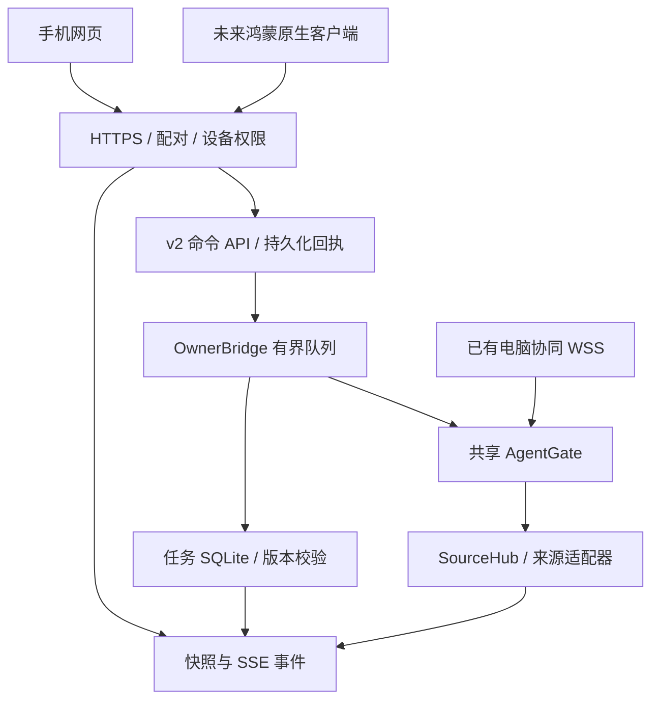

# SOLO 统一设备连接与远程操作服务

实现日期：2026-10-24。第一完整客户端是手机网页；原生客户端使用同一套 v2 业务接口。当前改动仅属于独立 SOLO，没有修改 BrightMoon 主项目、没有重新打包。

## 工作方式

安装版运行 SOLO 后，在“远程连接 → 设备服务”开启内置服务。服务随 SOLO 运行，无须另起终端。隐藏到托盘继续运行，关闭访问或彻底退出停止监听。只有选定的私人局域网接口可访问，不开启公网转发，不自动修改防火墙。

这里统一的是业务入口、授权原则与来源执行链。已有电脑协同协议继续兼容，并复用相同的 Agent 执行网关与跨设备一次性决定记录；未强行替换其配对格式、端口或已有 UI。电脑协同面板本次没有新增完整待办编辑器；另一台电脑可通过浏览器使用同一个完整 v2 客户端。原生鸿蒙 APP 尚未开发。

## 代码责任

- `phone/service.py`：网络线程、接口绑定、TLS 生命周期、设备管理、快照和媒体发布。
- `phone/server.py`：同源网页、Cookie / 原生 Bearer 认证、CSRF、SSE 与资源路由。
- `phone/devices.py` / `pairing.py`：长期设备摘要、三设备限制、撤销和桌面颁发权限。
- `remote/tls.py`：稳定安装身份、本地 CA、含 SAN 的短期站点证书、导入站点证书、DPAPI 私钥保护。
- `remote/api.py`：v2 任务查询、能力目录、操作校验、回执查询。复用已审查的来源投影，不开放任意脚本、文件或 shell API。
- `remote/owner.py`：跨线程队列、任务存储访问、共享 AgentGate 与 SourceHub 最终分发。
- `remote/journal.py`：设备内命令 ID 与内容摘要绑定，持久化处理结果；未知结果不自动重发。
- `phone/web/remote.js`：任务列表、任务编辑器、授权审核、断线提示、回执核对。
- `tasks/store.py`：新增远程删除版本校验；原有周期计算与任务保存逻辑保留。

## TLS 与首次信任

默认启用 HTTPS。每个安装数据目录具有独立 CA 和稳定服务 ID。CA 私钥使用 Windows 用户 DPAPI 保存。每次启动签发带当前 IP（及可选 DNS 名称）SAN 的站点证书，最低 TLS 1.2；证书链需要客户端验证，不使用全局跳过证书验证。

“导出证书 / 指纹”仅导出公开 CA 或已导入的站点证书链。用户通过可信渠道传到手机，按系统能力建立信任，核对 SHA-256。不会安装系统根证书或自动放行防火墙。

不同鸿蒙版本和浏览器对用户 CA 的信任策略可能不同。若不能使用本地 CA，可以在“证书设置”导入匹配的 PEM 站点证书链和私钥，并设置已经由 DNS 指向电脑的主机名。导入副本由 DPAPI 保护。当前只接受精确 SAN，不接受通配符匹配；口令加密的 PEM 私钥不在本次导入范围。公开受信任证书或组织已部署信任的证书可以免除用户手工安装本机 CA。

同一 Wi-Fi 本身不构成加密或身份认证。不能以“忽略证书警告”替代验收，也不能保证未建立证书信任的任意手机零配置访问。

## 身份、授权和升级兼容

- 原 HTTP `devices.json` 与 HTTPS `secure-devices.json` 分离。旧明文网络签发的凭据不会升级为加密控制凭据，迁移需要首次重新配对。
- 配对码 8 位、120 秒、一次使用；原有尝试次数和三设备限制继续有效。
- 初次配对只读。电脑“长期保存”后可授予待办查看、编辑、删除、提醒操作、Agent 授权、回答或停止权限。
- HTTPS 状态下才开放 v2 敏感数据和操作。全局“仅状态”模式覆盖设备操作授权，隐藏完整待办及操作目录。
- 浏览器 Cookie 使用 Secure、HttpOnly、SameSite=Strict，写操作额外校验同源和 CSRF；不把令牌放到 URL 或 localStorage。
- 原生认证要求 HTTPS、`X-Solo-Client: native` 和 Bearer 凭据，不放开跨站 CORS。原生客户端必须校验 TLS 信任后再提交配对码或凭据。
- 长期凭据由客户端保存，电脑只保存摘要。撤销先落盘，再移除活动会话，后续操作及 SSE 被拒绝。
- 同一访问主机下，重启 SOLO 和重新打开浏览器可恢复。浏览器 Cookie 与主机相关；改 IP 后不会凭空把旧 Cookie 转移到新 IP。可使用正确配置的稳定 DNS 名称，或重新配对。

## 任务目录与灵动岛视图

灵动岛仍同步桌面可见的最多五个本机任务；不绕过其他电脑对转发的限制。

完整待办从 TaskStore 独立读取，每页 50 项，含未到期、关闭和未显示在岛上的任务；读取不触发提醒、不认领声音。详细正文不使用岛上截断摘要来覆盖保存。

新建、编辑、启停、删除统一为持久化命令。编辑、启停、删除必须携带 `expected_revision`。电脑已修改则拒绝旧版本覆盖；网页保留编辑草稿和冲突提示，需要关闭后重新打开最新任务。周期和时区均复用原调度器，周重复与小时重复互斥。

SQLite 连接仍由主线程持有。网络线程通过有界 OwnerBridge 队列请求操作；每个 Tk tick 最多处理八项，网络请求不直接触碰 Tk 和 SQLite 连接。Agent 操作交给单一工作执行器。

“知晓本次提醒”和“暂缓五分钟”保留原含义。没有把知晓当成业务任务完成，没有增加公司群组推送或跨设备复制任务。

## Agent 审核与并发

操作目录仅包含来源实际支持的动作。展示来源、任务、工具和参数，用户确认后提交实体版本及确认请求版本。失联、终态、超时、被撤销的请求不可操作。

共享投影会清理敏感信息。若审核参数被隐藏或截断，就移除“同意”和相关回答入口，要求到来源应用核对；可以保留有效拒绝操作。不通过省略参数让用户盲目同意。

网络接收时和真正执行前都校验设备权限、请求版本和状态新鲜度；SourceHub 再校验完整任务身份、来源轮次及适配器当前动作。跨手机／电脑协同的同一确认请求由共享 AgentGate 原子认领，即便不同客户端生成不同命令 ID，也不会重复提交决定。认领后若结果不明确，继续在源应用核对，不自动释放并重试。

Agent 返回 `accepted` 仅表示已交给来源，最终执行仍由后续状态证明。断线或超时结果为 `outcome_unknown`；回执不存工具参数、提示词或任务正文。

## 命令幂等与生命周期

同一设备同一命令 ID 的内容必须相同。命令先持久化预留，再进入队列；重复请求返回已有回执。进程在发送后崩溃，记录保持未知结果，不盲目再执行一次。

尚未开始的队列请求有截止时间。关闭服务、撤销设备、权限改变会阻止未执行操作；已经交给外部 Agent 的操作不能声称可以被追溯撤回。

命令日志和授权认领各有 100000 条容量上限，不自动删除旧 ID 后允许历史重放。达到上限将明确拒绝新增操作，需要制定受控归档／凭据更新流程后维护，不能随意清空日志。

## 事件与前台恢复

保留 v1 完整快照 SSE（含 epoch、revision、心跳与在线回执）；新增 `service-changed` 作为失效通知，让客户端重取 v2 能力和任务目录。变更事件不广播私有正文。前端只在内容改变时重绘动作列表，编辑弹窗不随心跳重建；审核目标变化立即禁用提交。

重连先拉快照和当前权限，再继续订阅。图片仍采用内容哈希、ETag 和鉴权后缓存。页面退出或长期失联按原逻辑清除旧实况。任务离线与网络离线分开表示。

浏览器不保证后台常驻，不负责 mDNS 自动发现或手机系统推送。本次不提供公网穿透、手机反向服务器、原生 APP 构建或安装包。

## 验证入口

用户使用步骤见 [使用指南](../../docs/REMOTE_SERVICE_GUIDE.md)，原生客户端接入见 [API 协议](API.md)。

自动测试使用回环地址、临时数据库和合成来源；既不安装系统 CA，也不发送真实 Agent 授权。预览见 `preview/remote-service/`。最终验证结果见同目录 `VALIDATION.md`。
